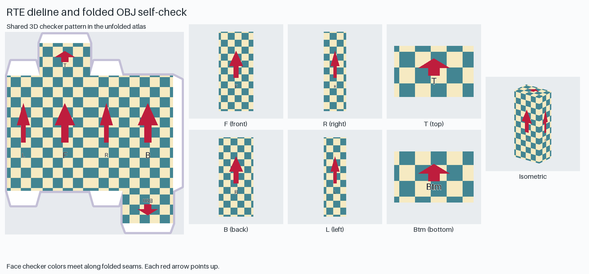

# E01 · 反向插舌纸盒最小验证

**在 E01 的 40 条留出简报中，SyncMVD 和 Paint3D 直接为纸盒刀版贴图仍无法满足禁墨与出血要求，建议暂不进入 S2。** 两种方法的粘口油墨覆盖率分别为 100.00% 和 99.88%。原型将粘口覆盖降到 0%，但出血填充率仅 2.52%，低频亮度梯度和两项图文质量评分亦落后于两种 3D 基线。

## S0 刀版与折叠自检

尺寸为 70 × 45 × 160 mm，出血与安全距各 3 mm，工作图集为 1024 × 1160 px。自检从实际 OBJ 读取六个印刷面的 UV，采用同一个三维棋盘函数给每面着色，再以正交视角观察。六面箭头均正立，12 条邻接边的采样颜色完全一致。几何自检验证参数化刀版和网格的对应关系。

工具输出带裁切、压痕、出血、安全线图层的 SVG、区域与出血归属图、12 条接缝拓扑、OBJ 和 MTL。纸厚用于插舌倒角，3D 评测网格只保留外观六面。此 RTE 为 ECMA A20 类实验几何。

## 指标健全性

下表在合成对照中只改变对应属性，检验指标的方向。数值为同一套 S0 指标的实际输出。[完整记录](sanity.json)共 16 项，全部通过。

| 检查 | 原图 | 人为破坏 |
| --- | ---: | ---: |
| 接缝 SDR | 0.0000 | 21.7048 |
| 接缝 LPIPS | 0.5101 | 0.5404 |
| CLIP 正立率 | 100.00% | 83.33% |
| 粘口油墨覆盖率 | 0.00% | 100.00% |
| 折翼边缘密度 | 0.00% | 49.80% |
| 出血填充率 | 100.00% | 0.00% |
| 低频亮度梯度（L*/px） | 0.00008 | 0.11799 |
| 色域外像素比 | 0.00% | 84.37% |
| 平均往返 ΔE00 | 0.0000 | 15.6478 |
| CLIPScore | 0.7822 | 0.5322 |
| HPS v2.0 | 0.2595 | 0.2248 |
| 折翼 OCR 检出数 | 0 | 1 |
| OCR 文字方向通过率 | 100.00% | 0.00% |

CLIP 对倒置的六面仍有五面误判。低频亮度梯度区分了受控光照样本，但给原本已含大尺度色彩变化的棋盘纹理加暗后，梯度反而由 0.49573 降至 0.36621。两项指标只作为正立与低频光照残留的代理。出血评测也通过了复制边缘的负对照。LUT 插值恒等、梯度传播和耗时/峰值显存字段的传递检查通过。

## E01 对比设置

| 方法 | 推理设置 |
| --- | --- |
| B2 | 冻结 SDXL 1.0 fp16 + SDXL Canny ControlNet，以裁切和分区边界图作为条件，整张画布采样 |
| B3 | 使用官方 SyncMVD 及原有刀版 UV，原始纹理统一到评测画布 |
| B4 | 使用官方 Paint3D 两阶段推理，按实际 OBJ 坐标登记原始图集 |
| Ours | SDXL 面级推理，将各面旋至正立方向，在相邻面的共享潜变量上累加噪声预测，再用印刷区域约束和 ICC 投影 |
| 无多面同步 | 保持其他印刷设置，各面独立预测，不向邻面读取或累加潜变量 |
| 无色域投影 | 保持同步和印刷区域设置，停用 sRGB 往返 LUT 的中间步投影 |

B2 与 Ours 使用 30 步 DDIM，基线沿用各自调度器，每次扩散调用为 30 步。种子为 42、1234、2026，所有方法用同一套简报和几何。试跑为前 5 条、1 个种子，调参只使用前 10 条。余下 40 条用于正式汇总，其中 20 条要求跨面连续。正式对比在同一简报内先平均三个种子，再计算 95% 置信区间和配对 Wilcoxon 检验。统计工具为 `dielinediff.summary`。

### 第三方基线

- SyncMVD 使用官方提交 `faa95621d220d7327847a994cd380608c04af5ab`。使用原版 SD 1.5、Depth ControlNet、8 个方位与 2 个顶视角，按原版同步组运行 30 步。保留六面 OBJ UV，原生 1024² 图集重采样至 1024 × 1160。输出按官方烘焙原样评分，粘口和出血不做补救。首盒 GPU 诊断样本（E01-001、种子 17）用时 117.08 秒，PyTorch 峰值分配 4.89 GiB。导出网格的 24 个 UV 坐标与输入的最大差异小于 `4.4e-7`。[官方代码](https://github.com/LIU-Yuxin/SyncMVD/tree/faa95621d220d7327847a994cd380608c04af5ab)
- Paint3D 使用官方提交 `d5545d38db6aaf78efc563269f70177688a4218e`。独立 PyTorch 2.5.1 / CUDA 12.4 / Kaolin 0.17 环境通过 3090 两阶段完整推理。首盒 GPU 诊断样本（E01-001、种子 17）用时 109.14 秒，PyTorch 峰值分配 4.13 GiB。该方法的耗时包含两阶段模型加载。Kaolin 0.17 的 OBJ 导入翻转了 V，按阶段一导出的实际 UV 配准图集，保留官方原图。验证中可见面 UV 支撑 IoU 由 0.7435 升至 1.0000。[配准记录](paint3d-atlas-registration.json)。各公开权重版本见 `code/dielinediff/methods/b4_paint3d.py`。[官方代码](https://github.com/OpenTexture/Paint3D/tree/d5545d38db6aaf78efc563269f70177688a4218e)

### 原型与方案的实现差异

- 正常外观面边界的出血由扩散边带共同预测。伸出窗口范围的插舌、粘口和防尘翼外围使用简报指定底色，避免未更新潜变量直接进入图集。这类统一色块仍按同一出血指标评测。
- 纸白粘口和配置好的折翼底色每步按参考噪声重置，最后在全分辨率重置这些区域以去除 VAE 边缘溢出。基线保持各自原始输出。
- E01 固定采用一组尺寸。当前每面加两条边带后的任一边不得超过 128 个潜空间格子。其他盒型和更大的面留到下一阶段检验。
- Ours 在物理正立坐标中生成，并提示设计元素居中和留边。正立坐标本身无法保证生成内容正立。C4 安全区的文字边界与 C7 法定标签属于后续阶段。固定种子控制初始噪声。GPU 邻域累加可能出现浮点舍入差异。

## 正式留出集结果

冻结配置完成 6 个方法和消融 × 50 条简报 × 3 个种子，共 900 条记录。正式统计使用 E01-011 至 E01-050，每份简报内先平均 3 个种子。跨面连续子集包含其中 20 份简报。下表为 40 份简报的均值。接缝 SDR、粘口覆盖率、低频亮度梯度和色域外比例越低越好，出血填充率、CLIPScore 和 HPS 越高越好。

| 方法 | 接缝 SDR | 粘口油墨 % | 出血填充 % | 亮度梯度 L*/px | 色域外 % | CLIPScore | HPS v2.0 |
| --- | ---: | ---: | ---: | ---: | ---: | ---: | ---: |
| B2 · SDXL + ControlNet | 5.03 | 100.00 | 46.17 | 0.175 | 1.81 | 0.6949 | 0.2395 |
| B3 · SyncMVD | 12.81 | 100.00 | 0.005 | 0.129 | 0.030 | 0.6495 | 0.2221 |
| B4 · Paint3D | 4.85 | 99.88 | 43.46 | 0.131 | 2.90 | 0.6904 | 0.2248 |
| Ours · DieLineDiff-TF | 8.27 | 0.00 | 2.52 | 0.375 | 2.98 | 0.6028 | 0.2184 |
| 无多面同步 | 10.92 | 0.00 | 34.42 | 0.515 | 13.57 | 0.5770 | 0.2172 |
| 无色域投影 | 8.17 | 0.00 | 2.46 | 0.375 | 3.41 | 0.6026 | 0.2188 |

[完整指标、95% 置信区间、配对 Wilcoxon 检验及跨面连续子集](HOLDOUT.md) · [900 条原始数据](results.csv)

- 原型相对 SyncMVD 的 SDR 低 4.54（配对 `p=9.60×10⁻⁶`），相对 Paint3D 高 3.42（`p=3.70×10⁻⁹`）。接缝 LPIPS 对 SyncMVD 的配对差缺乏显著证据（`p=0.527`），对 Paint3D 则高 0.0572（`p=3.95×10⁻⁸`）。
- 消融中，多面同步使 SDR 从 10.92 降为 8.27，LPIPS 从 0.5500 降为 0.5043，出血填充从 34.42% 降为 2.52%。跨面连续子集的 SDR 降幅为 2.81。同步改善了接缝，仍需解决窗口边带对图案向裁切边延伸的影响。
- 色域投影将色域外比例从 3.41% 降为 2.98%，改善 0.42 个百分点。原型的整体色域外比例仍高于各主基线。跨面连续子集的 Paint3D 色域外均值为 3.51%，原型为 3.24%，应结合该子集区间和总体结果解读。
- 六面的方向评分、亮度和色域均基于指标定义。置信区间按简报均值的 t 区间计算，比例的区间界可能略超出物理范围。Wilcoxon 为双侧未校正检验，解释时结合效应大小。此实验验证一个纸盒尺寸，印刷品和更广的盒型留作后续验证。

### RTX 3090 运行成本

以下统计覆盖各方法的 150 盒。峰值为推理进程报告的最大 PyTorch CUDA 已分配内存，加载与计时口径见运行记录。冻结批次的端到端时间约 11 小时 56 分钟。

| 方法 | 样本 | 平均秒/盒 | 最大峰值 GiB |
| --- | ---: | ---: | ---: |
| B2 · SDXL + ControlNet | 150 | 14.03 | 9.70 |
| B3 · SyncMVD | 150 | 110.29 | 4.89 |
| B4 · Paint3D | 150 | 105.58 | 4.13 |
| Ours · DieLineDiff-TF | 150 | 14.95 | 7.18 |
| 无多面同步 | 150 | 14.51 | 7.18 |
| 无色域投影 | 150 | 12.16 | 7.18 |

### 留出集展开图与折叠图

六个方法均展示同种子 42 的三盒留出样本，包括展开图、折叠正视图和等轴视图。样本按共有简报 ID 升序选择。

- [E01-011 六个方法的展开与折叠对照](examples/example-full-E01-011-seed42.jpg)
- [E01-012 六个方法的展开与折叠对照](examples/example-full-E01-012-seed42.jpg)
- [E01-013 六个方法的展开与折叠对照](examples/example-full-E01-013-seed42.jpg)

## E01 试跑

前 5 条简报，每条种子 42。B2、SyncMVD、Paint3D 和原型各有 5 张真实输出，图集为 1024 × 1160。下表为每方法 5 盒的均值，只用于排查流程和指导前 10 条简报的调参。

| 方法 | 粘口覆盖率 % | 接缝 SDR ↓ | 出血填充率 % ↑ | 低频亮度梯度 ↓ | OOG % ↓ | 平均秒/盒 ↓ | 峰值显存 GiB |
| --- | ---: | ---: | ---: | ---: | ---: | ---: | ---: |
| B2 | 100.00 | 2.754 | 53.14 | 0.131 | 0.94 | 14.05 | 9.70 |
| B3（SyncMVD） | 100.00 | 16.407 | 0.00 | 0.164 | 0.97 | 111.34 | 4.89 |
| B4（Paint3D） | 100.00 | 7.081 | 20.67 | 0.149 | 1.39 | 109.99 | 4.13 |
| Ours | 0.00 | 8.794 | 2.72 | 0.359 | 2.94 | 15.36 | 7.18 |

原型达到了粘口留白的构造目标。此批原型样例在接缝、出血、低频亮度梯度和色域指标上落后于 B2，且部分图面的图形相互独立。B2、B3、B4、Ours 的 CLIPScore 分别为 0.6864、0.6965、0.6879、0.6125，HPS v2.0 分别为 0.2385、0.2273、0.2233、0.2161。原型相对 B3 的出血填充升至 2.72%，仍不足以覆盖实际出血带。B3 平均每盒耗时估算 150 盒生成约需 4.64 小时。[B2、B3 和原型试跑原始数据](pilot/results.csv) · [B4 试跑原始数据](pilot/paint3d-results.csv)试跑记录将与三种子留出集分开。耗时不含开机和权重加载，显存为 PyTorch CUDA 最大已分配内存。

试跑同种子展开图与折叠渲染：[E01-001](pilot/example-pilot-E01-001-seed42.jpg)、[E01-002](pilot/example-pilot-E01-002-seed42.jpg)、[E01-003](pilot/example-pilot-E01-003-seed42.jpg)。Paint3D 对应图为 [E01-001](pilot/b4-E01-001-seed42.jpg)、[E01-002](pilot/b4-E01-002-seed42.jpg)、[E01-003](pilot/b4-E01-003-seed42.jpg)。

## 调参记录与冻结配置

调参限于 E01-001 至 E01-010，统一用种子 42。比较了边带宽度 `m`（潜空间格子）和色域投影强度 `λ`。各设置均采用同一固定底色和后三成步数每隔 3 步投影。

| m | λ | 接缝 SDR ↓ | 出血填充率 % ↑ | OOG % ↓ | CLIPScore ↑ |
| ---: | ---: | ---: | ---: | ---: | ---: |
| **4** | **0.20** | 8.6931 | 2.7171 | 3.0786 | 0.6012 |
| 4 | 0.10 | 8.6473 | 2.7062 | 3.2105 | 0.6002 |
| 6 | 0.20 | 9.5802 | 2.6750 | 2.3643 | 0.5896 |

选用 `m=4, λ=0.20`。相较较弱投影，该设置有更低色域外比例。加宽边带进一步降低色域外比例，但接缝 SDR 更高，CLIPScore 更低，出血填充未改善。按既定目的优先保留跨面一致性，冻结参数用于 40 条留出简报。三组试跑不参与留出集统计。

## 复现与运行记录

AutoDL RTX 3090 24 GB，Ubuntu 22.04，驱动 595.71.05。主环境用 PyTorch 2.5.1 / CUDA 12.4、Diffusers 0.35.2 和 Transformers 4.56.2。ICC 为 ISO Coated v2 (ECI) / FOGRA39L，使用相对比色和黑场补偿构建 33³ LUT。使用与再分发条件及文件 SHA-256 见[指标说明](../../../code/dielinediff/metrics/README.md)。主要模型的上游修订和权重 SHA-256 见 `code/scripts/fetch_E01_models.py`。服务器下载时，使用经逐字节校验的公开镜像提供大文件。

仓库位于数据盘 `/root/autodl-tmp/ai-design/repo`。`DIELINEDIFF_ROOT` 指定项目工作区，模型、临时文件、输出、环境和日志均在其子目录。主环境、权重、ICC 和指标通过 `bash code/scripts/setup_E01.sh` 准备。3D 基线的独立环境、仓库修订和模型缓存由 `code/scripts/setup_3d_baselines.sh` 准备。准备后运行 `bash code/scripts/run_E01.sh pilot`。冻结后，`bash code/scripts/run_E01.sh` 使用正式配置运行完整生成与评估。正式评测在一个 CPU 进程中增量评分，与单卡生成并行。生成和评分都可断点续跑。全量批次原始图集与逐样本记录在数据盘 `outputs/e01/full-52dd11c30fc1`，日志在 `logs/e01-full.log`。
