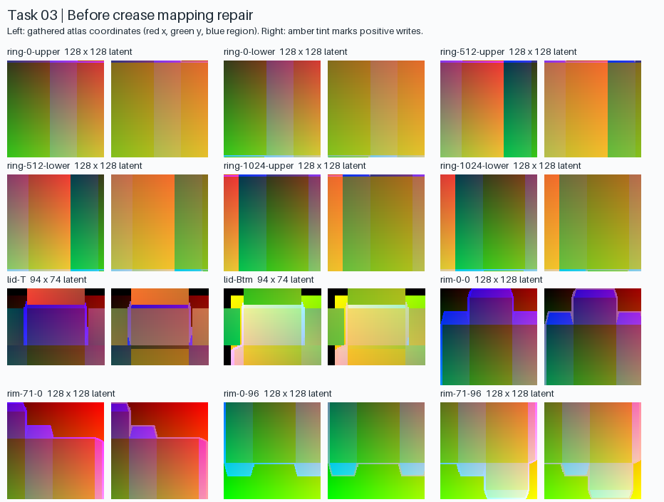
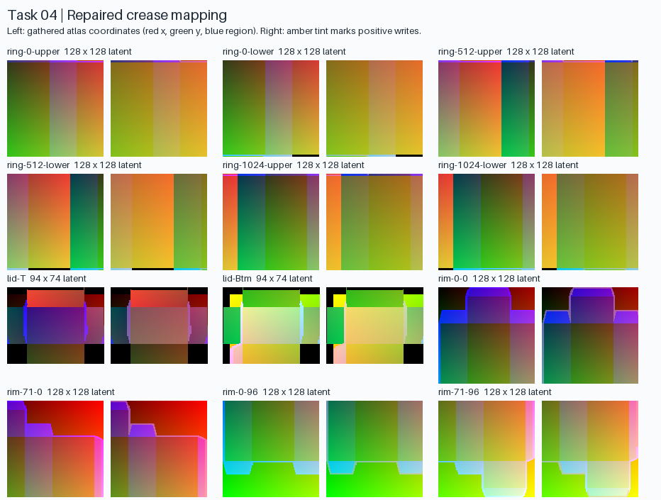
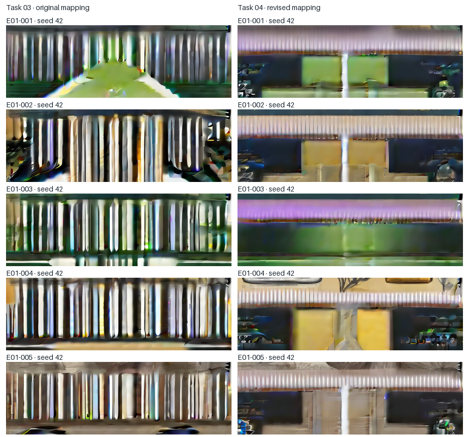

# E01b · 折边映射修复与毫米尺度复评

**旧版折边映射确有重复读取和不同正立方向混写，映射已修正；实际条带仍未完全消除，建议暂不进入 S2。** 同一批五盒、同一种子下，折边条带指数从 11.24 降到 2.44，仍超过 1.3020 的门槛。五张原像素裁图在背面与底面交界仍可见窄条带。当前证据确认了旧映射缺陷及修订后的改进，残余条带的成因尚未确定。

## 试跑关口

| 检查 | 五盒实测 | 结论 |
| --- | --- | --- |
| 覆盖 | 29,689 / 29,689 个非固定潜格，每盒 30 步，最小合成权重和 0.06064 | 通过 |
| CLIPScore | v2 0.7150，B2 0.6875，绝对差 0.0274 | 通过 |
| 折边条带指数 | v2 2.4355；最佳 3D/2D 基线为 Paint3D 的 1.0850，乘 1.2 后为 1.3020 | 未通过 |
| 原像素图 | 五盒均有背面与底面折边的可见周期条带 | 未通过 |

试跑只生成了修订后的 5 张 v2。B2、SyncMVD、Paint3D 和 v1 的 20 张图复用 E01 原件，均以 E01-001 至 E01-005、种子 42 对齐。门槛记录绑定图像、运行记录和测量哈希，程序实测拒绝启动调参与全量。此轮只交付试跑和历史回算。[门槛与逐图记录](pilot-gate-task04.json) · [覆盖热图](coverage-task04.png)

## 五盒 raw 与印前复位结果

下表为 `raw` 均值。完整 raw、preflight 主表、95% 置信区间、跨面连续子集和补充指标见统计附件。修订版只达到试跑阶段，配对 Wilcoxon 和跨面连续正式推断保留给通过门槛后的留出集；历史 E01 保留独立留出集配对统计。

| 方法 | 接缝 SDR ↓ | 接缝 LPIPS ↓ | 出血填充 % ↑ | 色域外 % ↓ | 折边条带指数 ↓ | CLIPScore ↑ | HPS ↑ |
| --- | ---: | ---: | ---: | ---: | ---: | ---: | ---: |
| B2 | 3.628 | 0.3580 | 55.74 | 0.916 | 1.1788 | 0.6875 | 0.2388 |
| SyncMVD | 17.939 | 0.5211 | 14.84 | 0.972 | 1.1285 | 0.6965 | 0.2273 |
| Paint3D | 7.309 | 0.3202 | 19.84 | 1.394 | 1.0850 | 0.6879 | 0.2233 |
| v1 | 9.054 | 0.4618 | 5.04 | 2.932 | 1.4094 | 0.6121 | 0.2162 |
| v2 · 修订 | 5.962 | 0.4394 | 39.74 | 0.099 | 2.4355 | 0.7150 | 0.2402 |

同一毫米口径下，任务 03 的 v2 回算 SDR 为 4.619、LPIPS 为 0.3973、出血为 36.77%。这次修订降低了条带指数，出血提高约 3 个百分点，两项整体接缝分数变差。B2 仍有更低的 SDR 和更高的出血填充率。[试跑完整统计](TABLES-TASK04.md) · [50 行试跑指标](results.csv)

### 顶底专项

| 方法 | 顶面 SDR / LPIPS ↓ | 底面 SDR / LPIPS ↓ | 顶面 CLIP 正立率 ↑ | 底面 CLIP 正立率 ↑ |
| --- | ---: | ---: | ---: | ---: |
| B2 | 3.364 / 0.361 | 4.082 / 0.392 | 0.80 | 0.60 |
| SyncMVD | 12.226 / 0.597 | 10.173 / 0.359 | 0.60 | 1.00 |
| Paint3D | 6.308 / 0.217 | 11.486 / 0.393 | 1.00 | 0.80 |
| v1 | 11.763 / 0.538 | 9.997 / 0.502 | 0.00 | 0.00 |
| v2 · 修订 | 6.933 / 0.482 | 7.645 / 0.512 | 0.80 | 0.20 |

顶面与底面各统计四条三维邻边。v2 的底面 SDR 低于两种 3D 基线，高于 B2；其底面 LPIPS 高于三种基线。正立率是原图的 CLIP 方向代理，五盒结果未显示底面朝向优势。已知倒置误判和低频亮度混淆仍在补充表说明。

## 定位与修复

在改代码前，先用任务 03 的提交构造坐标编码潜画布，R、G 分别编码 x、y，B 编码区域标签。图中的每个窗口都执行与 GPU 推理相同的 gather 和旋转，叠加其实际写入范围。两张图均覆盖六个环带窗、两个顶底窗和四个外缘出血窗。旧图的重叠和修订后的单调回读可在两张坐标图中对照。





| 审查问题 | 核对结果 |
| --- | --- |
| 刀版已有折边是否重复读取 | 是。沿顶盖到正面，旧中线读出 y=48,49,50,48,49,50；沿底盖到背面读出 y=175,174,173,175,174,173。修正后分别连续读出 48–66 和 175–157，各无重复。 |
| 底盖旋转、沿边反转与内向取样 | 以 OBJ 的三维端点核对旧虚拟邻条 5,888 格，`reverse` 与向内深度均一致。旧底窗在 180° 正立后仍回写侧面格，和侧面正立环窗构成不同方向的预测叠加。现由环窗独占侧面写权。 |
| 下位环窗的底盖上下文 | 旧版三个窗分别读入 108、168、60 个底盖格，均为只读。新版用固定背景潜格替换反向底盖读取，底盖及其旋转写入区域由对应窗口负责。 |

对原生相接的折边直接沿刀版坐标读入上下文。只有三维相邻、刀版上分离的边才拼接邻带，并优先保留真实出血格。同向重叠区仍采用平滑权重。回归测试遍历顶底边沿、核对实际三维端点、断言无重复读取及底盖唯一写权。

同配置和种子的五盒对照显示，宽彩带减弱，背面与底面交界仍有更窄的周期条带。五盒在同一原像素折边窄带内的亮度高通主峰均为 8 px。该结果定位了残余条带的尺度，尚未判定其生成机制。[原像素对照裁图](fold-edge-task04.png)



## 毫米指标与历史回算

沿物理刀版和 UV 配准统一到 4 px/mm，目标网格 992 × 1120。接缝 SDR 用 0.5 mm 条带，LPIPS 用 5 mm 条带，出血按 3 mm 设计值。CLIPScore、HPS、ImageReward 和方向评分仍从各自原图裁面。统一印前复位只改变固定区域，保留可见面及出血数据。物理几何评分只计算一遍，两种印前变体保留相同值。

折边条带指数对原生压痕相接的可见面计算。每侧取边内 3 mm 的窄带，沿折线方向计算 RGB 一阶差分均方能量，与同一面的 9–12 mm 参考带对比。对超额能量取非负部分，分母加入 (3/255)²，得到最低为 1 的指数。两侧取均值，全盒取实压痕线的最大值；背面—底面指数另报。平坦、渐变、自然色块边界对照均为 1。自检纹理从 1.074 升到注入条带后的 10.007。[健全性检查](physical-sanity.json)

完成历史 E01 的 900 张图和任务 03 独有的 5 张 v2 图回算，共 1810 行双口径历史指标。任务 03 的另 20 张复用图已包含在 E01 中，按来源哈希匹配。E01 停留在历史对照，保留两套口径和三种子留出集统计。按哈希匹配已有原生分数，复用 CLIP、HPS 等未变口径，补算缺失的 ImageReward、统一毫米指标和顶底专项。[历史回算明细](REANALYSIS.csv) · [E01 留出集回算](E01-PHYSICAL.md) · [任务 03 试跑回算](E01B-TASK03-PHYSICAL.md) · [新旧尺度对照](SCALE-COMPARISON.md)

物理重采样会改变边缘的相对颜色。合成的逐像素复制对照在旧口径计为 0%，重采样后计为 1.13%；两种口径的留白对照均为 0%。同一批五张 SyncMVD 原图的出血填充率从旧口径 0% 变为新口径 14.84%。这种变化包含采样和参照定义的影响，在同一 4 px/mm 口径下比较方法更合适。


## 配置、成本与复现

试跑保持窗口步长 512 px、顶底邻带 16 个潜格、引导强度 5.0、色域投影权重 0.20、30 步与种子 42。RTX 3090 上平均 **92.03 秒/盒**，PyTorch 峰值分配 **7378.42 MiB（7.21 GiB）**。按此速度外推 450 盒约 11.5 小时，实际消融各有不同的窗数与投影步骤。门槛未通过，调参和全量未执行。

在服务器项目目录运行 `bash code/scripts/run_E01b.sh` 复现任务 04 的试跑和关口。完整历史回算可用下列命令，前者会验证并准备评分资源。

```bash
source code/scripts/e01_env.sh
"$AD_ROOT/envs/e01/bin/python" -m dielinediff.e01b_backfill all
```

原图和逐样本记录在数据盘 `/root/autodl-tmp/ai-design/outputs/e01b/crease-fix`。任务 03 的结果与证据保留在原数据目录和原提交。[任务 03 报告](https://github.com/Casey-sketch-cyber/ai-design/blob/9779f7449261f51230550d846ca462c2954e2308/docs/experiments/E01b/REPORT.md)

三组 v1/v2 展开与折叠示例见 [E01-001](examples/task04/v1-v2-E01-001-42.jpg)、[E01-002](examples/task04/v1-v2-E01-002-42.jpg)、[E01-003](examples/task04/v1-v2-E01-003-42.jpg)。
