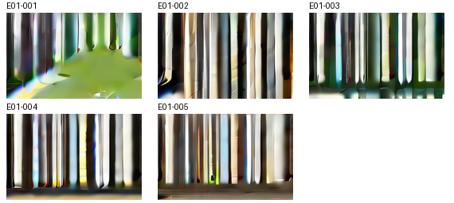
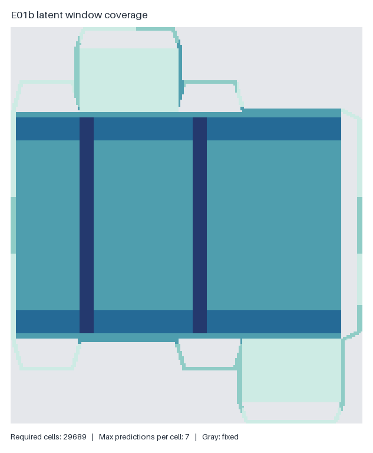

# E01b · DieLineDiff-TF v2 试跑

**建议暂不进入 S2。** 前 5 条简报中，v2 的接缝 SDR 低于 SyncMVD 和 Paint3D，出血填充率高于两者，色域外比例也低于三个基线。B2 的接缝 SDR 和出血填充率仍优于 v2。v2 与 B2 的平均 CLIPScore 差为 0.0100，满足 0.05 的试跑容差，HPS 均值分别为 0.2384 和 0.2388。五张 v2 原图在背面与底面的折边均出现彩色条带，图像关口未通过。结果只来自 5 条试跑简报，尚不足以支持留出集上的方法结论。

## 试跑关口

| 检查 | 结果 |
| --- | --- |
| 逐步覆盖 | 5 盒的每一步均覆盖 29,689 / 29,689 个非固定格。每盒检查 30 步，最小合成权重和为 0.07470。 |
| CLIPScore | B2 为 0.6875，v2 为 0.6976，绝对差为 0.0100。 |
| 原图边缘 | 5 / 5 的背面与底面折线附近可见彩色带状伪影。 |
| 继续条件 | 未通过。程序已验证调参和全量均被门槛阻断。 |

色条在原图 `y≈1408` 的背面与底面交界重复出现，脱离相邻主图并延伸进底面，呈带状而非随机散粒。裁图使用原像素，记录了不同简报在同一位置的表现。覆盖检查只验证各格有正权重贡献，这组结果显示该检查无法单独保证折边的视觉连续性。[原像素折边裁图](fold-edge-native.png) · [五图检查与门槛记录](pilot-gate.json)

## 五条共用简报的评测

E01-001 至 E01-005 均使用种子 42。只生成了 5 张 v2 图，B2、SyncMVD、Paint3D 以及 v1 的 20 张图直接读取 E01 归档原件。25 张图各测 `raw` 和 `preflight`，共 50 行。印前复位统一将粘口和刀版外复位至白色，插舌和防尘翼复位至简报底色。出血和六个可见面像素保持原样，因此图文分数、接缝和出血数值在两套口径下相同。v1 归档原件已经含 E01 的像素复位，其 `raw` 粘口 0% 只能作为历史参照。

| 方法 | raw 接缝 SDR ↓ | raw 接缝 LPIPS ↓ | raw 出血填充 % ↑ | raw 色域外 % ↓ | raw CLIPScore ↑ | raw HPS ↑ | raw ImageReward ↑ |
| --- | ---: | ---: | ---: | ---: | ---: | ---: | ---: |
| B2 | 2.784 | 0.3882 | 53.62 | 0.916 | 0.6875 | 0.2388 | −1.553 |
| SyncMVD | 16.407 | 0.5614 | 0.00 | 0.972 | 0.6965 | 0.2273 | −1.686 |
| Paint3D | 7.081 | 0.3685 | 20.67 | 1.394 | 0.6879 | 0.2233 | −1.818 |
| v1 | 8.785 | 0.4901 | 2.73 | 2.932 | 0.6121 | 0.2162 | −2.060 |
| v2 | 4.151 | 0.4246 | 38.52 | 0.097 | 0.6976 | 0.2384 | −1.230 |

v2 复位后的色域外比例为 0.0968%，往返 ΔE00 均值为 0.0900。完整的两套指标、95% 置信区间、跨面连续试跑子集和正立率、亮度梯度补充表见统计附件。配对 Wilcoxon 检验留给正式留出集。此轮未通过试跑关口，未进行调参、消融或留出集推断。[两套统计表](TABLES.md) · [50 行指标](results.csv)

两轮均按各自的原生分辨率和 UV 裁面。沿用 E01 的固定像素带宽，SDR 取 2 px，LPIPS 取 32 px。旧图分别约相当于 0.48 / 7.75 mm，新图为 0.31 / 5.00 mm，数值比较包含尺度差异。亮度梯度会响应设计渐变，CLIP 正立判断也已在 E01 健全性检查中误判倒置，两项均只用于补充。ImageReward v1.0 使用经校验的官方权重，在相同简报提示下对六面评分后取均值。

## 实现与复现

- 工作图集 1592 × 1792 px，几何比例为 6.4 px/mm，盒身高 1024 px。六个 1024² 环带窗首尾相接，按起点在上下两个位置覆盖真实出血。两个顶底窗为 752 × 592 px，读入相邻面的 16 个潜格边带。四个重叠窗口补充翼片外围，直接在对应出血坐标读写。
- SDXL 的原始和目标尺寸都使用窗的实际尺寸，裁剪偏移为零。环段主面由窗口中心决定，中心落在正面时使用 B2 的正面提示，其他窗口使用同一模板下的简报辅助图案或顶面提示。
- 粘口、插舌、防尘翼与刀版外在逐步去噪中替换参考潜变量。生成后保留解码原图，统一像素复位由评测入口执行。覆盖图以潜空间中正权重窗口的命中数着色，灰色表示固定区域。
- RTX 3090 24 GB 实测 v2 平均 **91.68 秒/盒**，峰值 PyTorch 分配为 **7378.54 MiB（7.21 GiB）**。按该速率外推 450 盒约需 11.46 小时，实际消融的窗口数和投影耗时不同。

同简报 v1/v2 展开与折叠图见 [E01-001](examples/v1-v2-E01-001-42.jpg)、[E01-002](examples/v1-v2-E01-002-42.jpg)、[E01-003](examples/v1-v2-E01-003-42.jpg)。

在服务器项目目录运行 `bash code/scripts/run_E01b.sh` 复现试跑。数据盘上保留了原图、逐盒记录、复位前后分数和原生边缘裁图，位置为 `/root/autodl-tmp/ai-design/outputs/e01b/runs/4b57f6e33a53`。
