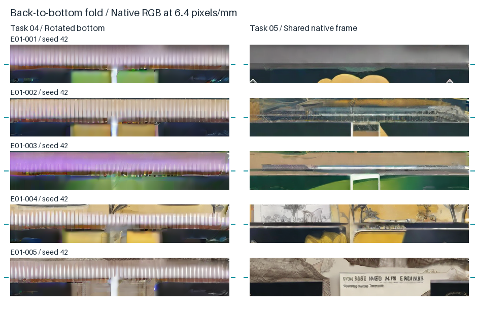
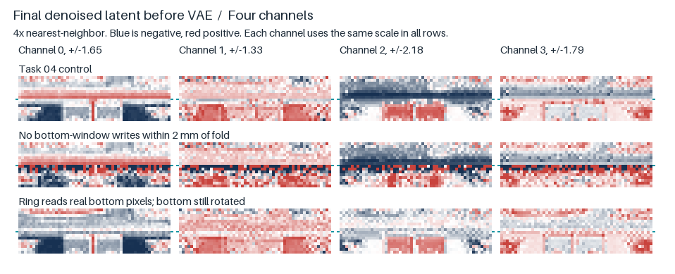
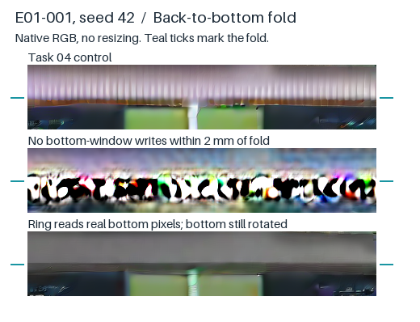
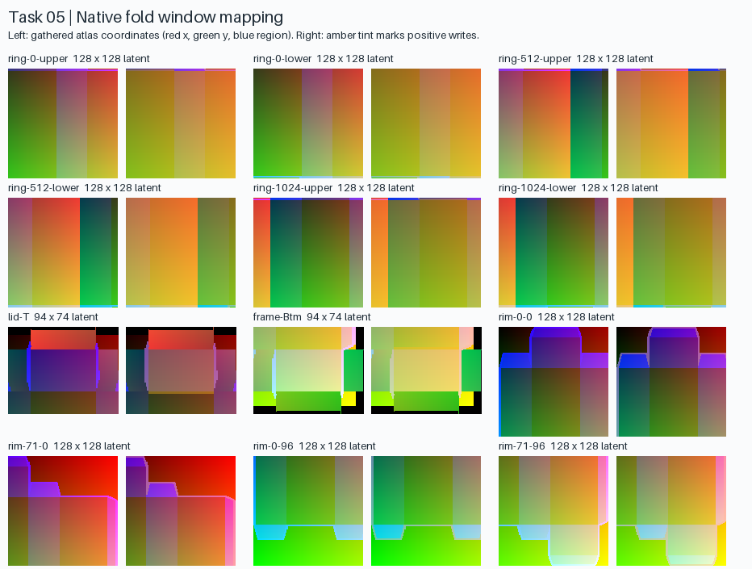

# E01b · 底面刀版方向与 B2-post

**背面—底面旧版的 8 px 周期竖纹大幅减弱，试跑仍有可见横带，整轮关口未通过，建议暂缓进入 S2。** v2 的背面—底面条带指数从 2.2734 降至 1.0446，通过 1.2281 的上限。全盒最大折边指数均值 1.8047，超出 1.3020 的上限。CLIPScore 比 B2 高 0.0551，超出预定的 ±0.05 等效容差。停止调参与全量生成，当前没有留出集上的 v2、B2 和 B2-post 对比结论。五盒试跑中，v2 的色域外比例低于 B2，B2-post 的色域外比例为 0%。B2 与 B2-post 的接缝和出血指标均优于 v2。

## 试跑关口

| 检查 | E01-001 至 E01-005、种子 42 | 结果 |
| --- | --- | --- |
| 覆盖 | 五盒各 30 步，29,689 / 29,689 个非固定潜格，最小合成权重和 0.07470 | 通过 |
| 背面—底面条带指数 | v2 1.0446，B2 1.0234 × 1.2 = 1.2281 | 通过 |
| 全盒最大折边条带指数 | v2 1.8047，Paint3D 1.0850 × 1.2 = 1.3020 | 未通过 |
| CLIPScore | v2 0.7427，B2 0.6875，绝对差 0.0551 | 未通过 |
| 原像素目视 | 旧式全宽周期竖纹大幅减弱，E01-002、E01-003、E01-004 仍有横带或贴折线的亮边 | 未通过 |

四个外部基线 B2、B2-post、SyncMVD、Paint3D 均参与两项条带门槛取最小值，CLIPScore 按任务仅与 B2 比较。`raw` 和 `preflight` 分别核对，两个版本的关口数值相同。目视记录绑定五张 v2 原图、关口方法的评分与覆盖图的哈希。实际入口分别尝试检查调参和全量，两次均拒绝进入后续阶段。[关口记录](pilot-gate-task05.json) · [覆盖热图](coverage-task05.png)



| 简报 | 背面—底面指数 | 最大指数及折边 |
| --- | ---: | --- |
| E01-001 | 1.0000 | 2.6384 · 背面—右面 |
| E01-002 | 1.0000 | 1.2202 · 正面—右面 |
| E01-003 | 1.0000 | 1.6632 · 正面—顶面 |
| E01-004 | 1.0000 | 1.4811 · 正面—顶面 |
| E01-005 | 1.2230 | 2.0206 · 正面—顶面 |

最大指数均来自其他实压痕。背底两侧各 8 px 的同相周期振幅在这五张新版图中分别最高为 1.844 和 1.815 RGB 灰度级。E01-003 的银白横带在物理条带指数为 1.0000 时仍肉眼可见。该指数度量沿折线方向的纹理变化，跨折线方向的整体亮度跳变仍需查看原像素。全套五条实压痕的原像素裁图保存在试跑目录的 `edge-review`。

## 三组改码前诊断

统一用 E01-001、种子 42 和任务 04 的提交运行。对照图与上轮归档逐像素一致。保存 30 步去噪完成、固定区潜变量复位后、最终 VAE 解码前的四通道潜变量。三个变体用相同色标和相同裁切范围，潜变量仅以最近邻放大用于阅读。





| 条件 | 背侧 / 底侧原像素 8 px 振幅 | 潜变量跨折线步差 / 附近步差 | 背面—底面条带指数 | 全盒最大条带指数 |
| --- | ---: | ---: | ---: | ---: |
| 任务 04 原版 | 16.86 / 8.40 | 0.972 / 0.422 | 1.194 | 1.800 |
| 关闭底窗折线 ±2 mm 内写入 | 3.81 / 5.10 | 8.907 / 2.650 | 37.687 | 37.687 |
| 环窗恢复真实底面读入，仍旋转底窗 | 0.060 / 0.116 | 0.569 / 0.395 | 1.000 | 2.703 |

原版解码前，四通道已可见沿折线的横带。8 px 恰好对应一个潜格，潜图无法分辨格内周期；VAE 解码后的原像素图才直接显示周期竖纹。在相同 VAE 下，仅恢复环窗真实读入就消除了这个样本原来的强 8 px 信号，且减小了潜变量跨折线的跳变。该干预支持窗口上下文是伪影成因之一，单轮干预无法量化窗口合成和 VAE 解码各自的贡献。关闭底窗写入留下 112 个无预测潜格，解码后出现黑白饱和斑块。它检验了删写造成的覆盖缺口，对同向共享写入的效果仍需用新版试跑判断。

8 px 振幅在原像素亮度裁图上去除每行线性趋势后，按同一相位求频率 1/8 px 的系数。它用于定位旧周期竖纹。关口沿用任务 04 的物理条带指标，重采样到 4 px/mm 后，比较折线每侧内 3 mm 窄带和同面 9–12 mm 参考带的切向 RGB 高频能量。[裁切坐标、频谱数值和原始产物哈希](diagnostics-task05/diagnostics-summary.json)

## 刀版方向与覆盖

底面窗以原刀版方向覆盖背面下部、整张底面和底面出血。提示采用简报的侧面辅助图案，50 条展开提示均未带入品名。背面下位环窗恢复读取真实底面潜格。侧面维持原方向，顶面维持正立方向。真实相接的压痕线上每格通过连续、同向坐标读取。两条水平折边每侧 2 mm 内的盖面与环窗预测用余弦衰减权重融合，每条折边共 224 个共同写入潜格。刀版上分开的三维邻条仍作只读上下文。无同步对照保留同样的底面方向，用本面反射处理会读到别面内容的边界，隔离跨面条件。

坐标编码图把潜画布横坐标、纵坐标和区域标签分别写入 RGB，用黄色叠层标明实际写入槽。核查覆盖刀版原生的五条外观折线，且拼接的三维虚拟邻条不会把旋转的预测写回对面。默认同步设置 12 个窗口，环带窗 1024 × 1024 px，顶底窗 752 × 592 px，SDXL 使用各窗实际尺寸。



## B2-post 与评价口径

将 E01 归档的 B2 原图 150 张各执行一次与 v2 同源的 ISO Coated v2 三线性 LUT，保留 1024 × 1160 原图尺寸。变换后的整幅图为 `raw`，再把裁切外和粘口复位到纸白、把插舌与防尘翼复位到简报底色，得到 `preflight`。各方法统一按此复位，外观面与出血保持同一版本内容。没有重跑 B2。CPU 投影和复位合计平均每盒 0.203 s，性能表中的 B2-post 耗时包含相应 B2 原生成耗时。与 v2 共用的 LUT SHA-256 为 `4f641d7417f866ba6e20badc60af6f9824aad9215edd67680babceed73896e20`。

接缝 SDR 与 LPIPS 分别沿 0.5 mm 和 5 mm 条带计算，出血宽度是 3 mm。CLIPScore、HPS、ImageReward 和方向代理继续从各自的原图裁面计算。顶底专项各涉及四条三维邻边，报告的 CLIP 正立率仍用折叠后的阅读方向。底面图案此轮按刀版方向生成，底面文字的可读方向由后续矢量排版保证。

## 主表

试跑共 30 张图、60 行记录，每个方法 5 张。下表展示主要指标。往返 ΔE00、ImageReward、原始粘口、完整区间及逐项明细见附件。[试跑统计与区间](TABLES-TASK05.md) · [逐样本指标](results.csv)

### raw

| 方法 | 接缝 SDR ↓ | 接缝 LPIPS ↓ | 出血填充 % ↑ | 色域外 % ↓ | 背底条带 ↓ | 最大条带 ↓ | CLIPScore ↑ | HPS ↑ |
| --- | ---: | ---: | ---: | ---: | ---: | ---: | ---: | ---: |
| B2 | 3.628 | 0.3580 | 55.74 | 0.9162 | 1.0234 | 1.1788 | 0.6875 | 0.2388 |
| B2-post | 3.634 | 0.3582 | 55.81 | 0.0000 | 1.0235 | 1.1821 | 0.6874 | 0.2387 |
| SyncMVD | 17.939 | 0.5211 | 14.84 | 0.9720 | 1.1285 | 1.1285 | 0.6965 | 0.2273 |
| Paint3D | 7.309 | 0.3202 | 19.84 | 1.3941 | 1.0238 | 1.0850 | 0.6879 | 0.2233 |
| v1 | 9.054 | 0.4618 | 5.04 | 2.9321 | 1.1886 | 1.4094 | 0.6121 | 0.2162 |
| v2 | 5.680 | 0.4280 | 39.59 | 0.0344 | 1.0446 | 1.8047 | 0.7427 | 0.2424 |

### preflight

| 方法 | 接缝 SDR ↓ | 接缝 LPIPS ↓ | 出血填充 % ↑ | 色域外 % ↓ | 背底条带 ↓ | 最大条带 ↓ | CLIPScore ↑ | HPS ↑ |
| --- | ---: | ---: | ---: | ---: | ---: | ---: | ---: | ---: |
| B2 | 3.628 | 0.3580 | 55.74 | 0.8338 | 1.0234 | 1.1788 | 0.6875 | 0.2388 |
| B2-post | 3.634 | 0.3582 | 55.81 | 0.0000 | 1.0235 | 1.1821 | 0.6874 | 0.2387 |
| SyncMVD | 17.939 | 0.5211 | 14.84 | 0.8222 | 1.1285 | 1.1285 | 0.6965 | 0.2273 |
| Paint3D | 7.309 | 0.3202 | 19.84 | 1.3941 | 1.0238 | 1.0850 | 0.6879 | 0.2233 |
| v1 | 9.054 | 0.4618 | 5.04 | 2.9321 | 1.1886 | 1.4094 | 0.6121 | 0.2162 |
| v2 | 5.680 | 0.4280 | 39.59 | 0.0338 | 1.0446 | 1.8047 | 0.7427 | 0.2424 |

v2 的 CLIPScore 和 HPS 高于两种 B2 口径，整体接缝 SDR、LPIPS 和出血填充落后。任务 05 相比任务 04 减轻了折边条带指数（2.4355 → 1.8047），与 B2-post 直接比较时，v2 的五盒色域外比例还有差距。正式色域优势需要留出集上的数据。

### 跨面连续子集

E01-001、E01-003、E01-005 三个试跑样本的描述均值如下。统一复位未改变这些列。

| 方法 | 接缝 SDR ↓ | 接缝 LPIPS ↓ | 出血填充 % ↑ | 背底条带 ↓ | 最大条带 ↓ | CLIPScore ↑ |
| --- | ---: | ---: | ---: | ---: | ---: | ---: |
| B2 | 4.205 | 0.3453 | 53.31 | 1.0390 | 1.1752 | 0.7021 |
| B2-post | 4.216 | 0.3454 | 53.45 | 1.0391 | 1.1812 | 0.7021 |
| SyncMVD | 16.150 | 0.5405 | 14.17 | 1.1880 | 1.1880 | 0.7035 |
| Paint3D | 10.230 | 0.3950 | 23.69 | 1.0397 | 1.1282 | 0.6910 |
| v1 | 9.146 | 0.4667 | 4.94 | 1.3143 | 1.4052 | 0.6076 |
| v2 | 5.964 | 0.4211 | 40.02 | 1.0743 | 2.1074 | 0.7752 |

### 顶面与底面

五盒均值，两种印前变体相同。底面 CLIP 正立率描述折叠阅读视角，后续矢量文字模块尚未实施。

| 方法 | 顶面 SDR ↓ | 顶面 LPIPS ↓ | 顶面正立率 ↑ | 底面 SDR ↓ | 底面 LPIPS ↓ | 底面正立率 ↑ |
| --- | ---: | ---: | ---: | ---: | ---: | ---: |
| B2 | 3.364 | 0.3605 | 0.80 | 4.082 | 0.3918 | 0.60 |
| B2-post | 3.376 | 0.3607 | 0.80 | 4.087 | 0.3919 | 0.60 |
| SyncMVD | 12.226 | 0.5965 | 0.60 | 10.173 | 0.3586 | 1.00 |
| Paint3D | 6.308 | 0.2174 | 1.00 | 11.486 | 0.3931 | 0.80 |
| v1 | 11.763 | 0.5379 | 0.00 | 9.997 | 0.5023 | 0.00 |
| v2 | 6.970 | 0.4734 | 1.00 | 6.878 | 0.5017 | 1.00 |

## 配置、成本与复现

试跑配置为窗口步长 512 px、过渡区每侧 2 mm、顶底虚拟邻带 16 潜格、引导强度 5.0、色域投影权重 0.20、30 步、种子 42。AutoDL RTX 3090 24 GB 实测平均 **91.94 s/盒**，PyTorch 峰值分配 **7,378.44 MiB（7.21 GiB）**。没有启动候选调参、v2 消融和正式留出集配对 Wilcoxon。B2-post 已完成全部 150 张的两种图像变体，评分发布范围限于闸前五盒。

在服务器项目根目录运行以下命令。默认试跑的退出码 1 表示记录并判定关口失败。历史两轮 v2 使用各自提交复现。

```bash
bash code/scripts/run_E01b.sh
bash code/scripts/run_E01b.sh baseline --phase full

source code/scripts/e01_env.sh
flock "$AD_ROOT/tmp/e01-gpu.lock" "$AD_ROOT/envs/e01/bin/python" code/scripts/diagnose_E01b_bottom_frame.py
"$AD_ROOT/envs/e01/bin/python" code/scripts/diagnose_E01b_windows.py \
  --geometry "$AD_ROOT/outputs/e01b/geometry" \
  --output "$AD_ROOT/tmp/e01b-task05-bottom-frame-mapping.png" \
  --transition-mm 2 --caption "E01b / Task 05 bottom native frame"
```

数据盘目录为 `/root/autodl-tmp/ai-design/outputs/e01b/bottom-frame`。试跑位于 `runs/b598a9650a8a`，B2-post 位于 `baselines/553a10692ea7/b2_post`，原始诊断 RGB 与四通道潜变量位于 `diagnostics`。[任务 04 历史报告](https://github.com/Casey-sketch-cyber/ai-design/blob/f1ef63a5a11561ea7267c032532f3bec279fd7d6/docs/experiments/E01b/REPORT.md)
