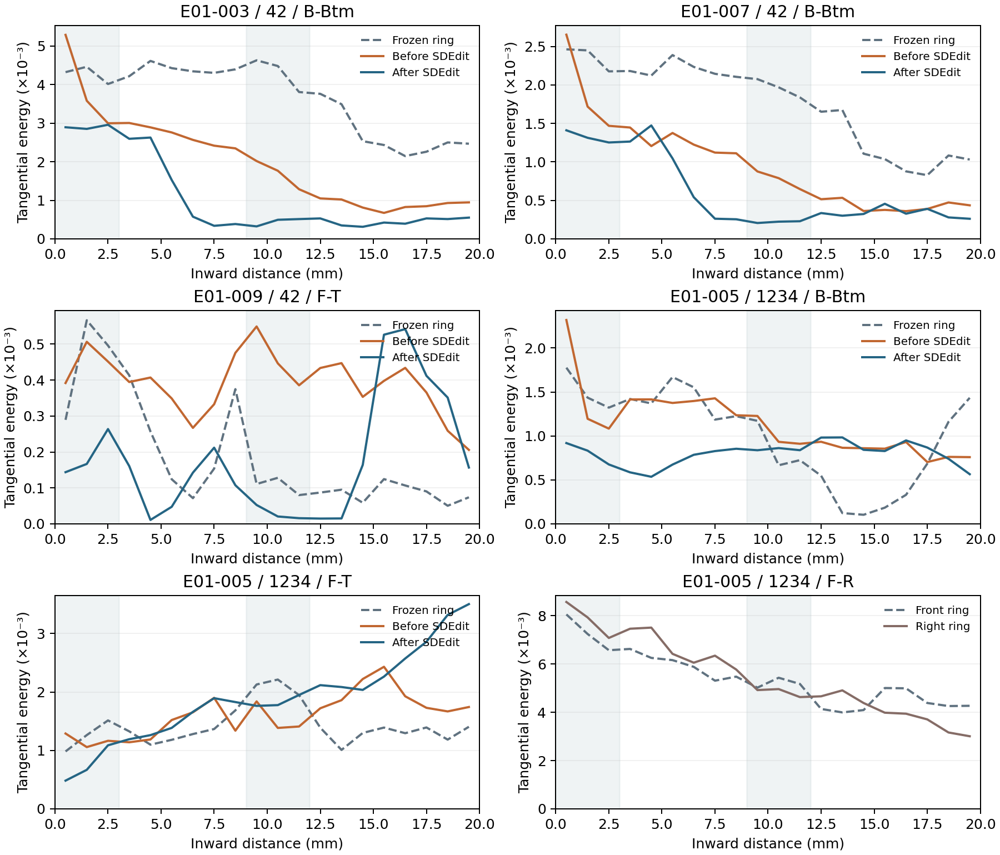
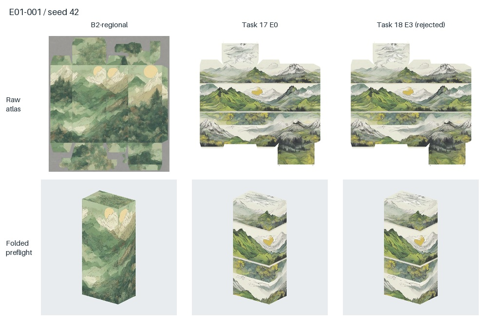
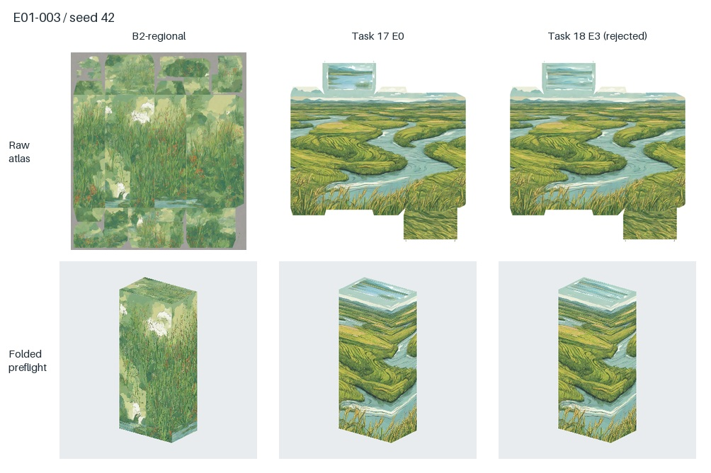
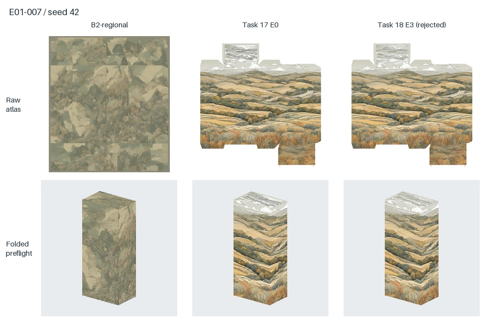

# E02 · 盖面内部纹理补足

E01-003、007 的底盖在初图中已经贴边密、内部疏。SDEdit 后两盒 9–12 mm 的能量再降 73.7% 和 71.5%。**五组均未通过硬筛选，未锁定复验配置。原 E0 仅作关口参照，种子 42 4/5，种子 1234 5/5。停在 Step 1，等待 Claude 审查。**

## 先诊断 E0 的初图与成图

用冻结 R0 重建任务 17 的 U1-σ28 初图。相同双倍盖面上的调和插值与纹理注入诊断通过原记录复核。用同一原生组装投影和冻结物理 4 px/mm 网格取样，逐毫米在切向求归一化 RGB 首差平方均值。SDEdit 前后对比覆盖这段流程的 VAE、去噪与色域约束。



连续三个 1 mm 箱低于本阶段近折基准的 80% 时记下起点。003、007 两个底盖由初图 3 mm 起变疏，成图的明显下降约在折线后 5–7 mm。009 的初图近折和参考带相近，成图在 9–14 mm 更疏，随后回升。1234 的 E01-005 峰值在 F–R，两侧都是原环带。其两个盖折的成图纹理也在图中各自列出。 [逐毫米数值](cap-energy-diagnosis/diagnostic-curves.csv) · [重建核验](cap-energy-diagnosis/diagnostic-curves.json)

## E1–E4 的初图与去噪

E1 以 E0 的 σ28 初图为底，冻结已知边带和盖面核心内 0–3 mm 的 E0 像素。分别取四条真邻边已知侧 0–3 mm 内的高通纹理 RMS，按物理距离加权合成局部目标方差。局部 3 mm 高斯窗口估计当前 RMS，只给内部添加受限的高通残差，从距折 3 mm 起渐增。四边距离权重、最大增益和过渡长度写入配置。中心／贴边 RMS 的实测结果见下表。 [配置](../../../code/configs/E02_cap_energy.yaml)

E1、E2、E3 均用同一先验，SDEdit 强度分别为 0.85、0.80、0.75。E4 用同一先验，最近折线内侧 0–3 mm 保持 0.85，由 3 到 15 mm 按 smoothstep 降到 0.70。每步用同一次采样的噪声构造当前时刻参考潜变量，逐位置释放到 DDIM 后缀。边缘 25 步，中心最少 21 步，保留九通道边带条件。 [Differential Diffusion 原文](https://doi.org/10.1111/cgf.70040)


强度图按 255×强度取整，用最近邻显示潜格。深色核心为约 0.70，亮色折边与已知区约为 0.85。 [顶盖强度图](cap-energy-examples/e4-strength-T.png)

| 种子 | 方法 | 盖 | 中心／贴边均值 | 最小 | 最大 | 0.9–1.1 盒数 / 10 | 0–3 mm 相对 E0 改动像素数 |
| --- | --- | --- | --- | --- | --- | --- | --- |
| 42 | E0 | 顶 | 0.804 | 0.593 | 1.102 | 1 | 0 |
| 42 | E0 | 底 | 0.606 | 0.494 | 0.756 | 0 | 0 |
| 42 | E1 | 顶 | 0.997 | 0.957 | 1.046 | 10 | 0 |
| 42 | E1 | 底 | 0.984 | 0.878 | 1.071 | 9 | 0 |
| 42 | E2 | 顶 | 0.997 | 0.957 | 1.046 | 10 | 0 |
| 42 | E2 | 底 | 0.984 | 0.878 | 1.071 | 9 | 0 |
| 42 | E3 | 顶 | 0.997 | 0.957 | 1.046 | 10 | 0 |
| 42 | E3 | 底 | 0.984 | 0.878 | 1.071 | 9 | 0 |
| 42 | E4 | 顶 | 0.997 | 0.957 | 1.046 | 10 | 0 |
| 42 | E4 | 底 | 0.984 | 0.878 | 1.071 | 9 | 0 |
| 1234 | E0 | 顶 | 1.151 | 0.521 | 2.718 | 0 | 0 |
| 1234 | E0 | 底 | 1.020 | 0.380 | 5.126 | 1 | 0 |

RMS 比来自实际送入 VAE 的注入残差。E0 为参考项。已知区及近折保护带的像素核验与逐毫米成图能量分开记录。 [初图与冻结环带核验](cap-energy-source-proof.json)

## 种子 42 盖面筛选

硬筛选为逐盒 60 s / 20 GiB、CLIPScore ≥0.6362、ImageReward ≥原 B2-regional 减 0.10、顶底盖各自面内能量均值至少原 B2-regional 的一半、各盖逐盒不超过同盒环带能量的 2 倍，以及原像素中没有明显拼贴、重影或镜像重复。原像素硬筛看顶底盖内容。拼贴标记断开同一画面的硬接界，重影标记同一对象的偏移重复边，镜像标记不规则细节的镜面对称复刻。原关口另看五条原生折线是否出现沿折窄带或亮边。合格时按较 E0 改善的六项数量排序，平手看 v1 和原像素。

| 候选 | 胜 E0 项数 | 硬筛选 | 预算 | CLIP | ImageReward | 顶盖下限 | 底盖下限 | 超过 2 倍的盖数 | 目视标记盒数 |
| --- | --- | --- | --- | --- | --- | --- | --- | --- | --- |
| E0 | 0 | 未过 | 通过 | 通过 | 通过 | 通过 | 通过 | 0 | 2 |
| E1 | 3 | 未过 | 未过 | 通过 | 通过 | 通过 | 通过 | 1 | 1 |
| E2 | 6 | 未过 | 未过 | 通过 | 通过 | 通过 | 通过 | 0 | 2 |
| E3 | 6 | 未过 | 通过 | 通过 | 通过 | 通过 | 通过 | 0 | 5 |
| E4 | 4 | 未过 | 通过 | 通过 | 通过 | 通过 | 通过 | 0 | 1 |

| 候选 | 盖侧 ΔE00 | 盖侧 LPIPS | 七缝 SDR | 七缝 LPIPS | 原出血 % | M3 % | 全盒 v1 | CLIPScore | ImageReward |
| --- | --- | --- | --- | --- | --- | --- | --- | --- | --- |
| E0 | 4.1045 | 0.3747 | 1.5630 | 0.3449 | 67.4601 | 58.5225 | 1.7209 | 0.6874 | -1.6541 |
| E1 | 4.1214 | 0.3774 | 1.5587 | 0.3472 | 67.5219 | 58.5302 | 1.7624 | 0.6886 | -1.6467 |
| E2 | 4.0677 | 0.3741 | 1.5420 | 0.3445 | 67.5364 | 58.6737 | 1.7809 | 0.6858 | -1.6478 |
| E3 | 3.9996 | 0.3671 | 1.5198 | 0.3384 | 67.7687 | 58.6947 | 1.8053 | 0.6810 | -1.6801 |
| E4 | 4.1328 | 0.3743 | 1.5657 | 0.3446 | 67.6448 | 58.6176 | 1.8224 | 0.6837 | -1.6602 |

| 候选 | 顶能量 ×10³ | 底能量 ×10³ | 顶环比 | 底环比 | 顶 2× 留存 | 底 2× 留存 |
| --- | --- | --- | --- | --- | --- | --- |
| E0 | 1.592 | 1.341 | 0.564 | 0.492 | 2.230 | 2.324 |
| E1 | 1.979 | 1.656 | 0.719 | 0.588 | 2.228 | 2.277 |
| E2 | 1.924 | 1.616 | 0.686 | 0.574 | 2.179 | 2.270 |
| E3 | 1.750 | 1.460 | 0.617 | 0.545 | 2.091 | 2.240 |
| E4 | 1.781 | 1.448 | 0.633 | 0.536 | 2.126 | 2.244 |

E1 在 E01-009 底盖出现截断花田的浅矩形亮阶，记录为拼贴。 [E1 底盖无损裁图](cap-energy-examples/e1-E01-009-bottom-collage.png)

五组均未通过硬筛选。E0 的两组同种子旧档仅用于原关口参照。 [筛选详情](cap-energy-selection.json) · [五组逐盒盖面原像素记录](cap-energy-cap-content-review.json)

## 逐毫米曲线与最差样本

图中各档显示 E01-001 至 E01-010 的逐毫米平均和整盒冻结 v1 最高两盒。盖面折线分环带、初图和成图三段。整盒峰值落在纯环带时，单列两侧环带证据。

| 种子 | 方法 | 最高两盒 v1 | 逐毫米记录 |
| --- | --- | --- | --- |
| 42 | E0 | E01-003（3.1078）、E01-007（2.6390） | [曲线图](cap-energy-curves/e0-42.png) · [CSV](cap-energy-curves/e0-42.csv) · [核验](cap-energy-curves/e0-42.json) |
| 42 | E1 | E01-003（3.0346）、E01-007（2.8633） | [曲线图](cap-energy-curves/e1-42.png) · [CSV](cap-energy-curves/e1-42.csv) · [核验](cap-energy-curves/e1-42.json) |
| 42 | E2 | E01-003（3.1494）、E01-007（2.9078） | [曲线图](cap-energy-curves/e2-42.png) · [CSV](cap-energy-curves/e2-42.csv) · [核验](cap-energy-curves/e2-42.json) |
| 42 | E3 | E01-003（3.2417）、E01-007（2.8447） | [曲线图](cap-energy-curves/e3-42.png) · [CSV](cap-energy-curves/e3-42.csv) · [核验](cap-energy-curves/e3-42.json) |
| 42 | E4 | E01-003（3.3449）、E01-007（2.8599） | [曲线图](cap-energy-curves/e4-42.png) · [CSV](cap-energy-curves/e4-42.csv) · [核验](cap-energy-curves/e4-42.json) |
| 1234 | E0 | E01-005（1.4982）、E01-001（1.4204） | [曲线图](cap-energy-curves/e0-1234.png) · [CSV](cap-energy-curves/e0-1234.csv) · [核验](cap-energy-curves/e0-1234.json) |

| 种子 | 方法 | 盖折 | 初图 0–3 mm | 初图 9–12 mm | 成图 0–3 mm | 成图 9–12 mm |
| --- | --- | --- | --- | --- | --- | --- |
| 42 | E0 | B-Btm | 2.259 | 1.298 | 1.736 | 0.989 |
| 42 | E0 | F-T | 1.341 | 1.161 | 0.748 | 1.067 |
| 42 | E1 | B-Btm | 2.259 | 1.996 | 1.744 | 1.086 |
| 42 | E1 | F-T | 1.341 | 1.343 | 0.745 | 1.181 |
| 42 | E2 | B-Btm | 2.259 | 1.996 | 1.763 | 1.005 |
| 42 | E2 | F-T | 1.341 | 1.343 | 0.742 | 1.237 |
| 42 | E3 | B-Btm | 2.259 | 1.996 | 1.792 | 1.015 |
| 42 | E3 | F-T | 1.341 | 1.343 | 0.791 | 1.147 |
| 42 | E4 | B-Btm | 2.259 | 1.996 | 1.715 | 0.990 |
| 42 | E4 | F-T | 1.341 | 1.343 | 0.755 | 1.204 |
| 1234 | E0 | B-Btm | 1.476 | 1.080 | 0.900 | 0.815 |
| 1234 | E0 | F-T | 1.486 | 1.495 | 0.820 | 1.115 |

上表的切向能量均为 ×10⁻³，按各组十盒均值。盖面初图加强的纹理在成图保留多少，按参考带和近折带分别核对。

## 双种子关口

按原始 E0 档案复核两种子既有 Step 1 关口。未合格的新配置没有进入 1234 验证。各自种子的五个原基线给出相应阈值。七缝与出血表中的顺序为原 B2-regional、B2-post。

| 种子 | 检查 | 测量与原对照 | 判定 |
| --- | --- | --- | --- |
| 42 | 七条非原生缝 | 七缝 SDR 1.5630（对照 4.4175 / 4.6199）。七缝 LPIPS 0.3449（对照 0.3646 / 0.4135） | 通过 |
| 42 | 双口径出血 | 原出血 % 67.4601（对照 52.9962 / 52.8471）。M3 % 58.5225（对照 28.4607 / 47.3847） | 通过 |
| 42 | 条带 v1 与原像素 | 1.7209 / 上限 1.2528。0/10 盒有沿折独立窄带或亮边 | 未过 |
| 42 | CLIPScore 单侧 | 0.6874 / 下限 0.6362 | 通过 |
| 42 | 逐盒硬件 | 最长 57.59 s，峰值 10.283 GiB | 通过 |
| 1234 | 七条非原生缝 | 七缝 SDR 2.0241（对照 4.6048 / 5.7941）。七缝 LPIPS 0.3540（对照 0.3694 / 0.4423） | 通过 |
| 1234 | 双口径出血 | 原出血 % 62.3479（对照 51.8315 / 52.8265）。M3 % 51.2440（对照 48.9578 / 50.5284） | 通过 |
| 1234 | 条带 v1 与原像素 | 1.3026 / 上限 1.3832。0/10 盒有沿折独立窄带或亮边 | 通过 |
| 1234 | CLIPScore 单侧 | 0.7036 / 下限 0.6460 | 通过 |
| 1234 | 逐盒硬件 | 最长 55.71 s，峰值 10.282 GiB | 通过 |

[逐盒评分 CSV](results-cap-energy.csv) · [关口记录](gate-cap-energy.json) · [折线原像素判读](cap-energy-visual-review.json)

## 条带来源和法向剖面

| 种子 | 方案 | 环带单侧下界 | 盖面单侧下界 | 全盒 v1 |
| --- | --- | --- | --- | --- |
| 42 | 任务 17 E0 | 1.2244 | 1.6157 | 1.7209 |
| 42 | 本轮复核 E0 归档 | 1.2244 | 1.6157 | 1.7209 |
| 42 | 变化 | +0.0000 | +0.0000 | +0.0000 |
| 1234 | 任务 17 E0 | 1.2798 | 1.0905 | 1.3026 |
| 1234 | 本轮复核 E0 归档 | 1.2798 | 1.0905 | 1.3026 |
| 1234 | 变化 | +0.0000 | +0.0000 | +0.0000 |

单侧下界将对侧固定为 1，再在每盒五折重取峰值。环带侧和盖面侧的峰值可能落在不同折线。

| 种子 | 折线 | 整折 v1 | 环带侧 | 盖面侧 |
| --- | --- | --- | --- | --- |
| 42 | B-Btm | 1.5886 | 1.0096 | 1.5790 |
| 42 | B-R | 1.1090 | 1.1090 | 1.0000 |
| 42 | F-L | 1.0066 | 1.0066 | 1.0000 |
| 42 | F-R | 1.0469 | 1.0469 | 1.0000 |
| 42 | F-T | 1.2203 | 1.1449 | 1.0754 |
| 1234 | B-Btm | 1.1687 | 1.0939 | 1.0748 |
| 1234 | B-R | 1.1107 | 1.1107 | 1.0000 |
| 1234 | F-L | 1.0860 | 1.0860 | 1.0000 |
| 1234 | F-R | 1.1764 | 1.1764 | 1.0000 |
| 1234 | F-T | 1.0464 | 1.0018 | 1.0446 |

| 种子 | 峰值盒 | 控制折线 | 全盒 v1 | 环带超额 | 盖面超额 |
| --- | --- | --- | --- | --- | --- |
| 42 | E01-003 | B-Btm | 3.1078 | 0.0000 | 2.1078 |
| 42 | E01-007 | B-Btm | 2.6390 | 0.0957 | 1.5432 |
| 42 | E01-009 | F-T | 2.1842 | 0.7030 | 0.4812 |
| 1234 | E01-005 | F-R | 1.4982 | 0.4982 | 0.0000 |
| 1234 | E01-001 | F-L | 1.4204 | 0.4204 | 0.0000 |
| 1234 | E01-010 | B-Btm | 1.4152 | 0.3416 | 0.0736 |

| 种子 | 盖折 | 0–3 / 3–9 mm 平均绝对 L* 差 | 单侧法向峰 L*/mm | 平均折点绝对 L* 跳变 |
| --- | --- | --- | --- | --- |
| 42 | B-Btm | 2.939 | 5.801 | 2.080 |
| 42 | F-T | 3.912 | 11.932 | 0.552 |
| 1234 | B-Btm | 3.362 | 7.356 | 0.898 |
| 1234 | F-T | 3.442 | 9.377 | 1.154 |

法向统计使用沿折切向平均的 L* 剖面。各候选完整两侧法向数据随曲线核验 JSON 提供。 [逐盒逐折拆解](cap-energy-stripe-sources.csv) · [最终法向明细](cap-energy-normal-profile.csv)

| 种子 42 候选 | 顶盖近折与参考带绝对差 | 底盖近折与参考带绝对差 | 顶盖折点绝对跳变 | 底盖折点绝对跳变 |
| --- | --- | --- | --- | --- |
| E1 | 2.480 | 2.764 | 0.542 | 2.033 |
| E2 | 2.545 | 2.644 | 0.579 | 1.897 |
| E3 | 2.610 | 2.598 | 0.546 | 1.821 |
| E4 | 2.558 | 2.675 | 0.637 | 1.996 |

每档十盒。差值用离折线 0–3 mm 和 3–9 mm 的均值，均以 L* 计。相同 R0 的环带侧近折与参考带绝对差，顶折 5.264，底折 3.277。 [候选法向数值及原图哈希](cap-energy-examples/cap-fold-profiles-and-provenance.json)

E1–E4 的四十张原图共检查 80 条原像素盖折，未见新增的明显均匀亮暗窄带。E01-003、007 底盖仍可见相邻两面的色阶和纹理锐度变化，盖侧最大法向梯度分别在 5.00–5.25 mm 和 8.50 mm。E01-009 顶盖保留轻微的天空色调界，跨折 L* 跳变为 0.49–0.61。 [E01-003 背—底折](cap-energy-examples/E01-003-candidate-folds.png) · [E01-007 背—底折](cap-energy-examples/E01-007-candidate-folds.png) · [E01-009 正—顶折](cap-energy-examples/E01-009-candidate-folds.png)

| 种子 42 候选 | 背—底整折 v1 | 背—底盖面侧 | 正—顶整折 v1 | 正—顶盖面侧 |
| --- | --- | --- | --- | --- |
| E0 | 1.5886 | 1.5790 | 1.2203 | 1.0754 |
| E1 | 1.5837 | 1.5741 | 1.2344 | 1.0895 |
| E2 | 1.6285 | 1.6189 | 1.2402 | 1.0953 |
| E3 | 1.6314 | 1.6218 | 1.2892 | 1.1443 |
| E4 | 1.6566 | 1.6471 | 1.2587 | 1.1138 |

## 耗时、显存、样图

| 种子 | 方法 | 均值 s / 盒 | 最长 s / 盒 | 峰值 GiB |
| --- | --- | --- | --- | --- |
| 42 | E0 | 54.90 | 57.59 | 10.283 |
| 42 | E1 | 57.74 | 60.76 | 10.282 |
| 42 | E2 | 57.64 | 60.62 | 10.282 |
| 42 | E3 | 55.54 | 56.26 | 10.284 |
| 42 | E4 | 58.27 | 59.28 | 10.284 |
| 1234 | E0 | 54.51 | 55.71 | 10.282 |

RTX 3090 计时包括已登记环带、两盖初图、去噪和刀版合成。模型载入、文件写出及评分在表外。

三组种子 42 样图从左到右是 B2-regional、任务 17 E0 与硬筛选未过的 E3。E3 仅展示。折叠视图来自印前复位图。







种子 42 的原生像素裁图。[E01-003](cap-energy-examples/seed-42/E01-003-folds.png) · [E01-007](cap-energy-examples/seed-42/E01-007-folds.png) · [E01-009](cap-energy-examples/seed-42/E01-009-folds.png)

种子 1234 的原生像素裁图。[E01-003](cap-energy-examples/seed-1234/E01-003-folds.png) · [E01-007](cap-energy-examples/seed-1234/E01-007-folds.png) · [E01-009](cap-energy-examples/seed-1234/E01-009-folds.png)

## 参考带留存与判定

E01-003 底盖的 9–12 mm 初图能量由 1.690 提到 2.427（×10⁻³），E1–E4 成图只保留 0.485、0.445、0.450、0.406，E0 成图为 0.444。E01-007 的初图由 0.771 提到 1.225，四组新成图只剩 0.204、0.195、0.204、0.197，均低于 E0 的 0.220。E4 的距离分级在这两盒没有保住新增的内部纹理。其全盒 v1 分别为 3.3449 和 2.8599，E0 为 3.1078 和 2.6390。

E01-009 顶盖的参考带在 E1–E4 初图仍约 0.461，成图仅为 0.029–0.043（×10⁻³）。该盒另有独立的底盖拼贴问题。E0–E4 都能看到上沿近水平、右侧近垂直的浅色矩形叠层截断花田。50 盒次的盖面检查中，各组拼贴盒数为 2、1、2、5、1，均无明显重影和镜像重复。这个矩形同时出现在 E0 归档中。E1 和 E2 的最长单盒分别为 60.76 和 60.62 秒，E1 的 E01-006 顶盖能量还达到同盒环带的 2.033 倍。 [五组同尺度底盖原像素](cap-energy-examples/e01-009-bottom-all.png)

E0 的原 Step 1 关口使用各自种子的五个原基线。种子 42 的整盒 v1 由盖面侧主导，均值 1.7209，高于 1.2528 的上限。种子 1234 的环带侧下界本身约 1.28，原 E0 均值 1.3026，低于上限 1.3832。初选没有合格配置，故没有为任何新配置生成种子 1234，也没有进入 Step 2。

## 复现

完整运行产物位于 AutoDL 数据盘 `/root/autodl-tmp/ai-design/outputs/e02/cap-energy/runs/83db4f96c64a`。在仓库根目录执行。两组人工判读分别绑定初选盖面原图及最终关口指纹。新生成原图按同一口径复核后，可用 `--cap-reviews` 和 `--visual` 绑定当前证据。 [输入登记](cap-energy-inputs.json)

```bash
bash code/scripts/run_E02_cap_energy.sh
```
