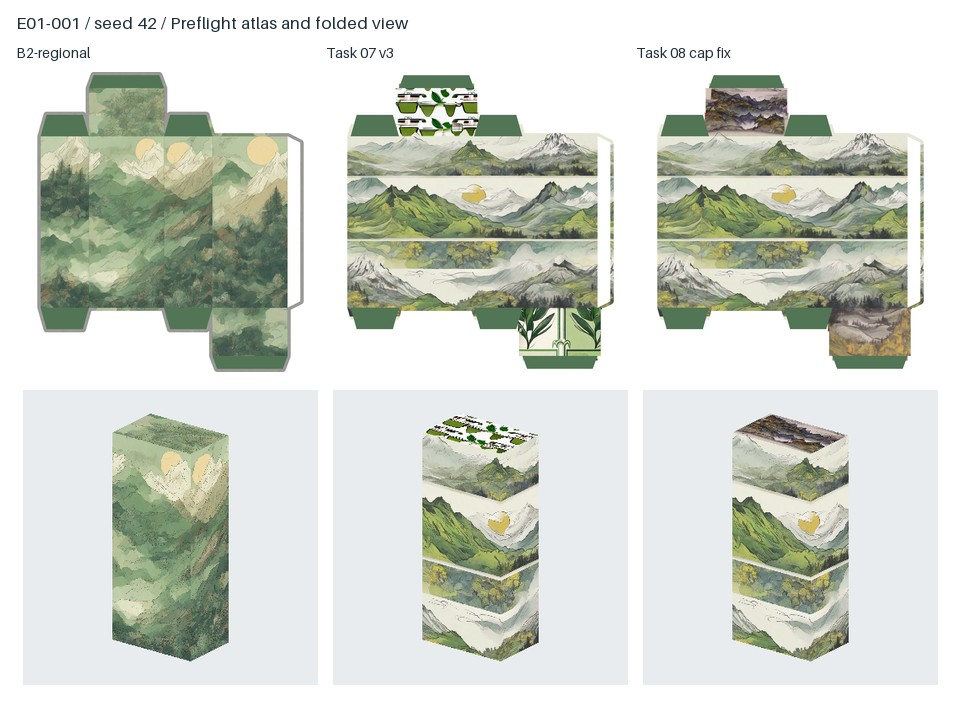
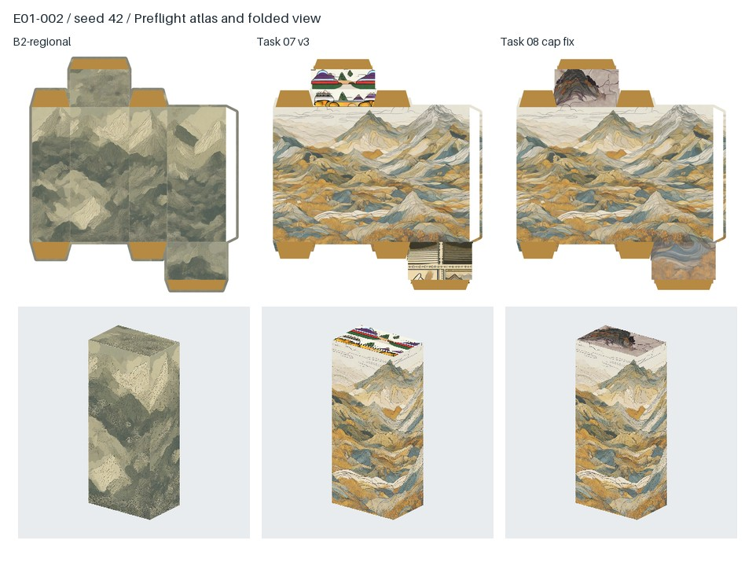
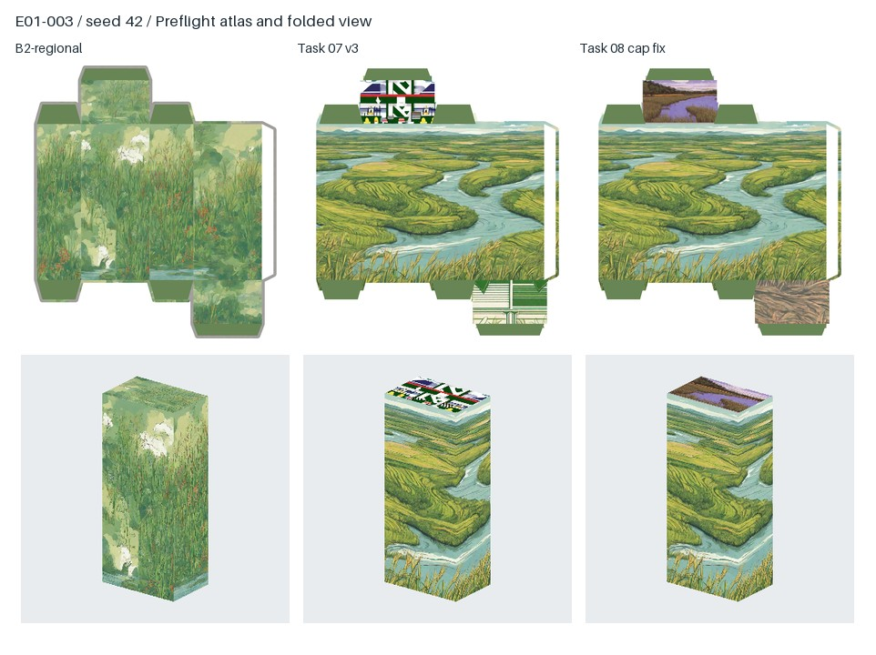

# E02 · v3 盖面修复

**Step 1 关口未通过。建议停在 Step 1。** 最终选择 C3（全盖延续提示、inpainting、两倍盖面）。盖侧连续性仍未达标。六条盖侧非原生缝的 ΔE00 / LPIPS 从 25.464 / 0.5369 变为 21.292 / 0.4732，两项均改善。B2-regional 为 9.493 / 0.3742，B2-post 为 14.260 / 0.4244。原像素目视仍有可见条带或亮边。同十条简报兼作候选选择和关口判定，存在过拟合风险，正式结论需用 Step 2 留出集检验。

## 冻结范围与可比性

只比较盖面。E01-001 至 E01-010 均使用种子 42，与任务 07 的 1280×1024 环带对齐。恢复任务 07 执行顺序中的 DDIM 系数驻留设备，重用同一份冻结环带潜变量、原像素图和盖面入口随机状态。指标代码、参数以及参考图哈希均与任务 07 归档核对。每个候选的四侧面和环带支持的侧面出血区逐像素相同。预览图使用相同刀版及统一印前复位。[指标冻结](METRICS_FREEZE.md) · [环带证明与关口](gate-capfix.json)

六条盖侧非原生缝由冻结的七缝平均减去 L—B 的贡献后取平均。绝对 ΔE00 和 LPIPS 都按相同六条缝汇总，原七缝 SDR、LPIPS 及其关口沿用任务 07。

## 盖面候选

- C1a 用延续侧面画面、色调和笔触的提示覆盖整个盖面。C1b 用相同提示约束四边，只在距每条边至少短边 25% 的中央区加小徽章提示。模板对 50 条简报一致，两套 SDXL tokenizer 在本轮十条都未截断。
- C2 单独换成公开的 SDXL inpainting UNet，用 9 通道输入接入掩码和冻结环带已知图像的 VAE 特征。原文本编码器、VAE、DDIM 和 LUT 继续使用。
- C3 将 704×576 盖面画布放大到 1408×1152，392×248 核心变为 784×512，短边按 512 px 最低约束补足。条件边带对应上采样，生成完按同一刀版比例降采样。
- C4 在盖面去噪中段额外回跳并重算一次。按预定规则仅在当前候选最高单盒耗时不超过 45 秒时尝试。各候选以同一种子起步，C4 的顶盖重采样消耗额外随机数，底盖初始噪声随之改变。

C2 使用 diffusers/stable-diffusion-xl-1.0-inpainting-0.1，上游修订为 115134f363124c53c7d878647567d04daf26e41e。FP16 safetensors 大小 5,135,178,560 字节，SHA-256 为 6470840731e98cc16713ddf3ac7ee458c9fdbcb881a98c6727cd4a938f227d3f。许可证为 CreativeML Open RAIL++-M。[官方模型卡](https://huggingface.co/diffusers/stable-diffusion-xl-1.0-inpainting-0.1/blob/115134f363124c53c7d878647567d04daf26e41e/README.md) · [许可证](https://huggingface.co/stabilityai/stable-diffusion-xl-base-1.0/blob/main/LICENSE.md) · [模型文件审计](capfix-inpainting-model.json)

## 按阶段选择

以十盒 preflight 配对均值比较。盖面 ΔE00 与 LPIPS、七缝 SDR 与 LPIPS、条带、CLIPScore、ImageReward 和耗时各一票。耗时差小于 0.25 秒时记平。加项必须赢票多于输票，至少改善一项盖面指标，并且十盒逐盒不超过 60 秒和 20 GiB。

| 阶段 | 比较 | 挑战方胜／负／平 | 保留 | 取舍 |
| --- | --- | ---: | --- | --- |
| C1 | C1b 对 C1a | 3 / 4 / 1 | C1a | 净胜票 |
| C2 | C2 对 C1a | 4 / 3 / 1 | C2 | 盖面改善且净胜票为正 |
| C3 | C3 对 C2 | 6 / 2 / 0 | C3 | 盖面改善且净胜票为正 |
| C4 | C4 对 C3 | 1 / 7 / 0 | C3 | 两项盖面指标均未改善 |

C2、C3 和 C4 的名称各代表在上一步保留配置上只启用该项的挑战方。[逐步参数、票和评分哈希](capfix-selection.json)

### 同批十盒的数值与成本

| 方法 | 盖面六缝 ΔE00 ↓ | 盖面六缝 LPIPS ↓ | 七缝 SDR ↓ | 七缝 LPIPS ↓ | 全盒条带 ↓ | CLIPScore ↑ | ImageReward ↑ | 耗时 s ↓ | 峰值 MiB |
| --- | ---: | ---: | ---: | ---: | ---: | ---: | ---: | ---: | ---: |
| B2-regional | 9.493 | 0.3742 | 4.418 | 0.3646 | 1.1399 | 0.6572 | -1.7550 | 43.12 | 10453.7 |
| B2-post | 14.260 | 0.4244 | 4.620 | 0.4135 | 1.2288 | 0.6856 | -1.6005 | 14.25 | 9928.9 |
| 任务 07 v3 | 25.464 | 0.5369 | 7.693 | 0.4840 | 1.2897 | 0.6878 | -1.5531 | 21.57 | 10423.6 |
| C1a | 24.604 | 0.5289 | 7.649 | 0.4771 | 1.4515 | 0.6818 | -1.6412 | 21.90 | 10422.3 |
| C1b | 24.795 | 0.5287 | 7.739 | 0.4770 | 1.4969 | 0.6851 | -1.6644 | 22.00 | 10422.3 |
| C2 | 23.311 | 0.5206 | 7.833 | 0.4700 | 1.3083 | 0.6771 | -1.6530 | 21.97 | 10422.3 |
| C3 | 21.292 | 0.4732 | 6.946 | 0.4294 | 1.5980 | 0.6838 | -1.6172 | 44.78 | 10511.1 |
| C4 | 22.398 | 0.4869 | 7.296 | 0.4411 | 1.3282 | 0.6811 | -1.6454 | 45.61 | 10511.1 |

保留配置的单盒最高耗时为 45.00 秒，最高峰值分配 10.26 GiB。每盒总时间包含本盒环带的实测时间和本候选盖面、合成的实测时间，模型载入和缓存读写在计时外。

C4 将指数从 1.5980 降到 1.3282，仍高于 1.2528 上限，六缝绝对 ΔE00 和 LPIPS 同时回退。保留 C3 反映预先登记的多指标选择，最终关口仍分别检验。

### raw 与 preflight 对照

#### raw

| 方法 | 盖面六缝 ΔE00 ↓ | 盖面六缝 LPIPS ↓ | L—B ΔE00 ↓ | 原口径出血 % ↑ | M3 出血 % ↑ | 全盒条带 ↓ | CLIPScore ↑ |
| --- | ---: | ---: | ---: | ---: | ---: | ---: | ---: |
| B2 | 14.291 | 0.4243 | 13.792 | 52.75 | 47.34 | 1.2271 | 0.6862 |
| B2-post | 14.260 | 0.4244 | 13.759 | 52.85 | 47.38 | 1.2288 | 0.6856 |
| B2-regional | 9.493 | 0.3742 | 11.621 | 53.00 | 28.46 | 1.1399 | 0.6572 |
| SyncMVD | 15.881 | 0.4563 | 70.031 | 11.90 | 5.98 | 1.2732 | 0.6664 |
| Paint3D | 11.573 | 0.3587 | 10.942 | 18.99 | 20.89 | 1.0440 | 0.6829 |
| 任务 07 v3 | 25.464 | 0.5369 | 4.065 | 57.85 | 50.24 | 1.2897 | 0.6878 |
| C3 | 21.292 | 0.4732 | 4.065 | 64.89 | 60.11 | 1.5980 | 0.6838 |

#### preflight

| 方法 | 盖面六缝 ΔE00 ↓ | 盖面六缝 LPIPS ↓ | L—B ΔE00 ↓ | 原口径出血 % ↑ | M3 出血 % ↑ | 全盒条带 ↓ | CLIPScore ↑ |
| --- | ---: | ---: | ---: | ---: | ---: | ---: | ---: |
| B2 | 14.291 | 0.4243 | 13.792 | 52.75 | 47.34 | 1.2271 | 0.6862 |
| B2-post | 14.260 | 0.4244 | 13.759 | 52.85 | 47.38 | 1.2288 | 0.6856 |
| B2-regional | 9.493 | 0.3742 | 11.621 | 53.00 | 28.46 | 1.1399 | 0.6572 |
| SyncMVD | 15.881 | 0.4563 | 70.031 | 11.90 | 5.98 | 1.2732 | 0.6664 |
| Paint3D | 11.573 | 0.3587 | 10.942 | 18.99 | 20.89 | 1.0440 | 0.6829 |
| 任务 07 v3 | 25.464 | 0.5369 | 4.065 | 57.85 | 50.24 | 1.2897 | 0.6878 |
| C3 | 21.292 | 0.4732 | 4.065 | 64.89 | 60.11 | 1.5980 | 0.6838 |

[全部逐盒评分](results-capfix.csv)

## Step 1 五项关口

| 检查 | 十盒 preflight 证据 | 结果 |
| --- | --- | --- |
| 七条非原生缝 | SDR 6.946，LPIPS 0.4294。两项须低于 B2-regional 和 B2-post | 未通过 |
| 双口径出血 | 原口径 64.89%，M3 60.11%。两项须高于 B2-regional 和 B2-post | 通过 |
| 全盒条带和原像素 | 指数 1.5980，上限 1.2528，最低基线为 Paint3D。原像素目视仍有可见条带或亮边 | 未通过 |
| CLIPScore 单侧 | 0.6838，下限 0.6362 | 通过 |
| RTX 3090 预算 | 十盒逐盒上限为 60 秒、20 GiB，最高耗时 45.00 秒、峰值 10.26 GiB | 通过 |

### 结果定位

L—B 环绕缝绝对 ΔE00 保持 4.065。其余六条盖侧边的绝对 ΔE00 仍为 21.292，最高两盒为 E01-003（28.709）、E01-008（25.076）。全盒条带最高两盒为 E01-003（3.542）、E01-002（1.874）。用同一冻结口径拆到实际邻边，顶盖三条非原生缝均值为 ΔE00 25.48、LPIPS 0.5379，底盖三条为 17.10、0.4085。左面—顶盖和右面—顶盖的绝对 ΔE00 最高，分别为 28.36 和 26.08，差距延伸至缝中段。E01-003 的全盒指数峰值 3.5422 出在背面—底盖，主要由底盖侧贡献。原像素可见的约 8 px 灰带出现在同盒的正面—顶盖。其他盒也贡献了全盒条带超标。计算上即使将 E01-003 的最大值降到它由固定侧面所决定的理论下界 1.2101，十盒均值仍约为 1.3648，高于 1.2528。E01-009 的正顶峰值有固定正面纹理贡献。

## 展开图、折叠图与原像素







原像素盖面图每份包含顶盖和底盖各四条边。相对的侧面条带在上，盖面在下。依据 OBJ 拓扑确定顺序与方向，仅旋转或翻转像素，未重新采样。

标记有可见条带或亮边的样本为 E01-003。逐盒观察见关口记录。[盖面四边原像素对照](capfix-edges.png)

Gemini 审阅指出，非原生盖边的出血缓冲会将冻结条件条向外移开。本轮保持这一几何，只能观察合成后的盖侧差距，无法单独估计缓冲带的贡献。[审阅意见](https://github.com/Casey-sketch-cyber/ai-design/pull/7#issuecomment-7156686175)

## 复现

在服务器项目根目录运行。完成后可用审查记录重建目视关口，前提是产物与评分指纹相同。数据盘路径为 `/root/autodl-tmp/ai-design/outputs/e02/capfix/runs/437980f564bb`。

```bash
bash code/scripts/run_E02_capfix.sh
source code/scripts/e01_env.sh
"$AD_ROOT/envs/e01/bin/python" -m dielinediff.e02_capfix review --review-file docs/experiments/E02/gate-capfix.json
```
