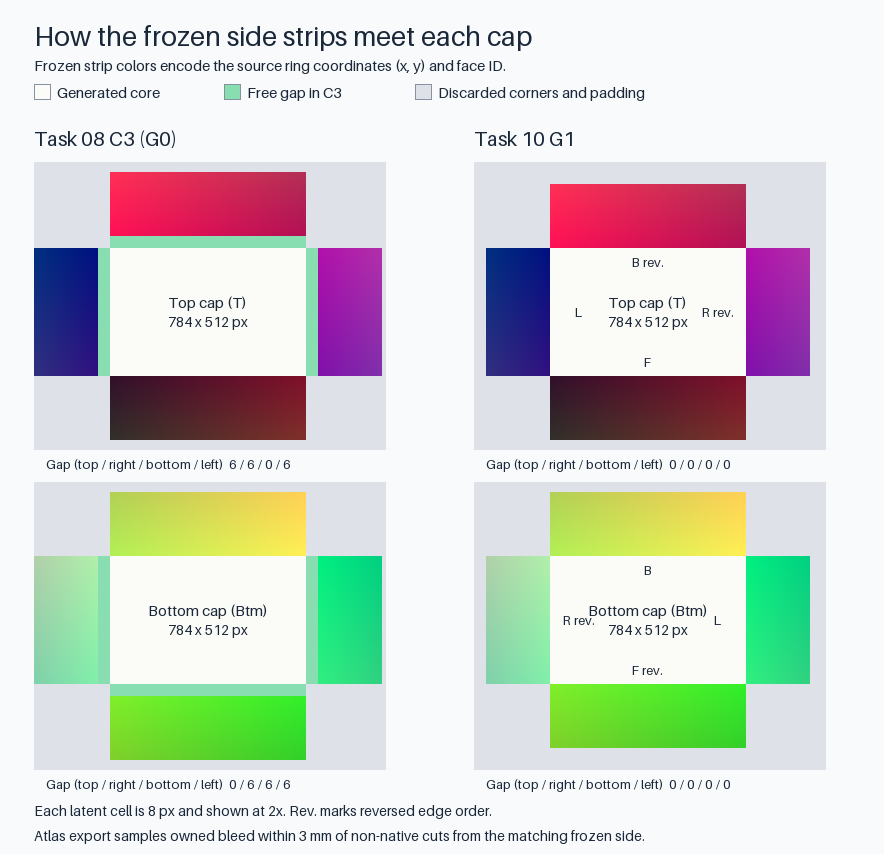
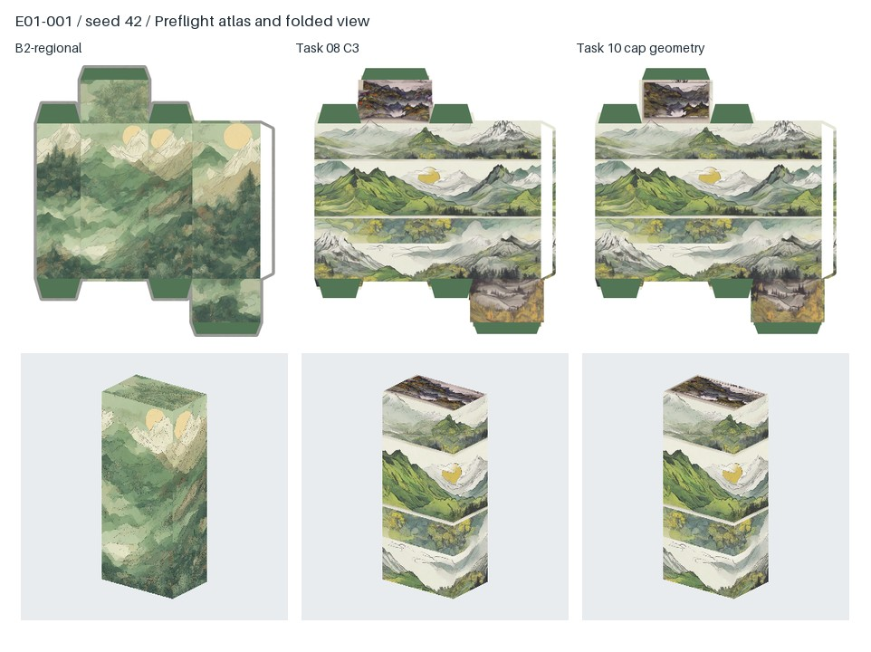
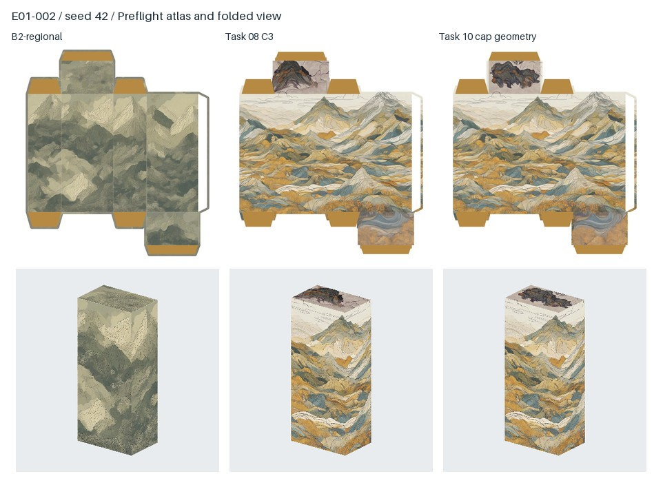
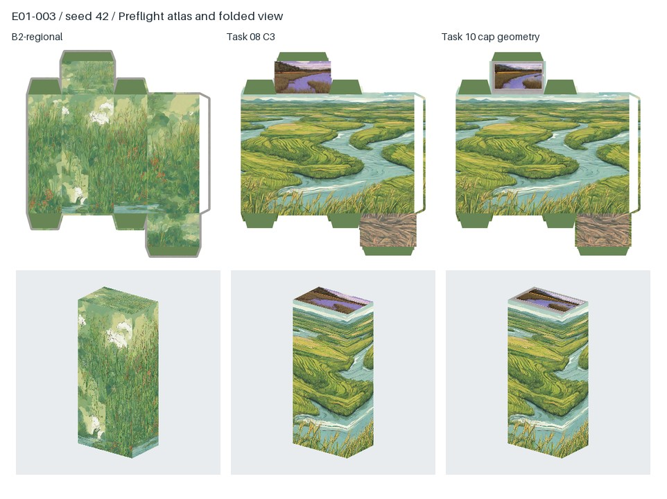
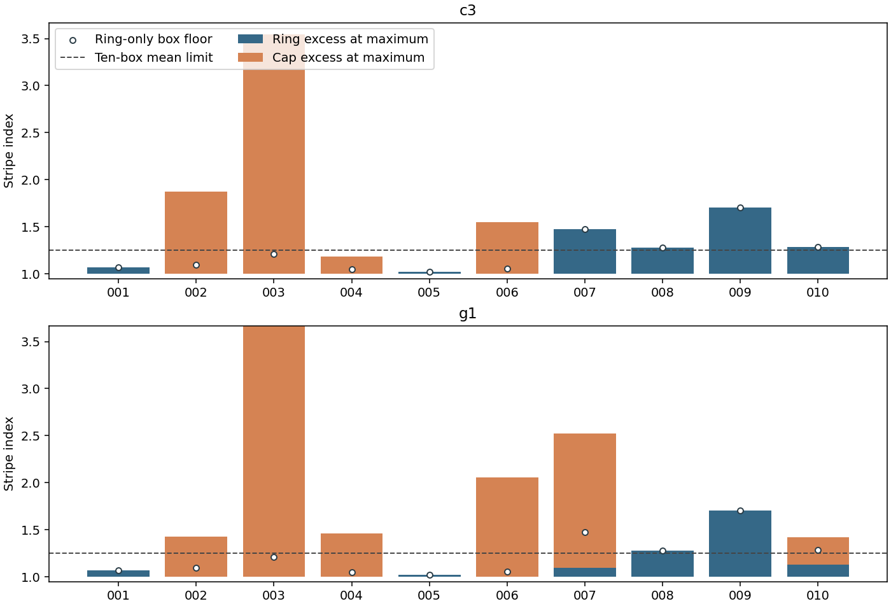

# E02 · v3 盖面几何与调和初始化

**Step 1 关口未通过。建议停在 Step 1。** 最终配置为 G1。盖面六缝 ΔE00／LPIPS 由任务 08 C3 的 21.292／0.4732 变为 11.497／0.4425，七条非原生缝 LPIPS 和原口径出血仍未达标。在选型种子 42 中，按每盒峰值折线汇总，环带侧平均超额 0.1301，盖面侧 0.6414。盖面侧单独即可使十盒均值超标。将盖面侧置为理论最小值后，固定环带下界低于门槛。种子 1234 的复验中，环带侧贡献超过盖面侧。

## 样本与选型范围

以任务 08 的 C3 为起点，在 E01-001 至 E01-010、种子 42 上逐项比较盖面。保持冻结环带及评分口径，沿用任务 07 原关口。种子 1234 只复验最终配置。同十条简报兼作选型和判定，存在过拟合风险，两个种子均为同简报的描述性检查。

数据盘运行目录为 `/root/autodl-tmp/ai-design/outputs/e02/capgeom/runs/7b2fcb2c668b`。

## 几何与实现

- **G1** 继续使用 C3 的 1408×1152 盖面画布、784×512 核心和 9 通道 SDXL inpainting。每块盖面的四条冻结边带紧贴核心，掩码中仍有 10,368 个已知潜格。坐标编码在四边保留原侧面坐标，六条非原生边的间隙由两倍画布上的 6 个潜格（48 px）缩到 0。出血按实际刀版和三维邻接方向从冻结侧面取对应字节，按 3 mm 区域导出。实际可用的盖面出血遮罩含 20,259 个像素，顶盖 9,795 个、底盖 10,464 个。插舌处只采用刀版上标为盖面出血的部分，自由角从导出中排除。
- **G2** 用已知 RGB 边带作 Dirichlet 条件，在 1408×1152 像素网格上解离散拉普拉斯方程，未知区包括核心与四角。画布外围采用零法向通量。CG 的多重网格预条件器按几何缓存，RGB 残差验收阈值为 3×10⁻⁸。将解 VAE 编码后前向加噪，两档分别执行 30 步 DDIM 原序列的最后 22 或 25 步，保持 LUT 投影的原始步号。两档均接在 G1 后，AdaIN 子选项省略。[SDEdit 原论文](https://arxiv.org/abs/2108.01073) · [Diffusers SDXL strength 说明](https://huggingface.co/docs/diffusers/api/pipelines/stable_diffusion/stable_diffusion_xl)
- **G3** 在环带的一个低分辨率上采样自注意力层记录 30 对 K/V 到 CPU。顶、底两盖只读取当前原始 DDIM 时间步对应的 K/V，并在同一层拼接到盖面的自注意力键和值。用同一简报和种子重跑环带时校验 RGB、潜变量和随机状态字节。计时包括权重在 CPU 与 GPU 间切换以及 K/V 传输。[共享注意力层配置](../../../code/configs/E02_capgeom.yaml)

每盒实测冻结环带像素为 1,507,328 个侧面本体像素和 213,582 个侧面出血像素。所有候选继承任务 07 的 1280×1024 环带和冻结指标。种子 42 的四侧面与原有侧面出血直接同任务 07 归档比对。种子 1234 用原实现生成新环带，比对该种子的盖面生成前后。冻结指标代码提交为 `33fe37229119c47f7aafdb0b5ee5f3116a2a57d1`，参数 SHA-256 为 `76b23ea65839e95a60d3a0c3f9354b601a8d7daa8429eb2ff71a72560631577c`。[指标冻结记录](METRICS_FREEZE.md) · [输入及环带实现哈希](capgeom-inputs.json) · [逐盒环带和生成证明](capgeom-ring-proof.json)



## 阶段选择

用种子 42 的十盒 preflight 均值沿用任务 08 八指标投票，每项等权，耗时差小于 0.25 秒记平。附加项须各盒符合预算、至少一项盖面指标改善，且净胜票为正。两档 G2 均合格时再同场比较，最终平手优先 0.75。

| 阶段 | 挑战方与当前配置 | 胜／负／平 | 保留 | 依据 |
| --- | --- | --- | --- | --- |
| G1 | G1 对任务 08 C3 | 5 / 2 / 1 | G1 | 盖面指标改善且净胜票为正 |
| G2 | G2 · 0.75 对 G1 | 2 / 6 / 0 | G1 | 净胜票不足 |
| G2 | G2 · 0.85 对 G1 | 4 / 4 / 0 | G1 | 净胜票不足 |
| G3 | G3 对 G1 | 4 / 4 / 0 | G1 | 净胜票不足 |

### 同批十盒的均值

| 方法 | 盖面六缝 ΔE00 | 盖面六缝 LPIPS | 七缝 SDR | 七缝 LPIPS | 全盒条带 | CLIPScore | ImageReward | 耗时（秒） | 峰值（MiB） |
| --- | --- | --- | --- | --- | --- | --- | --- | --- | --- |
| B2-regional | 9.493 | 0.3742 | 4.418 | 0.3646 | 1.1399 | 0.6572 | −1.7550 | 43.12 | 10453.7 |
| B2-post | 14.260 | 0.4244 | 4.620 | 0.4135 | 1.2288 | 0.6856 | −1.6005 | 14.25 | 9928.9 |
| 任务 08 C3 | 21.292 | 0.4732 | 6.946 | 0.4294 | 1.5980 | 0.6838 | −1.6172 | 44.78 | 10511.1 |
| G1 | 11.497 | 0.4425 | 3.863 | 0.4031 | 1.7715 | 0.6849 | −1.6283 | 44.83 | 10509.9 |
| G2 · 0.75 | 5.818 | 0.4445 | 2.296 | 0.4048 | 2.0807 | 0.6691 | −1.7583 | 47.13 | 10528.6 |
| G2 · 0.85 | 5.377 | 0.4250 | 2.139 | 0.3881 | 2.6482 | 0.6763 | −1.7215 | 49.39 | 10530.5 |
| G3 | 11.840 | 0.4417 | 3.988 | 0.4023 | 1.7457 | 0.6833 | −1.6274 | 49.06 | 10510.1 |

### raw 与 preflight

#### raw

| 方法 | 盖面六缝 ΔE00 | 盖面六缝 LPIPS | L–B ΔE00 | 原口径出血（%） | M3 出血（%） | 全盒条带 | CLIPScore |
| --- | --- | --- | --- | --- | --- | --- | --- |
| B2-regional | 9.493 | 0.3742 | 11.621 | 53.00 | 28.46 | 1.1399 | 0.6572 |
| B2-post | 14.260 | 0.4244 | 13.759 | 52.85 | 47.38 | 1.2288 | 0.6856 |
| 任务 08 C3 | 21.292 | 0.4732 | 4.065 | 64.89 | 60.11 | 1.5980 | 0.6838 |
| G1 | 11.497 | 0.4425 | 4.065 | 52.36 | 47.84 | 1.7715 | 0.6849 |
| G2 · 0.75 | 5.818 | 0.4445 | 4.065 | 66.27 | 58.21 | 2.0807 | 0.6691 |
| G2 · 0.85 | 5.377 | 0.4250 | 4.065 | 66.92 | 58.31 | 2.6482 | 0.6763 |
| G3 | 11.840 | 0.4417 | 4.065 | 52.39 | 47.88 | 1.7457 | 0.6833 |

#### preflight

| 方法 | 盖面六缝 ΔE00 | 盖面六缝 LPIPS | L–B ΔE00 | 原口径出血（%） | M3 出血（%） | 全盒条带 | CLIPScore |
| --- | --- | --- | --- | --- | --- | --- | --- |
| B2-regional | 9.493 | 0.3742 | 11.621 | 53.00 | 28.46 | 1.1399 | 0.6572 |
| B2-post | 14.260 | 0.4244 | 13.759 | 52.85 | 47.38 | 1.2288 | 0.6856 |
| 任务 08 C3 | 21.292 | 0.4732 | 4.065 | 64.89 | 60.11 | 1.5980 | 0.6838 |
| G1 | 11.497 | 0.4425 | 4.065 | 52.36 | 47.84 | 1.7715 | 0.6849 |
| G2 · 0.75 | 5.818 | 0.4445 | 4.065 | 66.27 | 58.21 | 2.0807 | 0.6691 |
| G2 · 0.85 | 5.377 | 0.4250 | 4.065 | 66.92 | 58.31 | 2.6482 | 0.6763 |
| G3 | 11.840 | 0.4417 | 4.065 | 52.39 | 47.88 | 1.7457 | 0.6833 |

最终配置启用 G1 的贴边和冻结侧面出血。

## 长尾

p90 用 Type 7 线性分位数（10 盒按升序，第 9 个值加上第 9 到第 10 个差值的 10%）。

| 方法 | 盖面 ΔE00 p90 | 盖面 ΔE00 最差两盒 | 条带 p90 | 条带最差两盒 |
| --- | --- | --- | --- | --- |
| B2-regional | 12.430 | E01-001（13.276）、E01-009（12.336） | 1.2330 | E01-002（1.3027）、E01-007（1.2253） |
| B2-post | 19.217 | E01-006（22.470）、E01-008（18.855） | 1.3490 | E01-007（1.8594）、E01-009（1.2923） |
| 任务 08 C3 | 25.439 | E01-003（28.709）、E01-008（25.076） | 2.0412 | E01-003（3.5422）、E01-002（1.8744） |
| G1 | 13.025 | E01-003（15.937）、E01-004（12.701） | 2.6455 | E01-003（3.7510）、E01-007（2.5227） |
| G2 · 0.75 | 8.438 | E01-008（8.648）、E01-005（8.415） | 2.9273 | E01-004（4.1569）、E01-002（2.7906） |
| G2 · 0.85 | 6.822 | E01-008（7.183）、E01-005（6.782） | 3.9653 | E01-004（4.2615）、E01-003（3.9324） |
| G3 | 13.662 | E01-003（17.108）、E01-009（13.280） | 2.5239 | E01-003（3.6759）、E01-007（2.3959） |

G1 将盖侧 ΔE00 的 p90 从 25.439 降至 13.025，同时把条带 p90 从 2.0412 抬到 2.6455。G2 的 0.75、0.85 档进一步压低盖侧 ΔE00 p90，条带 p90 分别升至 2.9273、3.9653。G3 将条带 p90 降到 2.5239，盖侧 ΔE00 p90 升至 13.662。

## Step 1 五项关口

| 检查 | 十盒 preflight 证据 | 结论 |
| --- | --- | --- |
| 七条非原生缝 | 七缝 SDR 3.863（B2-regional 4.418，B2-post 4.620）。七缝 LPIPS 0.4031（B2-regional 0.3646，B2-post 0.4135） | 未通过 |
| 双口径出血 | 原口径出血（%） 52.36（B2-regional 53.00，B2-post 52.85）。M3 出血（%） 47.84（B2-regional 28.46，B2-post 47.38） | 未通过 |
| 条带与原像素 | 指数 1.7715，上限 1.2528（Paint3D × 1.2）。原生折线目视通过 | 未通过 |
| CLIPScore 单侧 | 0.6849，下限 0.6362 | 通过 |
| RTX 3090 预算 | 最高单盒 45.18 秒、10.264 GiB。逐盒限额 60 秒、20 GiB | 通过 |

十盒在五条原生折线上均未检出贴折的独立窄带或亮边。E01-003 原正面—顶盖约 8 像素的灰窄带消退，顶盖与侧面仍有色调阶跃，顶盖右侧切边内仍可见浅色画框。

## 折边条带来源

在冻结的 4 px/mm 网格上，按每侧折线贴边 3 mm 的切向差分能量和面内参考带得到原方程的侧比值。每条折线指数等于 1 加环带侧与盖面侧超额，整盒取五条折线的最大值。反事实下界分别把一组侧比值置 1 后重新取最大值。数值描述指数结构，实际可见条带仍以原像素为准。

| 方法 | 实测均值 | 峰值折线环带侧超额 | 峰值折线盖面侧超额 | 只保留环带侧的下界 | 只保留盖面侧的下界 | 主导侧盒数（环带／盖面／持平） |
| --- | --- | --- | --- | --- | --- | --- |
| 任务 08 C3 | 1.5980 | 0.1835 | 0.4144 | 1.2244 | 1.4623 | 6 / 4 / 0 |
| G1 | 1.7715 | 0.1301 | 0.6414 | 1.2244 | 1.6633 | 4 / 6 / 0 |
| G2 · 0.75 | 2.0807 | 0.1248 | 0.9559 | 1.2244 | 1.9824 | 3 / 7 / 0 |
| G2 · 0.85 | 2.6482 | 0.0843 | 1.5639 | 1.2244 | 2.5639 | 1 / 9 / 0 |
| G3 | 1.7457 | 0.1301 | 0.6156 | 1.2244 | 1.6382 | 4 / 6 / 0 |

| 简报 | 峰值折线 | 全盒条带 | 环带侧超额 | 盖面侧超额 | 环带侧下界 |
| --- | --- | --- | --- | --- | --- |
| E01-001 | B-R | 1.0690 | 0.0690 | 0.0000 | 1.0690 |
| E01-002 | B-Btm | 1.4296 | 0.0000 | 0.4296 | 1.0969 |
| E01-003 | B-Btm | 3.7510 | 0.0000 | 2.7510 | 1.2101 |
| E01-004 | B-Btm | 1.4592 | 0.0000 | 0.4592 | 1.0497 |
| E01-005 | B-R | 1.0237 | 0.0237 | 0.0000 | 1.0237 |
| E01-006 | B-Btm | 2.0549 | 0.0000 | 1.0549 | 1.0520 |
| E01-007 | B-Btm | 2.5227 | 0.0957 | 1.4269 | 1.4764 |
| E01-008 | B-R | 1.2812 | 0.2812 | 0.0000 | 1.2812 |
| E01-009 | F-T | 1.7030 | 0.7030 | 0.0000 | 1.7030 |
| E01-010 | F-T | 1.4210 | 0.1283 | 0.2927 | 1.2821 |

G1 两个最强峰值都在背面—底盖。E01-003 峰值 3.7510，环带侧超额 0.0000，底盖侧 2.7510。E01-007 峰值 2.5227，底盖贴边的切向差分能量从 C3 的 1.51×10⁻³ 变为 1.45×10⁻³，面内参考能量从 9.84×10⁻⁴ 降到 2.75×10⁻⁴。同一冻结公式下，面内纹理变平也会推高贴边指数。

[逐折拆解](capgeom-stripe-sources.csv) · [条带贡献图](capgeom-stripe-sources.png)

### 环带横幅

原图中有 1/10 盒出现上下堆叠的横幅及浅白分隔线（E01-001）。表中汇总了观察到的组间差异。

| 有横幅／白线 | 盒数 | 整盒条带均值 | 环带侧下界均值 | ImageReward 均值 |
| --- | --- | --- | --- | --- |
| 有 | 1 | 1.0690 | 1.0690 | −2.2505 |
| 无 | 9 | 1.8496 | 1.2417 | −1.5591 |

E01-001 的条带指数比其余九盒平均值低 0.7806，ImageReward 低 0.6914。横幅分隔线横穿侧面原生折线，组间比较只涉及一盒含横幅的样本。

## 跨种子复验

在固定的 G1 上按简报配对。以下差值为 1234 减 42，选型与关口沿用 42。

| preflight 指标 | 种子 42 均值 | 种子 1234 均值 | 平均配对差值 |
| --- | --- | --- | --- |
| 盖面六缝 ΔE00 | 11.497 | 14.960 | +3.462 |
| 盖面六缝 LPIPS | 0.4425 | 0.4682 | +0.0257 |
| 七缝 SDR | 3.863 | 5.607 | +1.744 |
| 七缝 LPIPS | 0.4031 | 0.4320 | +0.0289 |
| 全盒条带 | 1.7715 | 1.3483 | −0.4233 |
| CLIPScore | 0.6849 | 0.7092 | +0.0243 |
| ImageReward | −1.6283 | −1.3460 | +0.2822 |
| 耗时（秒） | 44.83 | 44.74 | −0.09 |
| 原口径出血（%） | 52.36 | 48.11 | −4.25 |
| M3 出血（%） | 47.84 | 38.80 | −9.03 |
| HPS v2 | 0.2373 | 0.2369 | −0.0003 |
| 峰值（MiB） | 10509.9 | 10511.7 | +1.8 |

种子 1234 的盖面 ΔE00 p90 为 17.592，条带 p90 为 1.5507。

种子 1234 的盖侧 ΔE00 最差两盒为 E01-003（18.409）、E01-009（17.501）。全盒条带最差两盒为 E01-001（1.8568）、E01-010（1.5167）。

种子 1234 中，峰值折线的平均环带侧超额为 0.2261，盖面侧为 0.1221。环带侧单独取最大值后的十盒均值为 1.2798，高于种子 42 的数值参考 1.2528，种子 42 对应的环带侧下界为 1.2244。因此两种子各自的主要条带来源不同。种子 1234 沿用同十条简报，比较仅作描述。

## RTX 3090 实测开销

整盒耗时由环带、盖面与刀版合成计时组成。C3、G1、G2 与种子 1234 计入其各盒环带的实测时间。峰值记录 PyTorch 分配量，模型首次载入、文件写出和评测在计时之外。

| 配置 | 种子 | 盒数 | 整盒均值（秒） | 最高单盒（秒） | 最高峰值（GiB） | 盖面均值（秒） |
| --- | ---: | ---: | ---: | ---: | ---: | ---: |
| 任务 08 C3 | 42 | 10 | 44.78 | 45.00 | 10.265 | 32.37 |
| G1 | 42 | 10 | 44.83 | 45.18 | 10.264 | 32.42 |
| G2 · 0.75 | 42 | 10 | 47.13 | 50.26 | 10.282 | 34.72 |
| G2 · 0.85 | 42 | 10 | 49.39 | 49.72 | 10.284 | 36.98 |
| G3 | 42 | 10 | 49.06 | 49.36 | 10.264 | 34.19 |
| G1 | 1234 | 10 | 44.74 | 44.84 | 10.265 | 32.40 |

两档 G2 的平均每盖调和求解用时分别为 4.75 秒、4.60 秒，40 个盖的最大求解残差为 3.41e-11。

G3 的每盒 K/V CPU 缓存最大为 375.0 MiB。十盒每盖的 30 个实际调用均命中相同 DDIM 时间步。

## 图像证据

每组上排为展开图，下排为同一折叠视角。列顺序为 B2-regional、任务 08 C3、本轮保留配置，统一使用种子 42 和印前复位。







盖面原像素图每盒展示顶、底盖各四边，每对裁图上为实际相邻侧面，下为盖面，保留 1:1 原像素。相邻侧按 OBJ 拓扑旋转或翻转。每盒另有五条原生折线裁图和对应的人工观察。[E01-001 盖面四边](capgeom-examples/E01-001-cap-edges.png) · [E01-003 盖面四边](capgeom-examples/E01-003-cap-edges.png) · [十盒原生折线和环带判读](capgeom-review.json)



环带缩略图仅用于判读整幅版式。计入横向图框上下堆叠，且中间可见浅色或白色分隔线的情况。[E01-001 至 E01-005 环带](capgeom-examples/ring-audit-1.jpg) · [E01-006 至 E01-010 环带](capgeom-examples/ring-audit-2.jpg)

## 复现

在 AutoDL 数据盘上的仓库根目录执行。命令复用同一数据盘中任务 07 的指标、归档基线和任务 08 的 C3、冻结种子 42 环带，用已登记的哈希检查归档完整性。两档调和插值共用固定版本的 PyAMG。服务器保留各盒原图、评分、五折线和盖面裁图，详见开头所列运行目录。

```bash
bash code/scripts/run_E02_capgeom.sh
```

用已提交的原像素观察重建最终关口。程序验证观察记录的评分指纹并重新导出图表。

```bash
source code/scripts/e01_env.sh
"$AD_ROOT/envs/e01/bin/python" -m dielinediff.e02_capgeom review \
  --review-file docs/experiments/E02/capgeom-review.json
"$AD_ROOT/envs/e01/bin/python" code/scripts/render_E02_capgeom_map.py \
  --geometry "$AD_ROOT/outputs/e01b/geometry" \
  --output "$AD_ROOT/tmp/capgeom-coordinate-map.png"
```

[双口径逐盒评分](results-capgeom.csv) · [选型与评分哈希](capgeom-selection.json) · [结构化关口记录](gate-capgeom.json) · [长尾和跨种子评分](capgeom-evaluation.json) · [逐折线拆解](capgeom-stripe-sources.csv)
