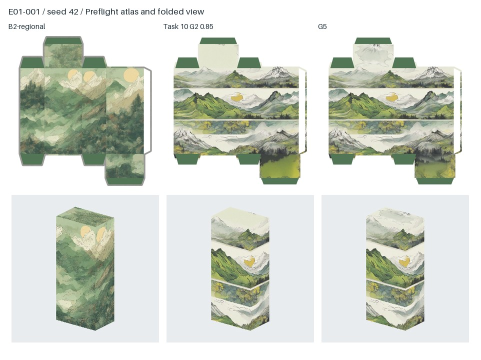
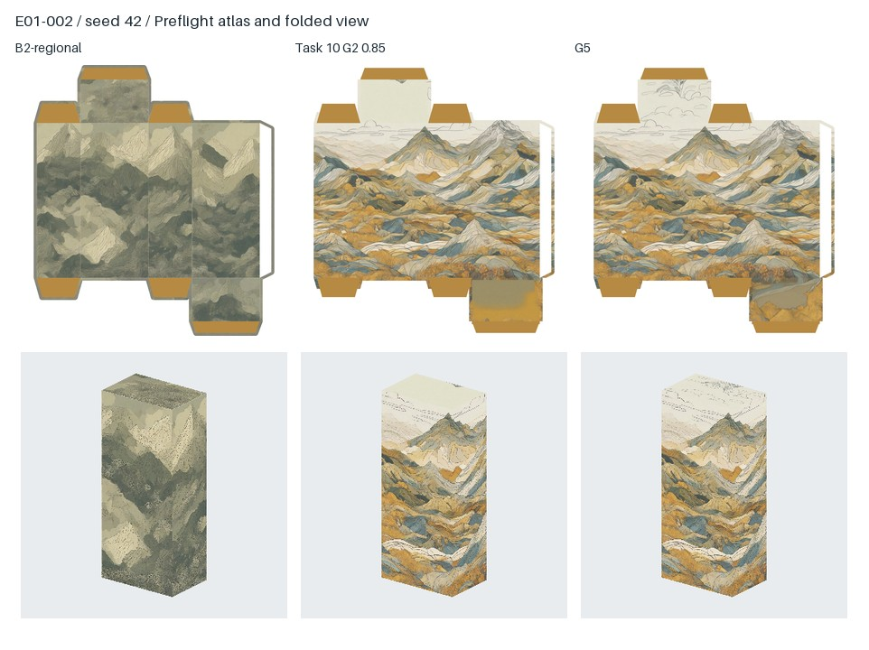
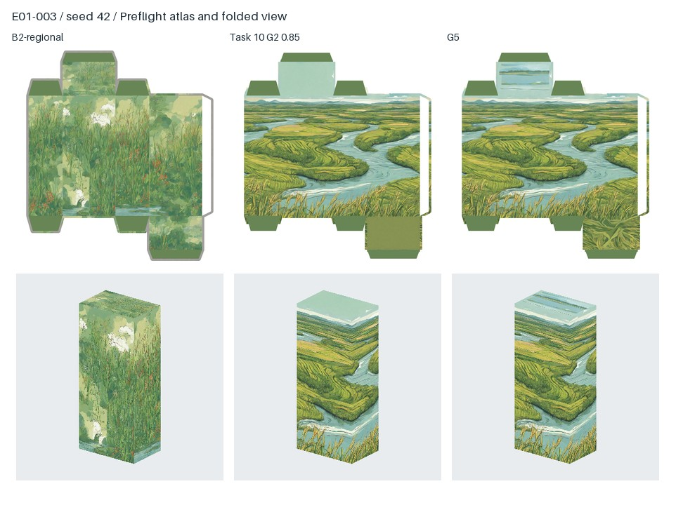

# E02 · v3 盖面颜色与纹理延续

**Step 1 未通过，建议停在 Step 1。** G5 将盖侧 ΔE00 从 G1 的 11.497 降到 4.189，顶底盖的面内纹理均达到下限。底盖跨缝纹理能量差仍高于 G1。原生折线目视通过，整盒条带 v1 为 1.5917，高于 1.2528 的上限。其余四项原关口通过。

RTX 3090 的运行目录为 `/root/autodl-tmp/ai-design/outputs/e02/captexture/runs/372fd0ca6170`。

## 盖面配置与复现

本轮只使用 E01-001 至 E01-010。种子 42 用于比较与决策，种子 1234 按同一批简报复验锁定的配置。G1、历史 G2 · 0.75 与 G2 · 0.85 使用任务 10 的原评分。两种子的环带读取各自在任务 08、10 上已审计的缓存。每盒四侧面及其原出血区、六条盖面切边的实际出血均逐像素校验。任务 07 的环带实现哈希与指标定义、阈值通过验证。[指标冻结记录](METRICS_FREEZE.md) · [任务 10](CAPGEOM.md) · [任务 12](STRIPE-DIAG.md) · [输入哈希](captexture-inputs.json) · [逐盒环带证明](captexture-ring-proof.json)

- **共同条件** 沿用 G1 的贴边几何、9 通道 SDXL inpainting、C1a 提示词和两倍盖面画布。盖面画布为 1408×1152，核心为 784×512。原 30 步 DDIM 日程与后段 LUT 投影步号保持不变。
- **G4** 从与 G1 对齐的纯噪声开始，全程 30 步。每次 DDIM 更新后，以该更新到达的时间步对调和先验加噪，把当前潜变量加上两者的低通差。参考加噪共用该盖的起始噪声样本。全程档最后一步用干净先验，前 70% 档只引导前 21 步。低通用因子 4 或 8 的面积平均下采样，再双线性还原。低通读取完整盖面画布，差值只写在核心潜格内。已知边带仍通过 inpainting 条件提供。[Choi 等，ILVR，ICCV 2021](https://openaccess.thecvf.com/content/ICCV2021/html/Choi_ILVR_Conditioning_Method_for_Denoising_Diffusion_Probabilistic_Models_ICCV_2021_paper.html)
- **G5** 对四条真邻边取 RGB 高通，用高斯 σ=8 px 在两倍画布上分离低频。高通沿法向镜像一次，用余弦权重从折边衰减到已知带深度 256 px，重叠处使用有界加权。只给调和初图的盖面核心注入该纹理。SDEdit 维持 0.85，执行原日程最后 25 步。
- **高强度 G2** 采用不注入纹理的调和初图，0.92、0.95 分别执行原日程最后 27、28 步。本轮采用七个登记组合，沿用硬掩码。

在 AutoDL 数据盘项目根目录运行。脚本按候选哈希校验已有产物，可在完整评分后绑定目视记录。

```bash
bash code/scripts/run_E02_captexture.sh
```

配对目视与原关口分开登记。若同一主目标赢数有多组，先核对各组十盒的五条原生折线；优先目视无伪影，其次取冻结条带 v1 较低者，再比较受影响盒数和登记顺序。关口的原像素子项仍按原规定单独检查。目视记录以原图、预检图和评分哈希绑定。

```bash
source code/scripts/e01_env.sh
"$AD_ROOT/envs/e01/bin/python" -m dielinediff.e02_captexture review \
  --review-file docs/experiments/E02/captexture-review.json
```

## 种子 42 选型

七项新配置先过三类硬约束。全十盒各自不超过 60 秒和 20 GiB，CLIPScore 均值至少 0.6362，顶盖和底盖面内能量分别至少为 B2-regional 对应值的一半。已通过者按六项主目标中优于 G1 的数量排序。硬筛选与原 Step 1 五项关口分列。

| 方法 | 胜 G1 项数 | 预算／CLIP／顶纹理／底纹理 | 顶盖能量 | 底盖能量 | 顶三缝能量差 | 底三缝能量差 | 盖侧六缝能量差 |
| --- | --- | --- | --- | --- | --- | --- | --- |
| B2-regional | — | 通过／通过／通过／通过 | 1.227 | 1.249 | 0.674 | 0.821 | 0.747 |
| B2-post | — | 通过／通过／通过／通过 | 3.322 | 2.871 | 0.857 | 0.804 | 0.831 |
| G1 | 0 | 通过／通过／通过／通过 | 2.473 | 1.677 | 1.887 | 1.128 | 1.508 |
| G2 · 0.75 | — | 通过／通过／未过／未过 | 0.016 | 0.008 | 1.441 | 2.268 | 1.854 |
| G2 · 0.85 | — | 通过／通过／未过／未过 | 0.023 | 0.037 | 1.258 | 2.156 | 1.707 |
| G2 · 0.92 | 6 | 通过／通过／未过／未过 | 0.060 | 0.310 | 1.117 | 2.096 | 1.607 |
| G2 · 0.95 | 6 | 通过／通过／未过／未过 | 0.297 | 0.495 | 1.061 | 2.030 | 1.546 |
| G5 | 6 | 通过／通过／通过／通过 | 0.888 | 0.790 | 0.719 | 1.549 | 1.134 |
| G4 · 4／全程 | 4 | 通过／通过／未过／未过 | 0.011 | 0.014 | 1.287 | 2.088 | 1.688 |
| G4 · 4／70% | 4 | 通过／通过／未过／未过 | 0.012 | 0.012 | 1.361 | 2.280 | 1.821 |
| G4 · 8／全程 | 4 | 通过／通过／未过／未过 | 0.022 | 0.119 | 1.281 | 2.004 | 1.642 |
| G4 · 8／70% | 4 | 通过／通过／未过／未过 | 0.024 | 0.149 | 1.271 | 2.052 | 1.661 |

能量单位为 10⁻³。两盖下限分别为 0.6136、0.6246。面内按任务 12 从四周排除 9 mm 后取双向差分能量。表中的跨缝纹理差是在每条非原生缝两侧各取 5 mm 后求的绝对差，数值较低代表纹理能量更接近。

G5 在七组中是唯一合格者，并取得 6/6 项优势。其七缝 LPIPS 为 0.3344，B2-regional 为 0.3646。顶三缝的两侧能量差从 G1 的 1.887 降到 0.719，底三缝则从 1.128 升到 1.549（×10⁻³）。因此恢复了底盖纹理强度，底盖跨缝纹理差仍大于 G1。两档高强度 G2 和四档 ILVR 均未达到顶底纹理下限。

| 方法 | 盖侧六缝 ΔE00 | 盖侧六缝 LPIPS | 七缝 SDR | 七缝 LPIPS | 原口径出血 % | M3 出血 % | 全盒条带 v1 | CLIPScore | ImageReward |
| --- | --- | --- | --- | --- | --- | --- | --- | --- | --- |
| B2-regional | 9.493 | 0.3742 | 4.418 | 0.3646 | 53.00 | 28.46 | 1.1399 | 0.6572 | -1.7550 |
| B2-post | 14.260 | 0.4244 | 4.620 | 0.4135 | 52.85 | 47.38 | 1.2288 | 0.6856 | -1.6005 |
| G1 | 11.497 | 0.4425 | 3.863 | 0.4031 | 52.36 | 47.84 | 1.7715 | 0.6849 | -1.6283 |
| G2 · 0.75 | 5.818 | 0.4445 | 2.296 | 0.4048 | 66.27 | 58.21 | 2.0807 | 0.6691 | -1.7583 |
| G2 · 0.85 | 5.377 | 0.4250 | 2.139 | 0.3881 | 66.92 | 58.31 | 2.6482 | 0.6763 | -1.7215 |
| G2 · 0.92 | 5.119 | 0.4108 | 2.034 | 0.3759 | 67.84 | 59.01 | 2.8400 | 0.6741 | -1.7316 |
| G2 · 0.95 | 5.339 | 0.3984 | 2.085 | 0.3653 | 67.67 | 58.76 | 1.8560 | 0.6813 | -1.6933 |
| G5 | 4.189 | 0.3624 | 1.624 | 0.3344 | 67.46 | 58.50 | 1.5917 | 0.6813 | -1.6774 |
| G4 · 4／全程 | 8.129 | 0.4820 | 3.137 | 0.4369 | 61.53 | 52.66 | 1.4555 | 0.6680 | -1.7706 |
| G4 · 4／70% | 5.622 | 0.4554 | 2.249 | 0.4141 | 67.49 | 57.51 | 1.7372 | 0.6693 | -1.7736 |
| G4 · 8／全程 | 9.003 | 0.4796 | 3.402 | 0.4348 | 59.74 | 51.37 | 1.5726 | 0.6736 | -1.7364 |
| G4 · 8／70% | 6.753 | 0.4568 | 2.633 | 0.4153 | 65.23 | 55.84 | 1.7458 | 0.6737 | -1.7497 |

表为十盒 preflight 均值。完整 CSV 保留所有登记对照和新方法的 raw、preflight 分值，逐折表报告冻结的五条原生折线。[双口径逐盒结果](results-captexture.csv) · [选型登记](captexture-selection.json)

### 多尺度纹理复核

任务 14 提醒，一阶差分能量也会响应颗粒。下表比较选型种子 42 的面内能量。先按任务 12 裁去四周 9 mm，再额外做 2×2 盒式平均下采样，比较两种网格的差分能量。细颗粒可能在平均后被削弱，纹样空间尺度和锐度也会影响比值。粗网格步长加倍，比值可以大于 1。此复核结合原像素、跨缝能量差及 ImageReward 解读。 [Gemini 任务 14 审阅](https://github.com/Casey-sketch-cyber/ai-design/pull/12#issuecomment-7166031174)

| 方法 | 顶／环面内能量比 | 底／环面内能量比 | 顶 2×平均后／原值 | 底 2×平均后／原值 |
| --- | ---: | ---: | ---: | ---: |
| B2-regional | 0.732 | 0.745 | 1.206 | 1.312 |
| G1 | 0.983 | 0.667 | 2.280 | 2.401 |
| G2 · 0.85 | 0.009 | 0.015 | 2.260 | 2.419 |
| G5 | 0.353 | 0.314 | 2.276 | 2.459 |

## 全盒条带与长尾

| 配置 | B-Btm | B-R | F-L | F-R | F-T | 整盒最大值的均值 |
| --- | --- | --- | --- | --- | --- | --- |
| G1 | 1.6721 | 1.1090 | 1.0066 | 1.0469 | 1.1742 | 1.7715 |
| G2 · 0.75 | 1.9768 | 1.1090 | 1.0066 | 1.0469 | 1.4620 | 2.0807 |
| G2 · 0.85 | 2.5316 | 1.1090 | 1.0066 | 1.0469 | 1.6391 | 2.6482 |
| G2 · 0.92 | 2.5014 | 1.1090 | 1.0066 | 1.0469 | 1.5971 | 2.8400 |
| G2 · 0.95 | 1.5840 | 1.1090 | 1.0066 | 1.0469 | 1.4848 | 1.8560 |
| G5 | 1.4654 | 1.1090 | 1.0066 | 1.0469 | 1.2090 | 1.5917 |
| G4 · 4／全程 | 1.3555 | 1.1090 | 1.0066 | 1.0469 | 1.2223 | 1.4555 |
| G4 · 4／70% | 1.6143 | 1.1090 | 1.0066 | 1.0469 | 1.3813 | 1.7372 |
| G4 · 8／全程 | 1.4795 | 1.1090 | 1.0066 | 1.0469 | 1.3723 | 1.5726 |
| G4 · 8／70% | 1.6154 | 1.1090 | 1.0066 | 1.0469 | 1.4994 | 1.7458 |

逐折各列在十盒内单独取平均。整盒先取每盒五折线最大值，再对十盒平均。原像素记录与数值均保留。[逐盒逐折线](captexture-stripe-sources.csv)

| 配置 | 盖侧 ΔE00 p90 | 盖侧 ΔE00 最差两盒 | 条带 p90 | 条带最差两盒 |
| --- | --- | --- | --- | --- |
| B2-regional | 12.430 | E01-001（13.276）、E01-009（12.336） | 1.2330 | E01-002（1.3027）、E01-007（1.2253） |
| B2-post | 19.217 | E01-006（22.470）、E01-008（18.855） | 1.3490 | E01-007（1.8594）、E01-009（1.2923） |
| G1 | 13.025 | E01-003（15.937）、E01-004（12.701） | 2.6455 | E01-003（3.7510）、E01-007（2.5227） |
| G2 · 0.75 | 8.438 | E01-008（8.648）、E01-005（8.415） | 2.9273 | E01-004（4.1569）、E01-002（2.7906） |
| G2 · 0.85 | 6.822 | E01-008（7.183）、E01-005（6.782） | 3.9653 | E01-004（4.2615）、E01-003（3.9324） |
| G2 · 0.92 | 6.384 | E01-005（6.423）、E01-008（6.380） | 5.5199 | E01-003（6.3618）、E01-004（5.4264） |
| G2 · 0.95 | 6.324 | E01-008（6.789）、E01-005（6.272） | 2.4433 | E01-007（3.7389）、E01-002（2.2993） |
| G5 | 5.120 | E01-005（5.439）、E01-008（5.085） | 2.1637 | E01-003（2.9928）、E01-009（2.0715） |
| G4 · 4／全程 | 11.092 | E01-008（11.493）、E01-004（11.048） | 1.7197 | E01-008（1.8698）、E01-009（1.7030） |
| G4 · 4／70% | 6.563 | E01-008（6.801）、E01-003（6.536） | 2.1254 | E01-008（2.6894）、E01-010（2.0627） |
| G4 · 8／全程 | 12.269 | E01-008（13.969）、E01-010（12.080） | 1.9138 | E01-005（2.0368）、E01-006（1.9002） |
| G4 · 8／70% | 8.384 | E01-008（8.912）、E01-004（8.326） | 2.2316 | E01-010（2.2332）、E01-005（2.2314） |

p90 使用 Type 7 线性分位数。

## 冻结 Step 1 关口

| 检查 | 十盒 preflight 与原像素 | 结论 |
| --- | --- | --- |
| 七条非原生缝 | 七缝 SDR 1.624（B2-regional 4.418，B2-post 4.620）。七缝 LPIPS 0.3344（B2-regional 0.3646，B2-post 0.4135） | 通过 |
| 双口径出血 | 原口径出血 % 67.46（B2-regional 53.00，B2-post 52.85）。M3 出血 % 58.50（B2-regional 28.46，B2-post 47.38） | 通过 |
| 全盒条带与原像素 | 指数 1.5917，上限 1.2528。原像素目视通过，0/10 盒标记可见伪影 | 未通过 |
| CLIPScore 单侧 | 0.6813，B2 减 0.05 的下限 0.6362 | 通过 |
| RTX 3090 预算 | 最高 53.22 秒、10.282 GiB | 通过 |

额外纹理硬约束通过。关口使用冻结版条带 v1。[关口记录](gate-captexture.json) · [十盒原像素判读](captexture-review.json)

G5 的 v1 关口差额主要出在盖面侧。种子 42 峰值折线的平均超额为盖面 0.4793、环带 0.1125。E01-003 的背面—底盖是最高峰值 2.9928，底盖贴边切向能量为 2.625×10⁻³，面内参考带为 0.416×10⁻³。E01-009 的峰值 2.0715 出现在正面—顶盖，较大的超额来自冻结侧面。固定环带单侧下界因而在个别盒高于 1.2528，十盒均值为 1.2244。

## 种子 1234 配对复验

仅复验已锁定的 G5。同一简报配对比较种子变化，并以任务 10 的 G1 · 1234 为同种子参照。这两组比较保留了原选型，仍属于原十条简报。

| 指标 | G5 · 42 | G5 · 1234 | 1234 减 42 | G1 · 1234 | 同种子相对 G1 差值 |
| --- | --- | --- | --- | --- | --- |
| 盖侧六缝 ΔE00 | 4.189 | 5.346 | +1.157 | 14.960 | -9.614 |
| 盖侧六缝 LPIPS | 0.3624 | 0.3717 | +0.0093 | 0.4682 | -0.0966 |
| 七缝 SDR | 1.624 | 2.144 | +0.520 | 5.607 | -3.463 |
| 七缝 LPIPS | 0.3344 | 0.3493 | +0.0149 | 0.4320 | -0.0828 |
| 原口径出血 % | 67.46 | 61.98 | -5.47 | 48.11 | +13.88 |
| M3 出血 % | 58.50 | 51.28 | -7.22 | 38.80 | +12.48 |
| 全盒条带 v1 | 1.5917 | 1.3455 | -0.2462 | 1.3483 | -0.0028 |
| CLIPScore | 0.6813 | 0.6973 | +0.0161 | 0.7092 | -0.0118 |
| ImageReward | -1.6774 | -1.4541 | +0.2232 | -1.3460 | -0.1081 |
| 顶盖面内能量 | 0.888 | 0.744 | -0.144 | 1.972 | -1.229 |
| 底盖面内能量 | 0.790 | 0.823 | +0.033 | 3.014 | -2.191 |
| 顶三缝能量差 | 0.719 | 1.898 | +1.179 | 1.155 | +0.743 |
| 底三缝能量差 | 1.549 | 1.775 | +0.226 | 1.357 | +0.418 |
| 盖侧六缝能量差 | 1.134 | 1.836 | +0.702 | 1.256 | +0.580 |
| 单盒耗时 s | 49.84 | 49.40 | -0.45 | 44.74 | +4.65 |
| 显存 MiB | 10528.6 | 10530.5 | +1.8 | 10511.7 | +18.8 |

| 种子 1234 | p90 | 最差两盒 |
| --- | --- | --- |
| 盖侧六缝 ΔE00 | 7.959 | E01-002（8.441）、E01-009（7.906） |
| 全盒条带 v1 | 1.5168 | E01-010（1.6842）、E01-005（1.4982） |

整盒条带 v1 的分解中，固定环带单侧下界均值从 1.2244 变为 1.2798，盖面单侧下界从 1.4858 变为 1.1645。单侧下界的计算先把另一侧比值设为 1，再对五折重新取最大值。种子 1234 的环带侧下界与同种子 G1 一致，并高于种子 42 的数值参考 1.2528。复验仅作描述。

## RTX 3090 开销

| 候选 | 均值秒／盒 | 最高秒／盒 | 最高峰值 GiB | 硬件 |
| --- | --- | --- | --- | --- |
| G1 | 44.83 | 45.18 | 10.264 | 通过 |
| G2 · 0.75 | 47.13 | 50.26 | 10.282 | 通过 |
| G2 · 0.85 | 49.39 | 49.72 | 10.284 | 通过 |
| G2 · 0.92 | 51.19 | 54.14 | 10.282 | 通过 |
| G2 · 0.95 | 51.62 | 51.93 | 10.284 | 通过 |
| G5 | 49.84 | 53.22 | 10.282 | 通过 |
| G4 · 4／全程 | 53.58 | 54.00 | 10.285 | 通过 |
| G4 · 4／70% | 53.28 | 53.59 | 10.285 | 通过 |
| G4 · 8／全程 | 53.33 | 53.98 | 10.285 | 通过 |
| G4 · 8／70% | 53.48 | 54.03 | 10.285 | 通过 |

总时间包含该盒已登记的环带时间、盖面生成及刀版合成。峰值为 PyTorch 分配量。首次载入模型、文件写出和评测在计时之外。顶底两盖的调和求解均计入。

| 候选 | 调和求解均值秒／盖 | 最大离散残差 |
| --- | --- | --- |
| G2 · 0.92 | 4.62 | 3.41e-11 |
| G2 · 0.95 | 4.42 | 3.41e-11 |
| G5 | 4.62 | 3.41e-11 |
| G4 · 4／全程 | 4.49 | 3.41e-11 |
| G4 · 4／70% | 4.38 | 3.41e-11 |
| G4 · 8／全程 | 4.39 | 3.41e-11 |
| G4 · 8／70% | 4.46 | 3.41e-11 |

复验十盒最高 49.75 秒，峰值 10.284 GiB。逐像素校验覆盖每盒 1,720,910 个环带与侧面出血像素，并核对 20,259 个盖面出血像素。

## 展开图、折叠图与原像素

每组从左至右为 B2-regional、任务 10 的 G2 · 0.85 和本轮保留配置，使用同一批简报与种子 42。







盖面裁图包含顶底各四条边。相邻侧面在上、盖面在下，仅按原拓扑旋转或翻转。 [E01-003](captexture-examples/E01-003-cap-edges.png) · [E01-004](captexture-examples/E01-004-cap-edges.png) · [E01-007](captexture-examples/E01-007-cap-edges.png) · [E01-008](captexture-examples/E01-008-cap-edges.png)

在四个底盖重点样本中，E01-003 的草叶和 E01-008 的枝叶、红果延续到盖面中央。E01-004 的中央偏右仍有灰米色缺纹块，E01-007 的中部有较浅、较疏的茎线。原像素中可见个别贴边枝线回弯，四例未见规则镜像铺图。十盒五条原生折线均未见独立贯通的窄带或亮边。E01-001 的浅色横幅分隔横穿侧面折线。E01-003 的顶盖图案仍有内部平行蓝绿纹，正面—顶盖原生折线处未见同类窄亮边。

[跨种子、长尾和纹理汇总](captexture-evaluation.json)
