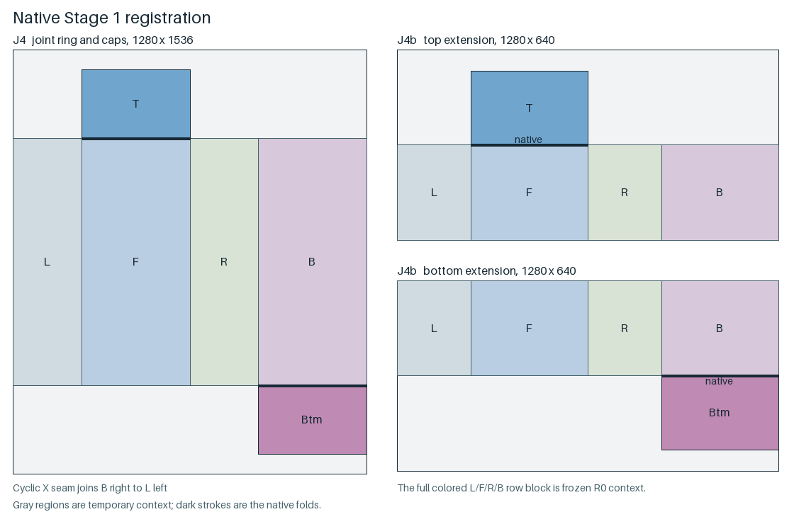
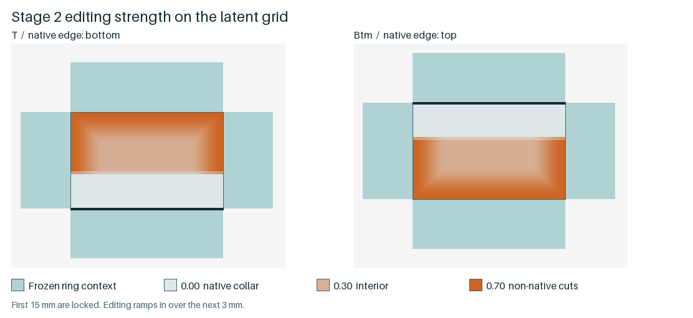
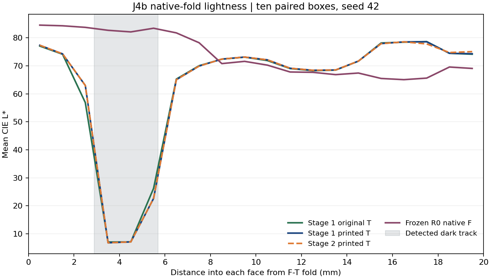
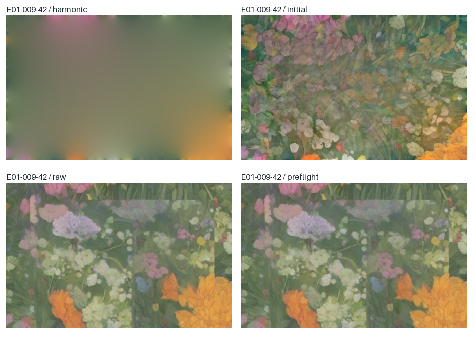
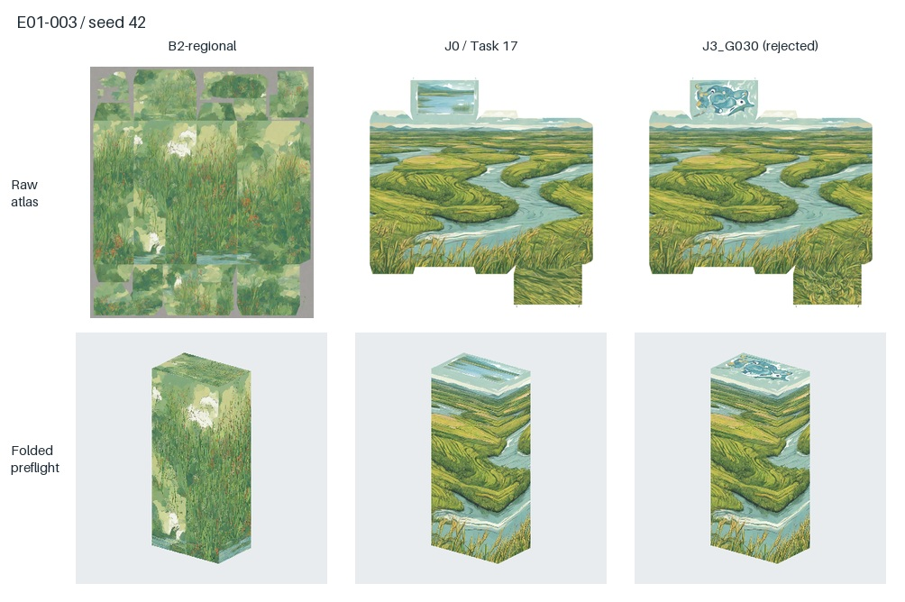
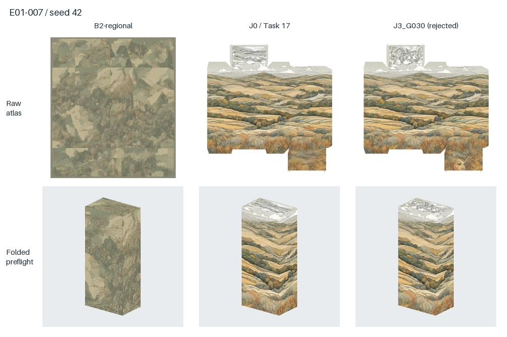
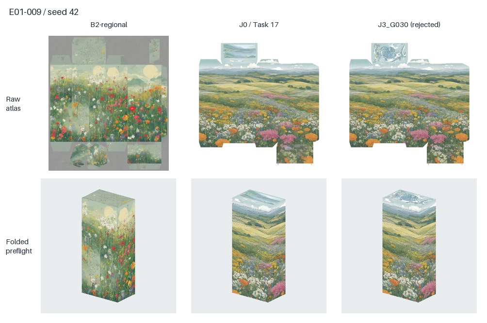

# E02 · 去噪引导与联合环盖生成

**硬筛选没有留下合格配置。在六项主目标胜项最多的候选中，J3 γ=0.30 的条带 v1 最低。原 J0 关口复核为种子 42 4/5、种子 1234 5/5，本轮没有新配置进入种子 1234 复验，停在 Step 1。**

## 配置与分阶段比较

J0 是已审查的 U1-σ28 归档。J1 仅净化盖面正负提示词，J2 使用环带共用的 4 通道 SDXL base，每步混合同一时间步加噪的冻结已知潜变量，最后 3 步在已知侧用 1 个潜格羽化。J3 以完整 30 步索引的 6–22 步每两步对预测洁净潜变量做单向高通标准差上托，逐通道取真实邻面 9–12 mm 参考，保护距已知边 3 mm。 [配置](../../../code/configs/E02_joint_cap.yaml) · [Blended Latent Diffusion 原文](https://omriavrahami.com/blended-latent-diffusion-page/)

| 步骤 | 基础配置 | 原因 |
| --- | --- | --- |
| J2 | J0 | 两组均未过硬筛，沿用登记对照完成机制对照 |
| J3 | J1 | 两组均未过硬筛，按六项胜数和 v1 排序做机制对照 |

## 种子 42 · 硬筛选与六项主目标

| 方法 | 胜 J0 项数 | 盖侧 ΔE00 | 盖侧 LPIPS | 七缝 SDR | 七缝 LPIPS | 原出血 % | M3 % | 全盒 v1 | CLIPScore | ImageReward |
| --- | --- | --- | --- | --- | --- | --- | --- | --- | --- | --- |
| J0 | 0 | 4.1045 | 0.3747 | 1.5630 | 0.3449 | 67.4601 | 58.5225 | 1.7209 | 0.6874 | -1.6541 |
| J1 | 6 | 4.0185 | 0.3679 | 1.5157 | 0.3392 | 67.4790 | 58.6557 | 1.4933 | 0.6733 | -1.6900 |
| J2 | 0 | 7.6353 | 0.4111 | 2.7118 | 0.3761 | 66.5324 | 56.8645 | 1.2724 | 0.6948 | -1.5734 |
| J3_G020 | 6 | 4.0422 | 0.3690 | 1.5058 | 0.3400 | 67.5386 | 58.6129 | 1.2990 | 0.6725 | -1.6832 |
| J3_G030 | 6 | 4.0513 | 0.3702 | 1.4999 | 0.3411 | 67.5137 | 58.5764 | 1.2539 | 0.6724 | -1.6754 |
| J4B | 0 | 19.3966 | 0.5236 | 6.1379 | 0.4726 | 52.8227 | 46.8572 | 1.2244 | 0.6670 | -1.6294 |

| 方法 | 硬筛选 | 预算 | CLIP | ImageReward | 顶盖下限 | 底盖下限 | 超过2倍的盖 | 目视标记盒 |
| --- | --- | --- | --- | --- | --- | --- | --- | --- |
| J0 | 未过 | 通过 | 通过 | 通过 | 通过 | 通过 | 0 | 2 |
| J1 | 未过 | 通过 | 通过 | 通过 | 通过 | 通过 | 0 | 5 |
| J2 | 未过 | 通过 | 通过 | 通过 | 通过 | 通过 | 0 | 5 |
| J3_G020 | 未过 | 通过 | 通过 | 通过 | 通过 | 通过 | 0 | 5 |
| J3_G030 | 未过 | 通过 | 通过 | 通过 | 通过 | 通过 | 0 | 4 |
| J4B | 未过 | 通过 | 通过 | 通过 | 通过 | 通过 | 5 | 7 |

| 方法 | 均值 s / 盒 | 最长 s / 盒 | 峰值 GiB |
| --- | --- | --- | --- |
| J0 | 54.90 | 57.59 | 10.283 |
| J1 | 55.94 | 59.40 | 10.282 |
| J2 | 55.71 | 58.99 | 10.272 |
| J3_G020 | 54.95 | 58.39 | 10.273 |
| J3_G030 | 54.53 | 55.29 | 10.275 |
| J4B | 33.64 | 34.99 | 10.178 |

预算使用 RTX 3090 的逐盒实际开销，包含冻结环带归档计时以及该候选生成时的盖面阶段。 [选型详情](joint-cap-selection.json) · [原像素盖面记录](joint-cap-content-review.json)

## 逐毫米能量与最差两盒

| 种子 | 方法 | 背—底 9–12 mm | 正—顶 9–12 mm | 冻结 v1 最差两盒 | 环带及盖面逐毫米记录 |
| --- | --- | --- | --- | --- | --- |
| 42 | J0 | 0.989 | 1.067 | E01-003（3.1078）、E01-007（2.6390） | [曲线图](joint-cap-curves/j0-42.png) · [CSV](joint-cap-curves/j0-42.csv) · [核验](joint-cap-curves/j0-42.json) |
| 42 | J1 | 1.110 | 1.957 | E01-003（2.7455）、E01-009（1.7030） | [曲线图](joint-cap-curves/j1-42.png) · [CSV](joint-cap-curves/j1-42.csv) · [核验](joint-cap-curves/j1-42.json) |
| 42 | J2 | 1.123 | 1.717 | E01-009（1.7030）、E01-001（1.5491） | [曲线图](joint-cap-curves/j2-42.png) · [CSV](joint-cap-curves/j2-42.csv) · [核验](joint-cap-curves/j2-42.json) |
| 42 | J3_G020 | 1.506 | 2.269 | E01-009（1.7030）、E01-003（1.6649） | [曲线图](joint-cap-curves/j3_g020-42.png) · [CSV](joint-cap-curves/j3_g020-42.csv) · [核验](joint-cap-curves/j3_g020-42.json) |
| 42 | J3_G030 | 1.743 | 2.448 | E01-009（1.7030）、E01-007（1.4764） | [曲线图](joint-cap-curves/j3_g030-42.png) · [CSV](joint-cap-curves/j3_g030-42.csv) · [核验](joint-cap-curves/j3_g030-42.json) |
| 42 | J4B | 3.664 | 4.268 | E01-009（1.7030）、E01-007（1.4764） | [曲线图](joint-cap-curves/j4b-42.png) · [CSV](joint-cap-curves/j4b-42.csv) · [核验](joint-cap-curves/j4b-42.json) |
| 1234 | J0 | 0.815 | 1.115 | E01-005（1.4982）、E01-001（1.4204） | [曲线图](joint-cap-curves/j0-1234.png) · [CSV](joint-cap-curves/j0-1234.csv) · [核验](joint-cap-curves/j0-1234.json) |

能量单位为 ×10⁻³。原生折线按冻结的 4 px/mm 网格量切向首差平方。J0–J3 初图为实际 SDEdit 输入或经哈希核对的旧档重建。联合候选的初图为 Stage 1 归档。

## J4 · 双种子闸门 1

两段式从 896 × 1088 定构图 28 步开始。完整环形 RGB 双三次放大到 1280 × 1536，然后以 0.47 跑 14 步细化。盖深按盒型尺寸计算再加 64 px 缓冲。顶盖在 F 上方，底盖在 B 下方。F 与 B 的主体区域在盒身中部 60%，上下段与延长区共享纹理条件，区域交界羽化 ±6 个潜行。

细化备选提高到 0.55，执行 16 个 DDIM 后缀步。

ScaleCrafter 备选以 1280 × 1536 一次运行 30 步。仅第 0–9 步对 `down_blocks.2`、`mid_block`、`up_blocks.0` 的目标卷积应用纵向 2×、横向 1× 空洞。 [ScaleCrafter 原文](https://proceedings.iclr.cc/paper_files/paper/2024/file/a39ab46bf619ada0e90ceed846648a81-Paper-Conference.pdf)



### coarse_047 · 未过

| 种子 | 检查 | R0 | 实测 | 上限 | 判定 |
| --- | --- | --- | --- | --- | --- |
| 42 | 侧面四缝 ΔE00 | 4.2401 | 3.1376 | 4.4521 | 通过 |
| 42 | 侧面四缝 LPIPS | 0.1831 | 0.1693 | 0.1922 | 通过 |
| 42 | 环带单侧下界 | 1.2244 | 1.2871 | 1.2244 | 未过 |
| 42 | M4 重复度 | 0.8492 | 0.8384 | 0.8692 | 通过 |
| 42 | 正—顶盖面侧 v1 最大值 | — | 2.6724 | 1.1500 | 未过 |
| 42 | 背—底盖面侧 v1 最大值 | — | 3.5523 | 1.1500 | 未过 |
| 42 | Stage 1 最长 s | — | 20.4373 | 60.0000 | 通过 |
| 42 | Stage 1 峰值 MiB | — | 12267.0615 | 20480.0000 | 通过 |
| 42 | 原像素横幅盒数 | 1.0000 | 3.0000 | 1.0000 | 未过 |
| 1234 | 侧面四缝 ΔE00 | 3.6178 | 3.0810 | 3.7987 | 通过 |
| 1234 | 侧面四缝 LPIPS | 0.2115 | 0.2471 | 0.2221 | 未过 |
| 1234 | 环带单侧下界 | 1.2798 | 3.5986 | 1.2798 | 未过 |
| 1234 | M4 重复度 | 0.7885 | 0.7190 | 0.8085 | 通过 |
| 1234 | 正—顶盖面侧 v1 最大值 | — | 1.9048 | 1.1500 | 未过 |
| 1234 | 背—底盖面侧 v1 最大值 | — | 1.7058 | 1.1500 | 未过 |
| 1234 | Stage 1 最长 s | — | 20.1247 | 60.0000 | 通过 |
| 1234 | Stage 1 峰值 MiB | — | 12268.3896 | 20480.0000 | 通过 |
| 1234 | 原像素横幅盒数 | 0.0000 | 1.0000 | 0.0000 | 未过 |

| 种子 | 方案 | 四侧 2× 留存均值 | 顶盖留存 | 底盖留存 | F 面 CLIP | 四侧 CLIP |
| --- | --- | --- | --- | --- | --- | --- |
| 42 | r0 | 1.931 | — | — | 0.7217 | 0.7068 |
| 42 | coarse_047 | 2.266 | 2.361 | 2.246 | 0.6301 | 0.6467 |
| 1234 | r0 | 2.150 | — | — | 0.7311 | 0.7313 |
| 1234 | coarse_047 | 2.590 | 2.636 | 2.513 | 0.7340 | 0.7131 |

同种子四侧原尺度纹理能量下降，且原生盖折触发 1.15 闸门，登记为锐度备选的触发条件。

[逐盒评分](joint-cap-gate1/coarse_047/gate1-scores.csv) · [逐折指标](joint-cap-gate1/coarse_047/gate1-folds.csv) · [明细](joint-cap-gate1/coarse_047/gate1.json)

### coarse_055 · 未过

| 种子 | 检查 | R0 | 实测 | 上限 | 判定 |
| --- | --- | --- | --- | --- | --- |
| 42 | 侧面四缝 ΔE00 | 4.2401 | 3.1337 | 4.4521 | 通过 |
| 42 | 侧面四缝 LPIPS | 0.1831 | 0.1697 | 0.1922 | 通过 |
| 42 | 环带单侧下界 | 1.2244 | 1.3089 | 1.2244 | 未过 |
| 42 | M4 重复度 | 0.8492 | 0.8485 | 0.8692 | 通过 |
| 42 | 正—顶盖面侧 v1 最大值 | — | 2.8898 | 1.1500 | 未过 |
| 42 | 背—底盖面侧 v1 最大值 | — | 3.5199 | 1.1500 | 未过 |
| 42 | Stage 1 最长 s | — | 21.5168 | 60.0000 | 通过 |
| 42 | Stage 1 峰值 MiB | — | 12267.0615 | 20480.0000 | 通过 |
| 42 | 原像素横幅盒数 | 1.0000 | 3.0000 | 1.0000 | 未过 |
| 1234 | 侧面四缝 ΔE00 | 3.6178 | 2.9037 | 3.7987 | 通过 |
| 1234 | 侧面四缝 LPIPS | 0.2115 | 0.2458 | 0.2221 | 未过 |
| 1234 | 环带单侧下界 | 1.2798 | 3.2556 | 1.2798 | 未过 |
| 1234 | M4 重复度 | 0.7885 | 0.7207 | 0.8085 | 通过 |
| 1234 | 正—顶盖面侧 v1 最大值 | — | 1.7020 | 1.1500 | 未过 |
| 1234 | 背—底盖面侧 v1 最大值 | — | 1.3884 | 1.1500 | 未过 |
| 1234 | Stage 1 最长 s | — | 21.1982 | 60.0000 | 通过 |
| 1234 | Stage 1 峰值 MiB | — | 12268.3896 | 20480.0000 | 通过 |
| 1234 | 原像素横幅盒数 | 0.0000 | 1.0000 | 0.0000 | 未过 |

| 种子 | 方案 | 四侧 2× 留存均值 | 顶盖留存 | 底盖留存 | F 面 CLIP | 四侧 CLIP |
| --- | --- | --- | --- | --- | --- | --- |
| 42 | r0 | 1.931 | — | — | 0.7217 | 0.7068 |
| 42 | coarse_055 | 2.254 | 2.333 | 2.211 | 0.6378 | 0.6483 |
| 1234 | r0 | 2.150 | — | — | 0.7311 | 0.7313 |
| 1234 | coarse_055 | 2.600 | 2.651 | 2.550 | 0.7390 | 0.7190 |

同种子四侧原尺度纹理能量下降，且原生盖折触发 1.15 闸门，登记为锐度备选的触发条件。

[逐盒评分](joint-cap-gate1/coarse_055/gate1-scores.csv) · [逐折指标](joint-cap-gate1/coarse_055/gate1-folds.csv) · [明细](joint-cap-gate1/coarse_055/gate1.json)

### redilation · 未过

| 种子 | 检查 | R0 | 实测 | 上限 | 判定 |
| --- | --- | --- | --- | --- | --- |
| 42 | 侧面四缝 ΔE00 | 4.2401 | 3.8307 | 4.4521 | 通过 |
| 42 | 侧面四缝 LPIPS | 0.1831 | 0.1855 | 0.1922 | 通过 |
| 42 | 环带单侧下界 | 1.2244 | 1.1954 | 1.2244 | 通过 |
| 42 | M4 重复度 | 0.8492 | 0.8788 | 0.8692 | 未过 |
| 42 | 正—顶盖面侧 v1 最大值 | — | 1.6678 | 1.1500 | 未过 |
| 42 | 背—底盖面侧 v1 最大值 | — | 1.0000 | 1.1500 | 通过 |
| 42 | Stage 1 最长 s | — | 20.7184 | 60.0000 | 通过 |
| 42 | Stage 1 峰值 MiB | — | 12266.4287 | 20480.0000 | 通过 |
| 42 | 原像素横幅盒数 | 1.0000 | 0.0000 | 1.0000 | 通过 |
| 1234 | 侧面四缝 ΔE00 | 3.6178 | 4.6010 | 3.7987 | 未过 |
| 1234 | 侧面四缝 LPIPS | 0.2115 | 0.2180 | 0.2221 | 通过 |
| 1234 | 环带单侧下界 | 1.2798 | 1.2083 | 1.2798 | 通过 |
| 1234 | M4 重复度 | 0.7885 | 0.8592 | 0.8085 | 未过 |
| 1234 | 正—顶盖面侧 v1 最大值 | — | 1.1137 | 1.1500 | 通过 |
| 1234 | 背—底盖面侧 v1 最大值 | — | 1.2888 | 1.1500 | 未过 |
| 1234 | Stage 1 最长 s | — | 20.5125 | 60.0000 | 通过 |
| 1234 | Stage 1 峰值 MiB | — | 12267.7568 | 20480.0000 | 通过 |
| 1234 | 原像素横幅盒数 | 0.0000 | 0.0000 | 0.0000 | 通过 |

| 种子 | 方案 | 四侧 2× 留存均值 | 顶盖留存 | 底盖留存 | F 面 CLIP | 四侧 CLIP |
| --- | --- | --- | --- | --- | --- | --- |
| 42 | r0 | 1.931 | — | — | 0.7217 | 0.7068 |
| 42 | redilation | 1.879 | 1.911 | 1.927 | 0.6573 | 0.6729 |
| 1234 | r0 | 2.150 | — | — | 0.7311 | 0.7313 |
| 1234 | redilation | 1.914 | 1.949 | 1.822 | 0.6544 | 0.6576 |

同种子四侧原尺度纹理能量下降，且原生盖折触发 1.15 闸门，登记为锐度备选的触发条件。

[逐盒评分](joint-cap-gate1/redilation/gate1-scores.csv) · [逐折指标](joint-cap-gate1/redilation/gate1-folds.csv) · [明细](joint-cap-gate1/redilation/gate1.json)

[横幅原像素记录](joint-cap-banner-review.json) · [Stage 1 取舍](joint-cap-j4-stage1.json)

原冻结的七条非原生缝包含 L–B 环带闭合缝。闸门 1 的四侧环带邻接表沿用同一物理带宽补齐其余三个环带折线。闸门的两个盖面侧比值在各盒各折上分别限于 1.15。

闸门 1 止损，J4 未进入 Stage 2。

## J4b · 冻结 R0 条带外扩和 Stage 2

J4b 从冻结 R0 的整圈顶部或底部取 320 px 条带，在 1280 × 640 的周期画布开放一侧。22 步完成一次延展，只保留 F 上方与 B 下方的实际盖面。两盖再用 Differential Diffusion 缝合三条非原生边。距原生折 0–15 mm 锁定，内侧强度为 0.30，三条非原生边的 15 mm 带内最高升到 0.70。R0 主体及支持像素逐位核对。 [Differential Diffusion 原文](https://differential-diffusion.github.io/)

按 J2 对 J0 的同组分层比较，Stage 2 使用 原 9 通道 inpainting。



J4B 的全盒 v1 为 1.2244，达到 1.2528 的上限要求，因此未触发 J5。 [J5 触发判定](joint-cap-j5-plan.json)

## 双种子关口

以下各行使用各自种子的五个原始基线。两种子均为 J0 归档复核。

| 种子 | 检查 | 测量 | 结果 |
| --- | --- | --- | --- |
| 42 | 七条非原生缝 | 七缝 SDR 1.5630（两原对照 4.4175 / 4.6199）。七缝 LPIPS 0.3449（两原对照 0.3646 / 0.4135） | 通过 |
| 42 | 双口径出血 | 原出血 % 67.4601（两原对照 52.9962 / 52.8471）。M3 % 58.5225（两原对照 28.4607 / 47.3847） | 通过 |
| 42 | 条带 v1 与原像素 | 1.7209 / 上限 1.2528，沿折伪影 0/10 盒 | 未过 |
| 42 | CLIPScore 单侧 | 0.6874 / 下限 0.6362 | 通过 |
| 42 | 逐盒硬件 | 57.59 s，10.283 GiB | 通过 |
| 1234 | 七条非原生缝 | 七缝 SDR 2.0241（两原对照 4.6048 / 5.7941）。七缝 LPIPS 0.3540（两原对照 0.3694 / 0.4423） | 通过 |
| 1234 | 双口径出血 | 原出血 % 62.3479（两原对照 51.8315 / 52.8265）。M3 % 51.2440（两原对照 48.9578 / 50.5284） | 通过 |
| 1234 | 条带 v1 与原像素 | 1.3026 / 上限 1.3832，沿折伪影 0/10 盒 | 通过 |
| 1234 | CLIPScore 单侧 | 0.7036 / 下限 0.6460 | 通过 |
| 1234 | 逐盒硬件 | 55.71 s，10.282 GiB | 通过 |

[关口 JSON](gate-joint-cap.json) · [逐盒评分 CSV](results-joint-cap.csv) · [复验折线原像素判读](joint-cap-fold-review.json)

## 逐折来源和法向剖面

| 种子 | 原生折线 | 均值 v1 | 环带侧 | 盖面侧 |
| --- | --- | --- | --- | --- |
| 42 | B-Btm | 1.5886 | 1.0096 | 1.5790 |
| 42 | B-R | 1.1090 | 1.1090 | 1.0000 |
| 42 | F-L | 1.0066 | 1.0066 | 1.0000 |
| 42 | F-R | 1.0469 | 1.0469 | 1.0000 |
| 42 | F-T | 1.2203 | 1.1449 | 1.0754 |
| 1234 | B-Btm | 1.1687 | 1.0939 | 1.0748 |
| 1234 | B-R | 1.1107 | 1.1107 | 1.0000 |
| 1234 | F-L | 1.0860 | 1.0860 | 1.0000 |
| 1234 | F-R | 1.1764 | 1.1764 | 1.0000 |
| 1234 | F-T | 1.0464 | 1.0018 | 1.0446 |

| 种子 | 最差盒 | 控制折线 | 全盒 v1 | 环带超额 | 盖面超额 |
| --- | --- | --- | --- | --- | --- |
| 42 | E01-003 | B-Btm | 3.1078 | 0.0000 | 2.1078 |
| 42 | E01-007 | B-Btm | 2.6390 | 0.0957 | 1.5432 |
| 42 | E01-009 | F-T | 2.1842 | 0.7030 | 0.4812 |
| 1234 | E01-005 | F-R | 1.4982 | 0.4982 | 0.0000 |
| 1234 | E01-001 | F-L | 1.4204 | 0.4204 | 0.0000 |
| 1234 | E01-010 | B-Btm | 1.4152 | 0.3416 | 0.0736 |

| 种子 | 候选 | 盖折 | 0–3 / 3–9 mm 平均绝对 L* 差 | 单侧法向峰 L*/mm | 折点绝对 L* |
| --- | --- | --- | --- | --- | --- |
| 42 | J0 | F-T | 2.559 | 8.873 | 0.552 |
| 42 | J0 | B-Btm | 2.602 | 7.006 | 2.080 |
| 42 | J1 | F-T | 2.840 | 5.753 | 0.580 |
| 42 | J1 | B-Btm | 2.367 | 6.271 | 2.315 |
| 42 | J2 | F-T | 2.658 | 9.134 | 0.974 |
| 42 | J2 | B-Btm | 2.584 | 10.134 | 3.717 |
| 42 | J3_G020 | F-T | 2.911 | 6.083 | 0.580 |
| 42 | J3_G020 | B-Btm | 2.383 | 6.202 | 2.310 |
| 42 | J3_G030 | F-T | 2.969 | 6.147 | 0.589 |
| 42 | J3_G030 | B-Btm | 2.344 | 6.239 | 2.301 |
| 42 | J4B | F-T | 29.881 | 165.306 | 5.662 |
| 42 | J4B | B-Btm | 5.055 | 25.019 | 3.382 |
| 1234 | J0 | F-T | 2.637 | 8.515 | 1.154 |
| 1234 | J0 | B-Btm | 0.899 | 3.166 | 0.898 |

[逐盒逐折](joint-cap-stripe-sources.csv) · [法向原始数据](joint-cap-normal-profile.csv)

J1 的六项主指标均优于 J0，背—底折的 9–12 mm 成图切向能量由 0.989 增至 1.110（×10⁻³），全盒 v1 从 1.7209 降到 1.4933。J2 把背—底参考带升到 1.123，全盒 v1 进一步降到 1.2724。它的盖侧 ΔE00 从 4.1045 升到 7.6353，LPIPS 从 0.3747 升到 0.4111，六项排序目标均未战胜 J0。J2 最差样本是 E01-009 的正—顶折（v1 1.7030），峰值的超额全部来自 R0 环带侧。两档各有 5/10 盒出现明显拼贴，均未过目视硬筛。

J3 γ=0.20 把十盒背—底折 9–12 mm 参考带能量从 1.110 提高到 1.506（×10⁻³），0–3 mm 近折能量也从 1.790 升至 1.907。E01-003 的参考带从 0.601 升到 1.292，该折 v1 由 2.7455 降至 1.6649。E01-007 的参考带从 0.571 升至 0.860，近折能量也上升。J3 γ=0.20 的全盒 v1 降至 1.2990，五盒的拼贴仍使硬筛未过。γ=0.30 将参考带进一步提高到 1.743、近折带提高到 1.980。全盒 v1 为 1.253929，仍比 1.252775 高 0.001154，还有四盒出现明显拼贴。

J4b 的全盒 v1 为 1.2244，等于同种子 R0 的环带单侧下界。有五个盖面的整体能量超过各自环带的 2 倍。十盒顶盖在距原生折约 3–6 mm 处出现明显暗带，七盒还出现明显拼贴。暗带在 Stage 1 原始顶盖已出现，Stage 2 在原生折内 15 mm 的像素锁定保留了它。冻结 v1 使用 0–3 mm 与 9–12 mm 的切向能量，3–6 mm 处主要沿折延伸的暗带需要靠法向剖面和原像素识别。

通过连续行中 RGB 三通道均低于 55 的肉眼可见暗像素补充定位。J4b 原始顶盖中暗带已覆盖约 99.7–100% 的对应行宽，距原生折 2.99–5.53 mm。最终顶盖在 3–4 和 4–5 mm 的平均 L* 为 6.80 和 7.13，R0 正面相应距离为 82.70 和 82.13。复位核对用原始盖面投影和 Stage 2 原生锁核查。 [逐盒法向取样](joint-cap-diagnosis/dark-band.json)



[003 原像素](joint-cap-diagnosis/E01-003-42-native-evidence.png) · [007 原像素](joint-cap-diagnosis/E01-007-42-native-evidence.png) · [009 原像素](joint-cap-diagnosis/E01-009-42-native-evidence.png)

## E01-009 底盖浅矩形亮阶

调和图与精确的 U1-σ28 初图没有出现原成图中对齐的直边。原始成图的上缘 ΔL* 为 +6.554，相同位置在初图为 +0.366。原始与印前底盖 448 × 288 像素完全一致，矩形附近属于同一盖面内部，没有已知掩码或组装分区边界。证据将出现位置缩小在初图至原成图的生成过程，包括 VAE、去噪与色域约束。



[坐标、哈希和阶段数值](joint-cap-diagnosis/rectangle-stage-proof.json) · [各候选的 E01-009 底盖原像素](joint-cap-diagnosis/e01-009-all-bottoms.png) · [原亮阶位置的 ΔL*](joint-cap-diagnosis/e01-009-rectangle-positions.csv)

按原图核对 J1、J2 和两档 J3 的实际 SDEdit 初图与 J0 相同。有环盖外扩及缝合的候选，逐像素核对原生折内 15 mm 和相应环带区域。 [初图、环带及原生保护区核验](joint-cap-diagnosis/source-audit.json)

| 候选 | E01-009 原像素判读 |
| --- | --- |
| J0 | 顶盖保留有外框的蓝灰层状山谷。底盖扩大查看可见浅绿色半透明矩形，其上横边和右竖边截断同一花田的花叶，矩形内外亮度突变，判为明显拼贴。未见偏移重影或镜像复刻。 |
| J1 | 底盖保留 J0 同位置的浅矩形亮阶。上缘横切花田，右侧竖直边切断绿色叶丛和橙花。顶部改为蓝灰旋纹。 |
| J2 | 底盖在同类位置形成面积更大的矩形风景片，顶端与右侧外露的原背景突变，右侧硬边仍约在相同横坐标。顶盖也形成有直边的内置山景框。 |
| J3_G020 | 底盖保留浅矩形亮阶，上沿截断花田，右竖边切断绿叶和橙花，位置与 J1 基本一致。顶盖延续蓝灰旋纹。 |
| J3_G030 | 底盖中央偏右仍有浅色半透明矩形，水平上沿和垂直左沿构成明显直角，沿边切断草叶、茎秆及细花轮廓。顶盖蓝色波纹连贯，两盖均未见可确认的重影或镜像重复。 |
| J4B | 顶盖暖色人物与陈列画在距 F–T 折线约 3–5.5 mm 的黑条处硬切到浅蓝带和白云。底盖为连续植叶与粉花，旧 E0 的无描边浅矩形亮阶在该图上不再可辨。 |

J4 三档 Stage 1 的 E01-009 底盖均未见 J0 对应位置的浅矩形亮阶。闸门 1 失败，对应图像停在三边缝合之前。 [J0 与三档 J4 Stage 1 的底盖原像素](joint-cap-diagnosis/e01-009-j4-stage1-bottoms.png)

## 实验样图

### 种子 42



[E01-003 顶底盖原像素](joint-cap-examples/seed-42/E01-003-lids.png)



[E01-007 顶底盖原像素](joint-cap-examples/seed-42/E01-007-lids.png)



[E01-009 顶底盖原像素](joint-cap-examples/seed-42/E01-009-lids.png)

[图像来源与哈希](joint-cap-examples/manifest.json)

## 复现

完整实验数据在 AutoDL 数据盘 `/root/autodl-tmp/ai-design/outputs/e02/joint-cap/runs/3411a058f0e6`。命令复用已归档的 R0、五个基线以及绑定原图的人工审核结果。从新生成原图时按命令输出的位置补上当前盖面、横幅和五折判读。

```bash
bash code/scripts/run_E02_joint_cap.sh
```

[输入登记](joint-cap-inputs.json) · [完整数值](joint-cap-evaluation.json)
