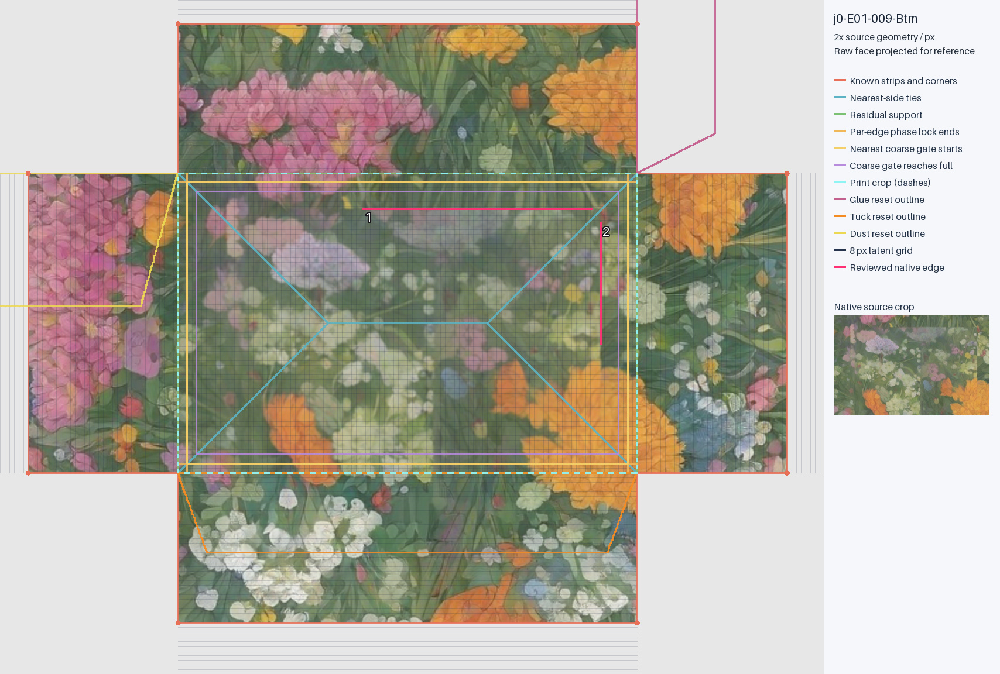
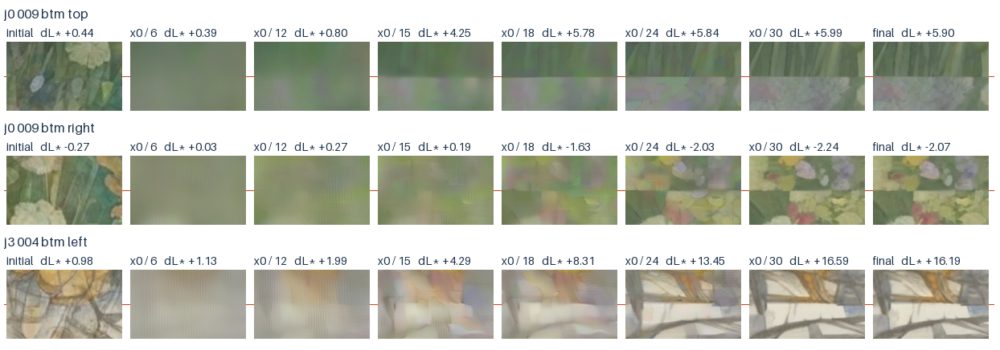
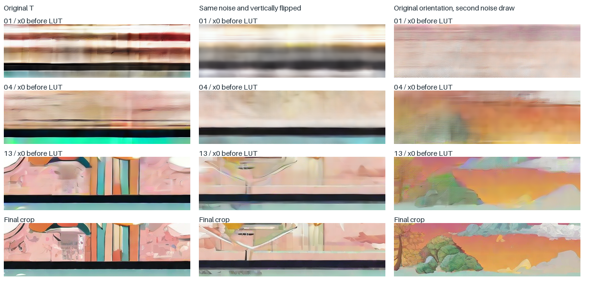
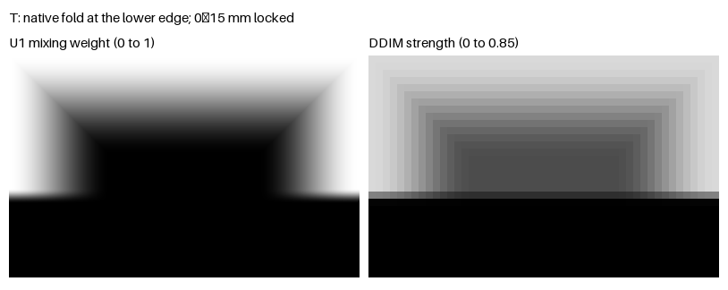
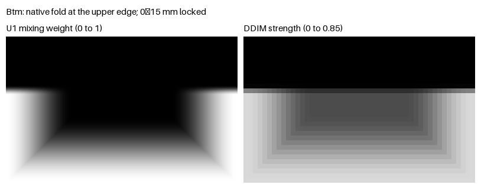
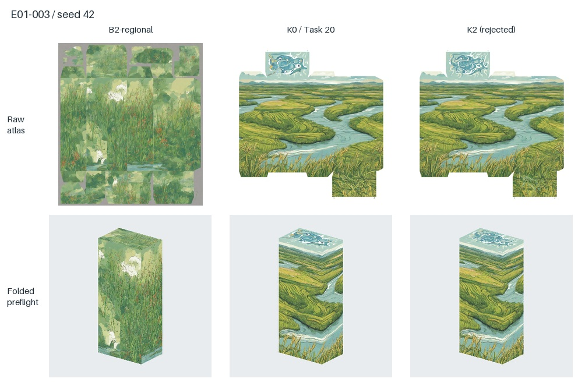
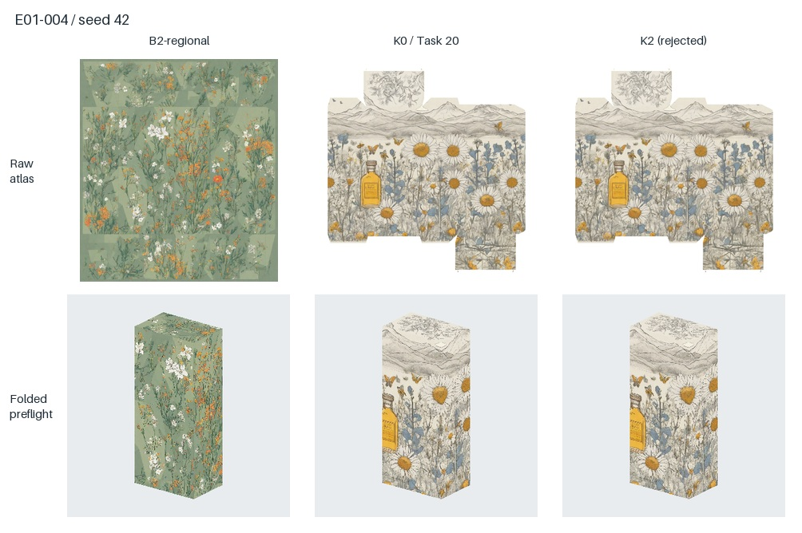
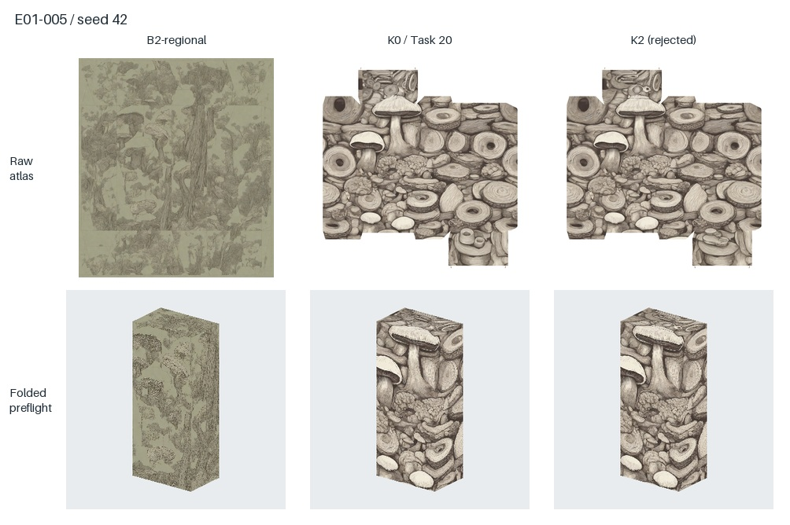
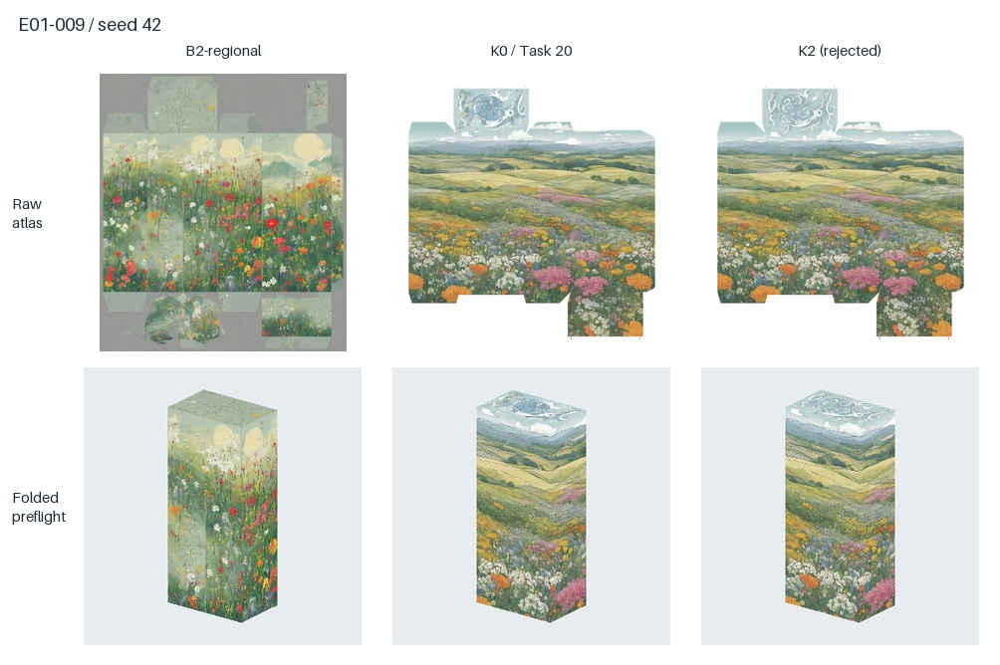
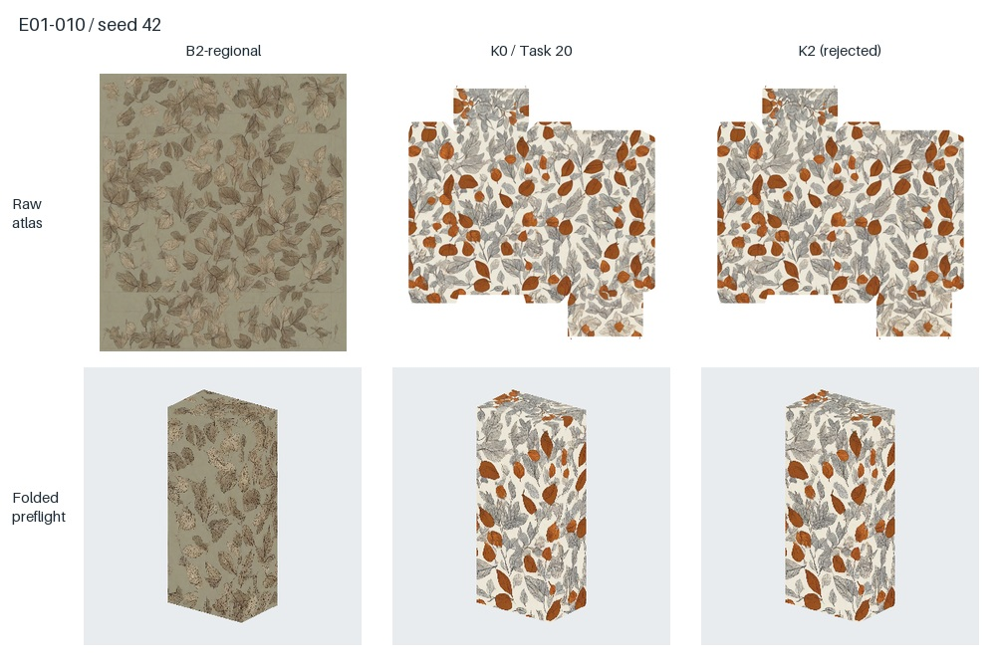

# E02 · 盖面贴片与顶盖暗带修复

**两例盖面贴片的贯通直边在去噪中形成，21 段硬边未与固定几何边界持续重合。J4b 的整行顶盖暗带由十盒反复使用的首个噪声实现触发，按盒和盖派生的固定噪声移除了这条系统性暗带。没有候选通过全部硬筛。按六项主目标胜数排序，同分比较 v1，K2 在未合格样例中排首位。原 J0 归档在 42、1234 分别通过 4/5、5/5，本轮没有新配置进入 1234 复验。停在 Step 1，等待 Claude 审查。**

## 贴片几何叠图与逐步洁净估计

11 个已标记的盖面共量了 21 段直边。使用各段至少 80% 的长度落在 1 个印刷原生像素误差内作为共线判据，固定掩码边与角点、最近边分区、高通支撑及其相位与完整粗项边界、裁切及插舌／防尘翼／糊头复位均为 0/21。E01-009 底盖的上边与右边距掩码分别为 60.44、63.00 个 2× 像素。E01-004 底盖左边距掩码 82.25 px，距最近边分区的中位数为 16.89 px。21 段里只有 4 段在 1 个模型像素内贴着同一条平行潜格线，6 段在 2 px 内。由整数原生像素换算到 2× 格点的偶合参考约为 29.9% 和 53.9%。跨方法的同一边视为重复观测。11 个原始盖面与印前复位图的相应裁区逐像素相同。 [逐段距离 CSV](panel-fix-diagnostics/panel-edges.csv) · [几何证据](panel-fix-diagnostics/panel-geometry.json)



[J0 004](panel-fix-diagnostics/overlay/j0-E01-004-Btm-geometry-2x.jpg) · [J1 004](panel-fix-diagnostics/overlay/j1-E01-004-Btm-geometry-2x.jpg) · [J1 005](panel-fix-diagnostics/overlay/j1-E01-005-T-geometry-2x.jpg) · [J1 007](panel-fix-diagnostics/overlay/j1-E01-007-T-geometry-2x.jpg) · [J1 009](panel-fix-diagnostics/overlay/j1-E01-009-Btm-geometry-2x.jpg) · [J1 010](panel-fix-diagnostics/overlay/j1-E01-010-T-geometry-2x.jpg) · [J3 004](panel-fix-diagnostics/overlay/j3_g030-E01-004-Btm-geometry-2x.jpg) · [J3 005](panel-fix-diagnostics/overlay/j3_g030-E01-005-T-geometry-2x.jpg) · [J3 009](panel-fix-diagnostics/overlay/j3_g030-E01-009-Btm-geometry-2x.jpg) · [J3 010](panel-fix-diagnostics/overlay/j3_g030-E01-010-T-geometry-2x.jpg)

两次 3090 回放的完整刀版均与归档逐像素一致。J0 的 E01-009 上缘，真实初图 ΔL* 为 +0.436，沿边同号占 50.6%。第 12 步为 +0.795，第 15 步为 +4.246，同号升至 96.2%。右缘在第 18–21 步成形。J3 的 E01-004 底盖左缘，真实初图为 +0.978、同号 52.9%。第 9 步已出现弱贯通结构，成品的装饰性亮阶在第 15–18 步清晰。证据支持去噪阶段生成卡片式分割。四边上下文仍可能影响其位置，未观察到需要修复的固定几何硬边。K1 按任务书只净化提示词。 [逐步取样](panel-fix-diagnostics/panel-x0-profiles.csv) · [回放校验](panel-fix-diagnostics/panel-x0-proof.json) · [Gemini 机制分析](https://github.com/Casey-sketch-cyber/ai-design/pull/22)



叠图以原 2× 分辨率压缩发布。逐像素核验使用数据盘上的无损原图。

## 顶盖暗带的复现、翻转与修复

原流程的 T 邻接已知区占画布第 40–79 潜行，来自 R0 第 8–47 潜行。Btm 使用画布第 0–39 潜行和 R0 第 80–119 潜行。两路索引无越界或重复，掩码和区域路由逐行核对。原 E01-003 顶底裁片均在 3090 上逐像素复现。旧顶盖第一个洁净估计就已有满宽暗带，早于 LUT 和末三步羽化。同一噪声下翻转外扩画布、掩码、条件和路由后暗带仍在，只翻转 VAE 解码也保留暗带。原方向只把噪声换成旧底盖的第二次抽样时，八个洁净估计与原尺度成图的旧型暗带均消失。所有测得潜变量及量化前 RGB 都有限，旧暗带像素在量化前已偏暗。 [逐行套准](panel-fix-diagnostics/dark/registration-rows.json) · [逐步浮点核验](panel-fix-diagnostics/dark/trace.json)



旧十盒 R0 缓存的外扩 RNG 状态具有同一 SHA-256。修复对每个预登记的种子、简报和盖面派生独立噪声，每盖只抽取一次。翻转只用于诊断。同图路由、冻结 R0 字节、调度和末三步保持一致。新 Stage 1 十盒均未重现旧 3–6 mm 厚暗带。E01-007 的原始顶盖在 2.8125 mm 有一条窄暗线，覆盖 84.44% 的单行，原始判定如实保留。投影至印刷刀版相应暗行最大覆盖为 63.17%。 [十盒原判](panel-fix-diagnostics/dark/precheck-42.json) · [旧暗带深度窗口](panel-fix-diagnostics/dark/historical-depth-window-42.json) · [E01-007 原像素](panel-fix-diagnostics/dark/E01-007-row-232.png)

## 固定 R0 的正式候选

K0 直接复用任务 20 的 J3 γ=0.30。K1 净化盖面正负提示词并保持相同初图、环带和去噪强度。K2 仅将 γ 从 0.30 提到 0.40。套准与初图哈希独立核验。 [配置](../../../code/configs/E02_panel_fix.yaml) · [初图和 R0 哈希核验](panel-fix-source-audit.json)

K3 和 K4 共用同一修复外扩。Stage 2 以真实 2× U1-σ28 初图为源，按实际像素覆盖面积从 784 × 512 配准至 392 × 248。非原生切边内 20 mm 将 U1 混合权重升至 1，去噪强度由内部 0.30 升至 0.85。原生折 0–15 mm 完整保留外扩图的像素，边界后 3 mm 平滑过渡。K4 再对当前步已释放的非零强度区域进行 J3 γ=0.30 引导。 [Differential Diffusion 原文](https://differential-diffusion.github.io/)





| 候选 | 胜 K0 项数 | 盖侧 ΔE00 | 盖侧 LPIPS | 七缝 SDR | 七缝 LPIPS | 原出血 % | M3 % | 条带 v1 | CLIPScore | ImageReward |
| --- | --- | --- | --- | --- | --- | --- | --- | --- | --- | --- |
| K0 | 0 | 4.0513 | 0.3702 | 1.4999 | 0.3411 | 67.5137 | 58.5764 | 1.2539 | 0.6724 | -1.6754 |
| K1 | 4 | 3.9146 | 0.3626 | 1.4666 | 0.3346 | 67.2373 | 58.3905 | 1.2376 | 0.6666 | -1.7077 |
| K2 | 4 | 3.9231 | 0.3629 | 1.4615 | 0.3349 | 67.2005 | 58.3035 | 1.2263 | 0.6660 | -1.7073 |
| K3 | 0 | 10.5132 | 0.4392 | 3.5228 | 0.4002 | 59.8033 | 52.5253 | 1.2552 | 0.6536 | -1.6634 |
| K4 | 0 | 10.5579 | 0.4393 | 3.5277 | 0.4003 | 59.8247 | 52.3997 | 1.2552 | 0.6529 | -1.6756 |

| 候选 | 硬筛选 | 预算 | CLIP | ImageReward | 顶盖下限 | 底盖下限 | 超过同盒环带 2 倍的盖 | 画面伪影盒 |
| --- | --- | --- | --- | --- | --- | --- | --- | --- |
| K0 | 未过 | 通过 | 通过 | 通过 | 通过 | 通过 | 0 | 4 |
| K1 | 未过 | 通过 | 通过 | 通过 | 通过 | 通过 | 0 | 1 |
| K2 | 未过 | 通过 | 通过 | 通过 | 通过 | 通过 | 0 | 1 |
| K3 | 未过 | 通过 | 通过 | 通过 | 通过 | 通过 | 2 | 2 |
| K4 | 未过 | 通过 | 通过 | 通过 | 通过 | 通过 | 2 | 3 |

| 候选 | 顶盖能量 ×10³ | 底盖能量 ×10³ | 顶盖／环带 | 底盖／环带 | 顶盖 2× 留存 | 底盖 2× 留存 |
| --- | --- | --- | --- | --- | --- | --- |
| K0 | 3.005 | 2.215 | 1.254 | 0.875 | 2.176 | 2.222 |
| K1 | 2.668 | 2.030 | 1.093 | 0.789 | 2.215 | 2.292 |
| K2 | 2.867 | 2.252 | 1.176 | 0.885 | 2.199 | 2.261 |
| K3 | 3.035 | 2.888 | 1.247 | 1.174 | 2.120 | 2.214 |
| K4 | 3.077 | 3.005 | 1.262 | 1.228 | 2.129 | 2.215 |

| 候选 | 均值 s／盒 | 最长 s／盒 | 峰值 GiB |
| --- | --- | --- | --- |
| K0 | 54.53 | 55.29 | 10.275 |
| K1 | 55.96 | 58.75 | 10.273 |
| K2 | 55.50 | 56.24 | 10.275 |
| K3 | 50.23 | 54.04 | 10.178 |
| K4 | 49.52 | 51.14 | 10.178 |

[硬筛和排序明细](panel-fix-selection.json) · [盖面逐盒原像素判读](panel-fix-cap-review.json)

## 逐毫米切向能量、最差两盒和法向剖面

| 种子 | 候选 | 盖折 | 初图 0–3 | 初图 9–12 | 成图 0–3 | 成图 9–12 | 冻结 v1 最差两盒 | 原数据 |
| --- | --- | --- | --- | --- | --- | --- | --- | --- |
| 42 | K0 | B-Btm | 2.259 | 1.298 | 1.980 | 1.743 | E01-009（1.7030）、E01-007（1.4764） | [曲线](panel-fix-curves/j3_g030-42.png) · [CSV](panel-fix-curves/j3_g030-42.csv) · [核验](panel-fix-curves/j3_g030-42.json) |
| 42 | K0 | F-T | 1.341 | 1.161 | 0.852 | 2.448 | E01-009（1.7030）、E01-007（1.4764） | [曲线](panel-fix-curves/j3_g030-42.png) · [CSV](panel-fix-curves/j3_g030-42.csv) · [核验](panel-fix-curves/j3_g030-42.json) |
| 42 | K1 | B-Btm | 2.259 | 1.298 | 1.734 | 1.647 | E01-009（1.7030）、E01-007（1.4764） | [曲线](panel-fix-curves/k1-42.png) · [CSV](panel-fix-curves/k1-42.csv) · [核验](panel-fix-curves/k1-42.json) |
| 42 | K1 | F-T | 1.341 | 1.161 | 0.828 | 1.889 | E01-009（1.7030）、E01-007（1.4764） | [曲线](panel-fix-curves/k1-42.png) · [CSV](panel-fix-curves/k1-42.csv) · [核验](panel-fix-curves/k1-42.json) |
| 42 | K2 | B-Btm | 2.259 | 1.298 | 1.788 | 1.844 | E01-009（1.7030）、E01-007（1.4764） | [曲线](panel-fix-curves/k2-42.png) · [CSV](panel-fix-curves/k2-42.csv) · [核验](panel-fix-curves/k2-42.json) |
| 42 | K2 | F-T | 1.341 | 1.161 | 0.848 | 2.042 | E01-009（1.7030）、E01-007（1.4764） | [曲线](panel-fix-curves/k2-42.png) · [CSV](panel-fix-curves/k2-42.csv) · [核验](panel-fix-curves/k2-42.json) |
| 42 | K3 | B-Btm | 1.865 | 2.585 | 1.865 | 2.585 | E01-009（1.7030）、E01-007（1.4764） | [曲线](panel-fix-curves/k3-42.png) · [CSV](panel-fix-curves/k3-42.csv) · [核验](panel-fix-curves/k3-42.json) |
| 42 | K3 | F-T | 1.583 | 2.198 | 1.583 | 2.198 | E01-009（1.7030）、E01-007（1.4764） | [曲线](panel-fix-curves/k3-42.png) · [CSV](panel-fix-curves/k3-42.csv) · [核验](panel-fix-curves/k3-42.json) |
| 42 | K4 | B-Btm | 1.865 | 2.585 | 1.865 | 2.585 | E01-009（1.7030）、E01-007（1.4764） | [曲线](panel-fix-curves/k4-42.png) · [CSV](panel-fix-curves/k4-42.csv) · [核验](panel-fix-curves/k4-42.json) |
| 42 | K4 | F-T | 1.583 | 2.198 | 1.583 | 2.198 | E01-009（1.7030）、E01-007（1.4764） | [曲线](panel-fix-curves/k4-42.png) · [CSV](panel-fix-curves/k4-42.csv) · [核验](panel-fix-curves/k4-42.json) |
| 1234 | J0 | B-Btm | 1.476 | 1.080 | 0.900 | 0.815 | E01-005（1.4982）、E01-001（1.4204） | [曲线](panel-fix-curves/j0-1234.png) · [CSV](panel-fix-curves/j0-1234.csv) · [核验](panel-fix-curves/j0-1234.json) |
| 1234 | J0 | F-T | 1.486 | 1.495 | 0.820 | 1.115 | E01-005（1.4982）、E01-001（1.4204） | [曲线](panel-fix-curves/j0-1234.png) · [CSV](panel-fix-curves/j0-1234.csv) · [核验](panel-fix-curves/j0-1234.json) |

能量单位为 ×10⁻³。K3、K4 的初图为实际输入 VAE 的高低分辨率混合图。环带的同位置参考带在每档图中单列。

| 种子 | 候选 | 盖折 | 0–3 对 3–9 mm 平均绝对 ΔL* | 法向峰 L*/mm | 折点绝对 ΔL* |
| --- | --- | --- | --- | --- | --- |
| 42 | K0 | B-Btm | 2.344 | 6.239 | 2.301 |
| 42 | K0 | F-T | 2.969 | 6.147 | 0.589 |
| 42 | K1 | B-Btm | 2.067 | 5.963 | 2.059 |
| 42 | K1 | F-T | 3.155 | 6.802 | 0.478 |
| 42 | K2 | B-Btm | 2.126 | 6.066 | 2.059 |
| 42 | K2 | F-T | 3.200 | 6.924 | 0.494 |
| 42 | K3 | B-Btm | 5.262 | 27.658 | 4.219 |
| 42 | K3 | F-T | 8.603 | 32.090 | 5.617 |
| 42 | K4 | B-Btm | 5.262 | 27.658 | 4.219 |
| 42 | K4 | F-T | 8.603 | 32.090 | 5.617 |
| 1234 | J0 | B-Btm | 0.899 | 3.166 | 0.898 |
| 1234 | J0 | F-T | 2.637 | 8.515 | 1.154 |

| 种子 | 候选 | 顶盖 0–9 mm 近黑行盒数 | 底盖 0–9 mm 近黑行盒数 | 顶盖 3–6 mm 平均 L* | 底盖 3–6 mm 平均 L* | 逐盒数据 |
| --- | --- | --- | --- | --- | --- | --- |
| 42 | K3 | 0 | 1 | 59.44 | 57.43 | [法向 1 mm 记录](panel-fix-dark-profiles/k3-42.json) |
| 42 | K4 | 0 | 1 | 59.44 | 57.43 | [法向 1 mm 记录](panel-fix-dark-profiles/k4-42.json) |

近黑行筛查复用任务 20 的行级定义。距原生折 9 mm 内，同一行至少 80% 像素的 RGB 三通道都低于 55。其余沿折伪影仍由原像素判读。

## 双种子五项关口

| 种子 | 检查 | 实测与基线 | 判定 |
| --- | --- | --- | --- |
| 42 | 七条非原生缝 | 七缝 SDR 1.5630（原 B2-regional 4.4175，B2-post 4.6199）。七缝 LPIPS 0.3449（原 B2-regional 0.3646，B2-post 0.4135） | 通过 |
| 42 | 双口径出血 | 原出血 % 67.4601（原 B2-regional 52.9962，B2-post 52.8471）。M3 % 58.5225（原 B2-regional 28.4607，B2-post 47.3847） | 通过 |
| 42 | 条带 v1 与原像素 | 1.7209 / 上限 1.2528，沿折伪影 0/10 盒 | 未过 |
| 42 | CLIPScore 单侧 | 0.6874 / 下限 0.6362 | 通过 |
| 42 | 逐盒硬件 | 最长 57.59 s，峰值 10.283 GiB | 通过 |
| 1234 | 七条非原生缝 | 七缝 SDR 2.0241（原 B2-regional 4.6048，B2-post 5.7941）。七缝 LPIPS 0.3540（原 B2-regional 0.3694，B2-post 0.4423） | 通过 |
| 1234 | 双口径出血 | 原出血 % 62.3479（原 B2-regional 51.8315，B2-post 52.8265）。M3 % 51.2440（原 B2-regional 48.9578，B2-post 50.5284） | 通过 |
| 1234 | 条带 v1 与原像素 | 1.3026 / 上限 1.3832，沿折伪影 0/10 盒 | 通过 |
| 1234 | CLIPScore 单侧 | 0.7036 / 下限 0.6460 | 通过 |
| 1234 | 逐盒硬件 | 最长 55.71 s，峰值 10.282 GiB | 通过 |

[双种子结果](gate-panel-fix.json) · [逐盒评分](results-panel-fix.csv) · [五折原像素判读](panel-fix-fold-review.json)

| 种子 | 原生折线 | 全折 v1 | 环带侧 | 盖面侧 |
| --- | --- | --- | --- | --- |
| 42 | B-Btm | 1.5886 | 1.0096 | 1.5790 |
| 42 | B-R | 1.1090 | 1.1090 | 1.0000 |
| 42 | F-L | 1.0066 | 1.0066 | 1.0000 |
| 42 | F-R | 1.0469 | 1.0469 | 1.0000 |
| 42 | F-T | 1.2203 | 1.1449 | 1.0754 |
| 1234 | B-Btm | 1.1687 | 1.0939 | 1.0748 |
| 1234 | B-R | 1.1107 | 1.1107 | 1.0000 |
| 1234 | F-L | 1.0860 | 1.0860 | 1.0000 |
| 1234 | F-R | 1.1764 | 1.1764 | 1.0000 |
| 1234 | F-T | 1.0464 | 1.0018 | 1.0446 |

[逐折拆解 CSV](panel-fix-stripe-sources.csv) · [法向 CSV](panel-fix-normal-profile.csv)

## 硬筛差距与残留来源

K1 的 v1 为 1.2376，低于种子 42 的冻结上限 0.0152，六项主目标有四项优于 K0。K1 的出血原口径下降 0.2764 个百分点，M3 下降 0.1860 个百分点。K0 原先标出的 E01-005 顶盖木纹块、E01-009 底盖浅矩形和 E01-010 顶盖叶片块，在同坐标原像素对照中消失。E01-004 底盖在 x=47 px 处仍有一条截断黄色花束的长直边，纵跨第 24–77 像素。K1 因此未过盖面硬筛。 [原像素判读](panel-fix-cap-review.json) · [K1 曲线与折点来源](panel-fix-curves/k1-42.json)

K2 将 v1 降至 1.2263，低于上限 0.0265，六项主目标同样有四项优于 K0。顶盖和底盖的 2× 纹理留存分别为 2.199 和 2.261，ImageReward 为 −1.7073，高于 −1.8550 的下限。两盖均没有超出各自盒的环带纹理上限。E01-004 底盖仍保留同一条竖直硬边，因而未过硬筛。K0 至 K4 的 v1 最差两盒均为 E01-009（1.7030）和 E01-007（1.4764），均由 F–T 的固定环带侧贡献。逐盒峰值用于定位，v1 关口比较十盒均值。 [K2 曲线与折点来源](panel-fix-curves/k2-42.json)

与旧 J4b 相比，K3 和 K4 的盖侧六缝 ΔE00 由 19.3966 降至 10.5132 和 10.5579，仍高于 K0 的 4.0513。两者的 v1 都是 1.2552，超出种子 42 上限 0.0024。顶盖 E01-004 和 E01-007 分别达到本盒环带纹理的 2.335 和 2.968 倍（K3），以及 2.376 和 2.960 倍（K4），都超过冻结的 2 倍上限。两组顶盖 3–6 mm 平均 L* 均为 59.44，十盒均未重现原来的贯宽暗带。E01-006 底盖约 8.05 mm 有一行暗线，K3 和 K4 共用并逐像素保留该段原生折源图。 [旧 J4b 实测](joint-cap-selection.json) · [K3 法向剖面](panel-fix-dark-profiles/k3-42.json) · [K4 法向剖面](panel-fix-dark-profiles/k4-42.json)

K3 的目视标记集中在 E01-003 底盖右上浅矩形，以及 E01-008 顶盖红色横界与白条形成的 T 形截片。它们出现在修复后的盖面，位置与 K0 标出的四处旧贴片不同。K4 同样标记 E01-003 底盖与 E01-008 顶盖，另有 E01-006 底盖的直边嵌片。复核 E01-010 底盖时，K3 与 K4 共享建筑剪影，K4 增加的灰叶和浅弧纹未构成新的独立贴片。两组均未标记重影或镜像重复。 [K3 与 K4 逐盒判读](panel-fix-cap-review.json)

原 J0 归档种子 42 超出 v1 上限 0.4681。峰值来自 E01-003、E01-007 的 B–Btm，分别为 3.1078、2.6390，底盖侧是主要来源。种子 1234 留有 0.0806 的 v1 余量，最差两盒为 E01-005 的 F–R（1.4982）和 E01-001 的 F–L（1.4204），均为侧面折线。两种子的原 J0 沿折目视复核均无标记。 [逐折来源](panel-fix-stripe-sources.csv) · [原 J0 双种子判定](gate-panel-fix.json)

## 样图与原像素



[E01-003 顶底盖原像素](panel-fix-examples/seed-42/E01-003-lids.png)



[E01-004 顶底盖原像素](panel-fix-examples/seed-42/E01-004-lids.png)



[E01-005 顶底盖原像素](panel-fix-examples/seed-42/E01-005-lids.png)



[E01-009 顶底盖原像素](panel-fix-examples/seed-42/E01-009-lids.png)



[E01-010 顶底盖原像素](panel-fix-examples/seed-42/E01-010-lids.png)

[样图来源与哈希](panel-fix-examples/manifest.json)

## 复现

完整实验数据保存在 AutoDL 数据盘 `/root/autodl-tmp/ai-design/outputs/e02/panel-fix/runs/1b14af47ba2d`。命令读取冻结原始基线、诊断决策及绑定原图的人工判读。

```bash
bash code/scripts/run_E02_panel_fix.sh
```

[冻结输入登记](panel-fix-inputs.json) · [完整评分汇总](panel-fix-evaluation.json)
