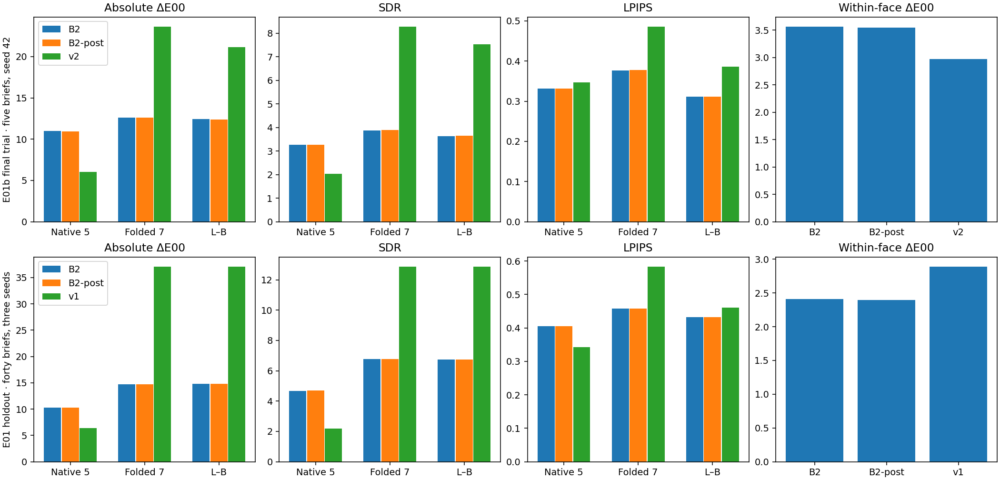
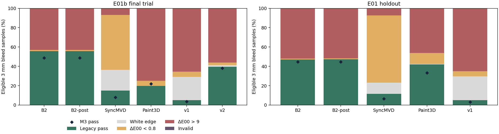
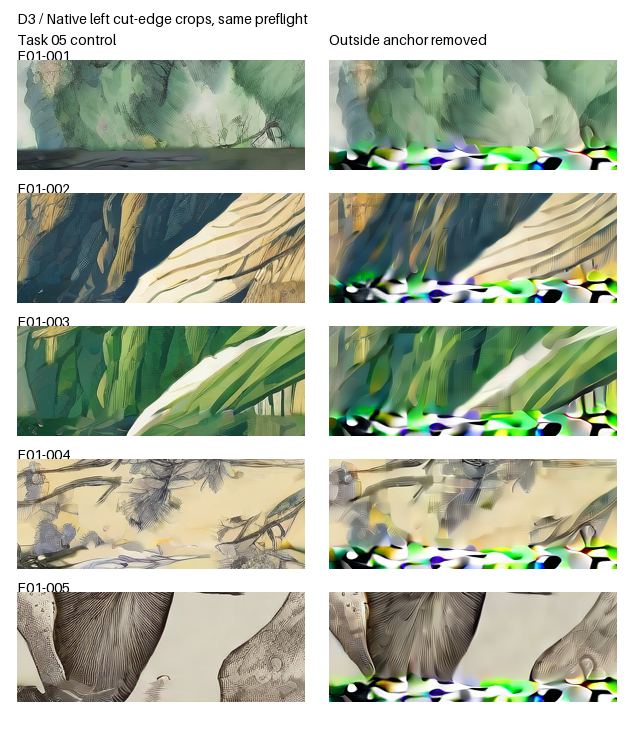
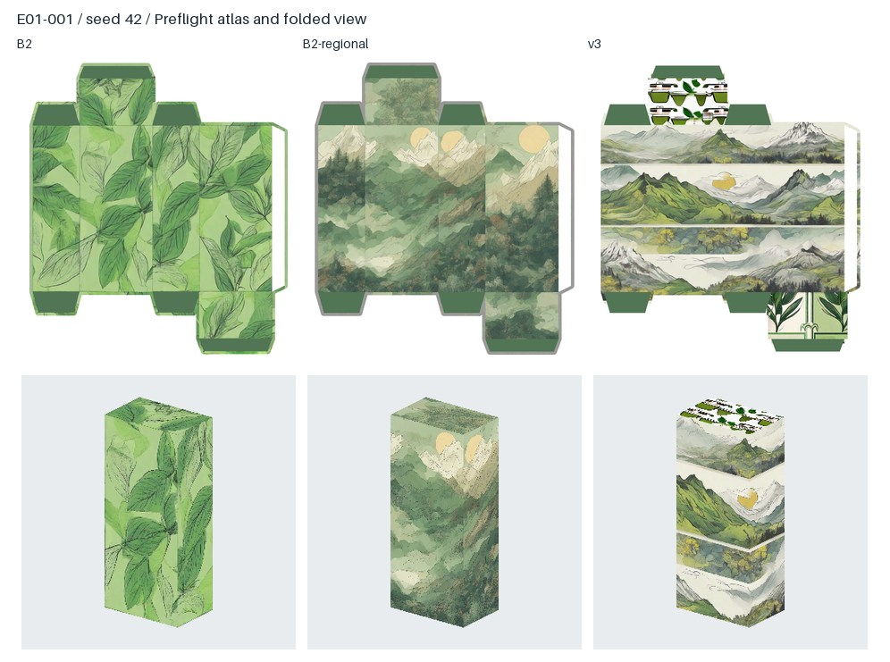
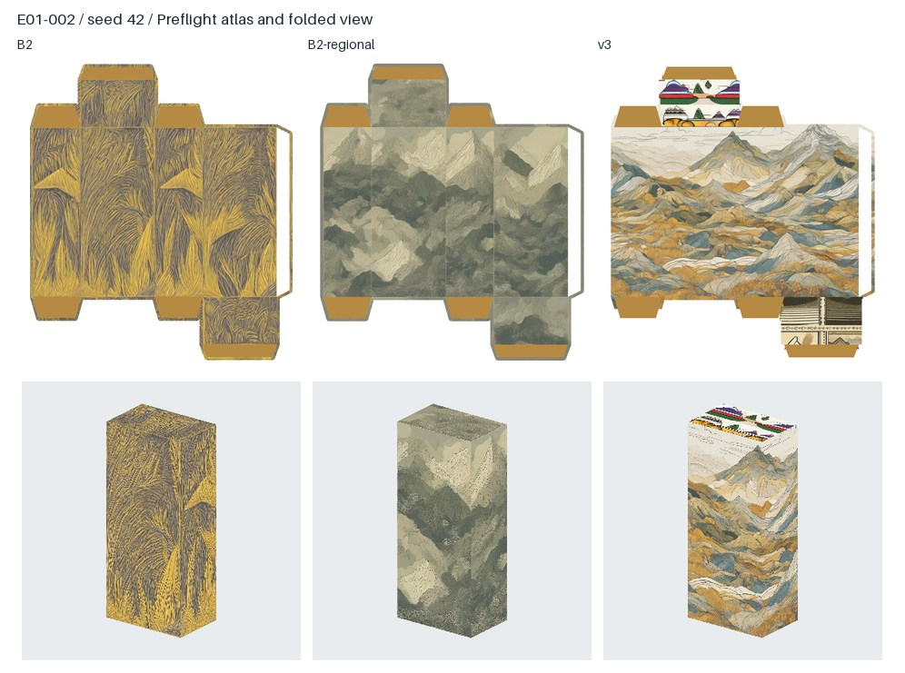
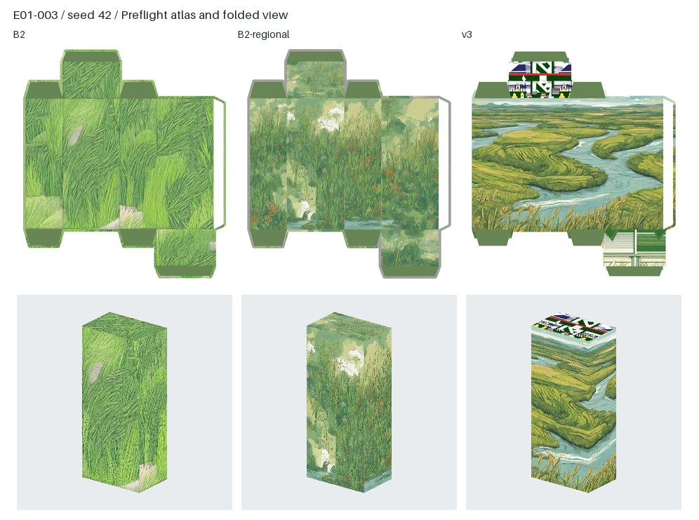

# E02 · DieLineDiff v3 最小验证

**Step 1 关口未通过。建议停在 Step 1。** 预定规则选出 v3 · 1280×1024。在同一十盒印前复位对照中，七条非原生缝 SDR 为 7.693（B2-regional 4.418，B2-post 4.620），LPIPS 为 0.4840（两者分别为 0.3646、0.4135）。旧口径出血为 57.85%（两者分别为 53.00%、52.85%），M3 为 50.24%（两者分别为 28.46%、47.38%）。CLIPScore 相对 B2 的差值为 +0.0016。本轮只在前十盒得出描述性结果。

## Step 0 · 诊断与指标冻结

### D1 · 拆开接缝和 SDR 分母

同一 4 px/mm 配准下，按刀版是否实际相接拆成五条原生折线和七条非原生折叠缝，另列侧面 L—B。E01b 的 v2 只有任务 05 五盒。与 v2 的直接对照用相同五盒、同种子 B2 与 B2-post。E01 留出集另报 40 盒 × 3 种子，与 v1 对照。

| E01b 五盒均值 | 面内 ΔE00 | 原生 ΔE00 | 非原生 ΔE00 | 非原生 SDR | 非原生 LPIPS | L—B ΔE00 |
| --- | ---: | ---: | ---: | ---: | ---: | ---: |
| B2 | 3.562 | 11.005 | 12.630 | 3.883 | 0.377 | 12.422 |
| B2-post | 3.541 | 10.936 | 12.583 | 3.893 | 0.377 | 12.373 |
| v2 | 2.970 | 6.008 | 23.633 | 8.283 | 0.486 | 21.130 |

v2 在原生折线的绝对色差更低，七条非原生缝在绝对色差、归一化 SDR 和 LPIPS 上均落后。分母差异会放大部分个体差距，却解释不了绝对色差及 LPIPS 的顺序。E01 留出集 B2 的面内 ΔE00 为 2.406，v1 为 2.889。B2 的非原生 ΔE00 为 14.731，v1 为 37.067，支持同一方向的结论。[分组数值与来源](d1-d2.json)



### D2 · 出血失分的组成

按旧口径把 3 mm 出血网格互斥分桶。先判断采样有效性、白边和色彩跳变，再区分过近颜色与通过。过近指 ΔE00 < 0.8，其中可能有合法纯色、复制色边或本来就变化很小的纹理。

| E01b 五盒均值 | 通过 % | 白边 % | 过近 % | 色彩跳变 % | 其他 % | M3 双准则通过 % |
| --- | ---: | ---: | ---: | ---: | ---: | ---: |
| B2 | 55.74 | 0.00 | 1.16 | 43.10 | 0.00 | 48.76 |
| v2 | 39.59 | 1.63 | 2.79 | 56.00 | 0.00 | 38.10 |

v2 的失分中，色彩跳变约占 92.7%。纯色底的旧阈值值得修正，五盒差距的主要来源仍是面边和出血颜色不匹配。[逐桶汇总](d1-d2.json)



### D3 · 解除 v2 的 Outside 锚定

用 RTX 3090 重跑任务 05 的 E01-001 至 E01-005、种子 42。仅从逐步潜变量替换中移除 Outside，保留 Glue、Tuck 和 Dust 的潜变量锚定，以及解码后相同的印前复位。原始窗口写入地图保持一致，未为 Outside 添加模型预测。比较两版同坐标原像素裁图和出血评分。

| 条件 | 旧出血填充率 % | 原生出血白像素 % | 全盒条带指数 |
| --- | ---: | ---: | ---: |
| 任务 05 对照 | 39.586 | 9.244 | 1.805 |
| 解除 Outside 锚定 | 26.056 | 2.470 | 1.623 |

五盒的出血白像素均减少。移除锚定在原窗口结构中留下未写入的 Outside 潜格，解码后的切边出现彩色饱和斑块。旧口径出血分数在五盒均下降。D3 证明了对 Outside 的锚定会影响切边外观，但单独移除它会破坏该版窗口的出血连续性。v3 的缓冲区有完整去噪预测，须通过 Step 1 独立检验。[逐盒结果](d3.csv)



### 指标冻结

M1—M4 先在同一 755 张历史原图试算，再冻结代码与参数。M3 在逐像素复制及整图双线性重采样复制反例上分别为 0% 和 0.626%，合法纯色出血为 100%。M4 的重复主体和分工样式合成对照分别为 0.9681 和 0.6498。历史 M4 均值为 B2 0.7883、B2-post 0.7881、SyncMVD 0.6851、Paint3D 0.7026、v1 0.6617 和 v2 0.7005。v2 只有前五盒，其余各 150 张。[冻结定义与测试结果](METRICS_FREEZE.md)

## Step 1 · 方法、配置与样本

v3 用单次水平环形卷积生成四侧面，环带上下各有可生成缓冲，随后冻结环带。顶、底盖在四条已配准的 3D 邻边条件下顺序生成，整个过程对环带保持只读。盖面的有效外切出血由真实自由区域生成，虚拟条件带和自由角不合成入刀版。无真实生成支撑的远翼切边留纸白。

B2-regional 用同刀版、SDXL、ControlNet 线稿和与 v3 相同的区域交叉注意力路由。两种新方法均不设白墙，使用同一晚期 LUT 投影配置，同样进行印前复位。两档环带分别为 1280×1024 和 1472×1152，每侧缓冲 11.43 mm 和 10.00 mm。实际生成覆盖的出血像素分别为 88,556 和 86,994，总出血像素 134,624。该覆盖是目标刀版的采样可达性，出血通过率还要求颜色和结构条件。

环形填充对有水平边界的 UNet、VAE 卷积启用，VAE 外置下采样补边采用同一环形语义。水平平移等价在小型真实 Diffusers UNet 与 VAE 上验证，绝对容差 3×10⁻⁶、相对容差 2×10⁻⁵。全体 SDXL 层另行检查补边覆盖。盖面四边读取与拓扑一致，单元测试检查冻结环带无写回及虚拟条不会泄漏到输出。[坐标编码图](v3-coordinate-registration.png)

候选仅在 E01-001 至 E01-010、种子 42 上比较。初始参数为 30 步、引导强度 5.0、区域权重 1.0、邻带 16 潜格、LUT 强度 0.20。两档先以 CLIPScore、ImageReward、HPS、七缝 SDR、七缝 LPIPS 和 M4 各一票选择，票数相同取实测耗时较短者。随后只在选中档考察共享自注意力开关。正式 Step 2 和留出集推断均未启动。

## 两档分辨率与调参

| 方法 | 样本数 | CLIP | ImageReward | HPS | 七缝 SDR ↓ | 七缝 LPIPS ↓ | M4 ↓ |
| --- | ---: | ---: | ---: | ---: | ---: | ---: | ---: |
| v3 · 1280×1024 | 10 | 0.6878 | -1.5531 | 0.2374 | 7.693 | 0.4840 | 0.8492 |
| v3 · 1472×1152 | 10 | 0.6896 | -1.2653 | 0.2372 | 8.789 | 0.4856 | 0.8538 |

档位比较票数为低档 4.0、高档 2.0，选出 v3 · 1280×1024。共享注意力候选状态为 已完成十盒。
全套参数保持一致，仅改变共享注意力开关。比较票数为默认版 5.0、共享版 1.0，最终使用 v3 · 1280×1024。

共享注意力对照的四侧面 RGB 逐像素一致。M4 的浮点差异约 4.2e-08，列在原始计票记录中，视为量级上的平局。默认版在其余五项均占优，M4 差异不影响选择。

[档位选择](resolution-selection.json) · [候选选择](candidate-selection.json)

## 试跑结果

试跑原图和统一印前复位分别统计。v2 只有五盒历史结果，其他行均为相同的十盒。两档 v3 和共享注意力候选均保留在明细中。

### raw

| 方法 | 样本数 | 全缝 SDR ↓ | 全缝 LPIPS ↓ | 出血 % ↑ | 折边条带 ↓ | 色域外 % ↓ | 往返 ΔE00 ↓ | CLIP ↑ | HPS ↑ | ImageReward ↑ |
| --- | ---: | ---: | ---: | ---: | ---: | ---: | ---: | ---: | ---: | ---: |
| B2 | 10 | 4.071 | 0.3914 | 52.75 | 1.2271 | 0.8651 | 0.1029 | 0.6862 | 0.2380 | -1.6015 |
| B2-post | 10 | 4.073 | 0.3915 | 52.85 | 1.2288 | 0.0000 | 0.0676 | 0.6856 | 0.2379 | -1.6005 |
| SyncMVD | 10 | 15.919 | 0.4858 | 11.90 | 1.2732 | 0.4861 | 0.2078 | 0.6664 | 0.2230 | -1.8155 |
| Paint3D | 10 | 5.056 | 0.3704 | 18.99 | 1.0440 | 0.7835 | 0.1603 | 0.6829 | 0.2238 | -1.7147 |
| v1 | 10 | 8.921 | 0.4639 | 5.15 | 1.3834 | 3.0760 | 0.2838 | 0.6011 | 0.2149 | -2.0461 |
| v2 · 任务 05 | 5 | 5.680 | 0.4280 | 39.59 | 1.8047 | 0.0344 | 0.0803 | 0.7427 | 0.2424 | -1.0278 |
| B2-regional | 10 | 4.201 | 0.3475 | 53.00 | 1.1399 | 0.0055 | 0.0483 | 0.6572 | 0.2290 | -1.7550 |
| v3 · 1280×1024 | 10 | 5.600 | 0.4189 | 57.85 | 1.2897 | 0.1829 | 0.0882 | 0.6878 | 0.2374 | -1.5531 |
| v3 · 1472×1152 | 10 | 6.250 | 0.4176 | 49.28 | 1.9389 | 0.0543 | 0.0714 | 0.6896 | 0.2372 | -1.2653 |
| v3 · 共享注意力 | 10 | 7.381 | 0.4687 | 52.03 | 1.2495 | 1.5531 | 0.1630 | 0.6582 | 0.2335 | -1.7331 |

### preflight

| 方法 | 样本数 | 全缝 SDR ↓ | 全缝 LPIPS ↓ | 出血 % ↑ | 折边条带 ↓ | 色域外 % ↓ | 往返 ΔE00 ↓ | CLIP ↑ | HPS ↑ | ImageReward ↑ |
| --- | ---: | ---: | ---: | ---: | ---: | ---: | ---: | ---: | ---: | ---: |
| B2 | 10 | 4.071 | 0.3914 | 52.75 | 1.2271 | 0.7957 | 0.1024 | 0.6862 | 0.2380 | -1.6015 |
| B2-post | 10 | 4.073 | 0.3915 | 52.85 | 1.2288 | 0.0000 | 0.0703 | 0.6856 | 0.2379 | -1.6005 |
| SyncMVD | 10 | 15.919 | 0.4858 | 11.90 | 1.2732 | 0.4112 | 0.1784 | 0.6664 | 0.2230 | -1.8155 |
| Paint3D | 10 | 5.056 | 0.3704 | 18.99 | 1.0440 | 0.7835 | 0.1637 | 0.6829 | 0.2238 | -1.7147 |
| v1 | 10 | 8.921 | 0.4639 | 5.15 | 1.3834 | 3.0760 | 0.2838 | 0.6011 | 0.2149 | -2.0461 |
| v2 · 任务 05 | 5 | 5.680 | 0.4280 | 39.59 | 1.8047 | 0.0338 | 0.0887 | 0.7427 | 0.2424 | -1.0278 |
| B2-regional | 10 | 4.201 | 0.3475 | 53.00 | 1.1399 | 0.0054 | 0.0527 | 0.6572 | 0.2290 | -1.7550 |
| v3 · 1280×1024 | 10 | 5.600 | 0.4189 | 57.85 | 1.2897 | 0.1709 | 0.0925 | 0.6878 | 0.2374 | -1.5531 |
| v3 · 1472×1152 | 10 | 6.250 | 0.4176 | 49.28 | 1.9389 | 0.0492 | 0.0770 | 0.6896 | 0.2372 | -1.2653 |
| v3 · 共享注意力 | 10 | 7.381 | 0.4687 | 52.03 | 1.2495 | 1.4796 | 0.1636 | 0.6582 | 0.2335 | -1.7331 |

### 补充指标 M1—M4

下表项目均基于已配准的外观面及出血，在两种印前变体下数值相同。M1 其余组的 SDR、LPIPS、M4 分项余弦和逐盒结果见 CSV。

| 方法 | 样本数 | 原生 ΔE00 ↓ | 非原生 ΔE00 ↓ | L—B ΔE00 ↓ | 面内 ΔE00 | 非原生 SDR ↓ | 非原生 LPIPS ↓ | M2 ↑ | M3 % ↑ | M4 ↓ |
| --- | ---: | ---: | ---: | ---: | ---: | ---: | ---: | ---: | ---: | ---: |
| B2 | 10 | 10.618 | 14.220 | 13.792 | 3.422 | 4.616 | 0.4134 | 0.1292 | 47.34 | 0.8157 |
| B2-post | 10 | 10.578 | 14.189 | 13.759 | 3.410 | 4.620 | 0.4135 | 0.1300 | 47.38 | 0.8150 |
| SyncMVD | 10 | 14.931 | 23.617 | 70.031 | 1.263 | 18.784 | 0.4889 | 0.0478 | 5.98 | 0.7124 |
| Paint3D | 10 | 1.281 | 11.483 | 10.942 | 1.675 | 8.004 | 0.3872 | 0.0136 | 20.89 | 0.6839 |
| v1 | 10 | 6.159 | 39.020 | 41.102 | 2.851 | 13.753 | 0.5684 | 0.0350 | 3.51 | 0.6819 |
| v2 · 任务 05 | 5 | 6.008 | 23.633 | 21.130 | 2.970 | 8.283 | 0.4858 | 0.1034 | 38.10 | 0.7005 |
| B2-regional | 10 | 8.666 | 9.797 | 11.621 | 2.353 | 4.418 | 0.3646 | 0.0800 | 28.46 | 0.8630 |
| v3 · 1280×1024 | 10 | 7.816 | 22.407 | 4.065 | 2.929 | 7.693 | 0.4840 | 0.1087 | 50.24 | 0.8492 |
| v3 · 1472×1152 | 10 | 9.473 | 30.334 | 5.850 | 3.541 | 8.789 | 0.4856 | 0.1066 | 42.83 | 0.8538 |
| v3 · 共享注意力 | 10 | 9.753 | 29.807 | 4.065 | 2.935 | 10.283 | 0.5587 | 0.1077 | 47.14 | 0.8492 |

[逐样本双口径 CSV](results.csv)

### 跨面连续子集

| 方法 | 样本数 | 七缝 ΔE00 ↓ | 七缝 SDR ↓ | 七缝 LPIPS ↓ | 出血 % ↑ | M3 % ↑ | CLIP ↑ |
| --- | ---: | ---: | ---: | ---: | ---: | ---: | ---: |
| B2 | 5 | 12.602 | 4.487 | 0.3721 | 57.59 | 55.62 | 0.6731 |
| B2-post | 5 | 12.550 | 4.495 | 0.3720 | 57.79 | 55.69 | 0.6730 |
| SyncMVD | 5 | 25.682 | 18.764 | 0.5350 | 13.79 | 2.79 | 0.6859 |
| Paint3D | 5 | 13.403 | 11.298 | 0.4070 | 21.32 | 22.19 | 0.6807 |
| v1 | 5 | 39.389 | 14.166 | 0.5716 | 5.17 | 3.52 | 0.6076 |
| v2 · 任务 05 | 3 | 22.422 | 8.778 | 0.4783 | 40.02 | 38.58 | 0.7752 |
| B2-regional | 5 | 10.446 | 5.089 | 0.3564 | 36.85 | 20.10 | 0.6484 |
| v3 · 1280×1024 | 5 | 22.366 | 8.222 | 0.4704 | 61.31 | 54.30 | 0.6890 |
| v3 · 1472×1152 | 5 | 30.925 | 9.455 | 0.4676 | 53.84 | 47.23 | 0.6857 |
| v3 · 共享注意力 | 5 | 29.267 | 10.687 | 0.5621 | 53.68 | 49.81 | 0.6675 |

## 五项关口

| 关口 | 十盒 preflight 均值或观察 | 判定 |
| --- | --- | --- |
| 七条非原生缝 | SDR 7.693，LPIPS 0.4840。两项须都低于 B2-regional 和 B2-post | 未通过 |
| 双口径出血 | 旧值 57.85%，M3 50.24%。两项须都高于 B2-regional 和 B2-post | 通过 |
| 全盒折边 | 均值 1.2897，上限 1.2528。最优基线为 Paint3D。原像素目视未通过 | 未通过 |
| CLIPScore 单侧 | 0.6878，下限 0.6362 | 通过 |
| RTX 3090 开销 | 21.57 s/盒，平均峰值 10.18 GiB。上限为 60 s 和 20 GiB | 通过 |

[绑定图像与评分哈希的关口记录](gate.json)

### 结果定位

L—B 环绕缝绝对 ΔE00 为 4.065，B2-regional 与 B2-post 分别为 11.621 和 13.759。剔除 L—B 后，六条非原生盖缝的绝对 ΔE00 分别为 25.464、9.493、14.260。这将七缝差距定位到盖面和侧面的连接，环带首尾连接已有改善。生成后将独立盖面合成到刀版，部分折边处仍能看出色调和构图断层。

可见面邻域的出血失分中，所选配置的色彩跳变为 25.49%，B2-regional 为 45.16%，B2-post 为 46.02%。整张原生刀版的出血支持率还受翼片范围限制，和旧出血评价的物理采样网格不同。

原像素中标记可见窄条带、亮边或可疑延伸色带的图为 E01-002、E01-009。逐盒观察见关口记录。末步共享注意力开关对照的 10 对实际输出中，四侧面 RGB 逐像素相同。

### 耗时与显存

| 方法 | 样本数 | 单盒耗时 s | PyTorch 平均峰值 MiB |
| --- | ---: | ---: | ---: |
| B2-regional | 10 | 43.12 | 10453.7 |
| v3 · 1280×1024 | 10 | 21.57 | 10423.6 |
| v3 · 1472×1152 | 10 | 25.84 | 11505.1 |
| v3 · 共享注意力 | 10 | 22.71 | 11424.1 |

胜出配置的单盒最高峰值显存为 10.18 GiB。耗时包含提示词编码、环带、顶底盖及刀版合成，显存为每盒 PyTorch 峰值分配。

## 展开图、折叠图与原像素折边







两组保留可见条带的裁图均按原像素输出。完整十盒的五条原生折边裁图在服务器运行目录。[E01-002](native-folds-E01-002.png) · [E01-009](native-folds.png)

## 复现

在服务器项目根目录运行以下命令。Step 1 使用冻结的指标记录及已校验的模型。程序只会生成前十条简报。原始图、输出摘要、日志及历史逐样本分片均位于 AutoDL 数据盘。完成原像素人工检查后可用下方 review 命令登记十盒观察。已提交记录的复用需要当前关口指纹一致。

```bash
bash code/scripts/run_E02_step0.sh d3
bash code/scripts/run_E02_step0.sh physical
bash code/scripts/run_E02_step0.sh m4 --device cuda
bash code/scripts/run_E02_step1.sh
source code/scripts/e01_env.sh
"$AD_ROOT/envs/e01/bin/python" -m dielinediff.e02 review --review-file docs/experiments/E02/gate.json
```

Step 1 运行目录为 `/root/autodl-tmp/ai-design/outputs/e02/step1/c6bb770094d3`。
