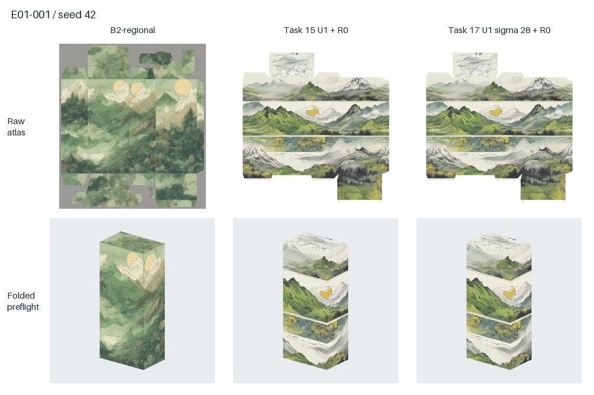
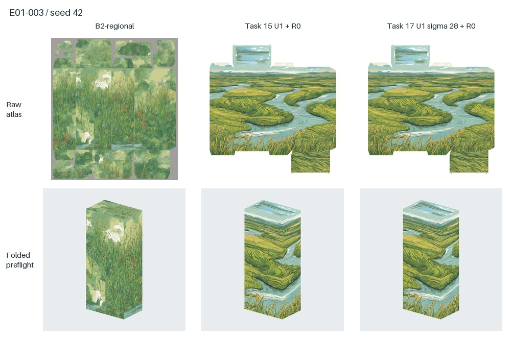
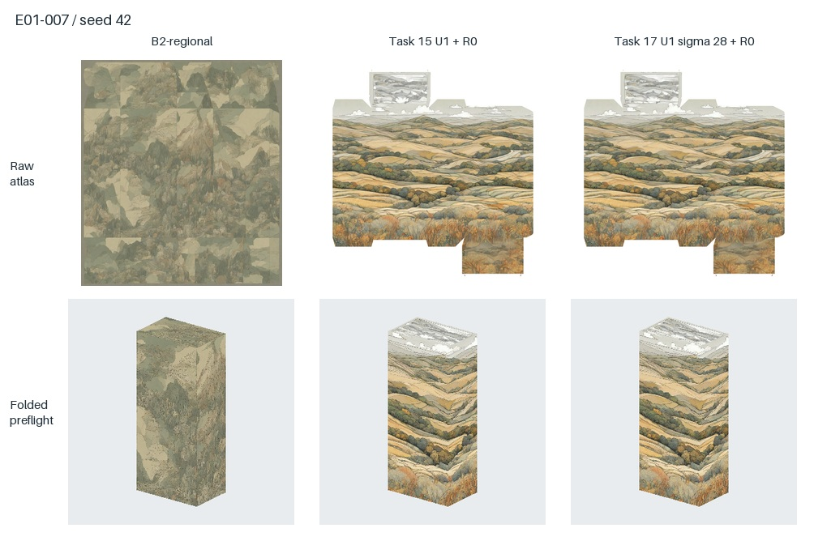

# E02 · 环带提示词调度与循环滚动

**种子 42 4/5，种子 1234 5/5。停在 Step 1，等待 Claude 审查。** 锁定 R0 + U1-σ28。相对任务 15 同种子 U1 + R0，环带侧下界分别变动 +0.0000 / +0.0000，盖面侧下界分别变动 +0.0344 / +0.0066。上述差值按种子 42 / 1234 排列。

## 五种环带方案

只用 E01-001 至 E01-010。R0 读取同种子的审查归档，M3b 只把上下缓冲由各 64 px 扩为 128 px。可打印环带仍宽 1280 px、体部高 896 px，盒身位置向下平移 64 px，横向面界和套准坐标一致。M3 在 M3b 上逐步水平循环移动潜变量和标签。第 k 步的移位为 (37×k) mod 160，UNet 预测回到原坐标后再执行 LUT 投影和 DDIM 更新。M2 使用原画布，前 9 步单一全局环绕语句，剩余 21 步权重由 0 线性升至 0.60。四条周期竖边各侧 7 mm 线性混合相邻区域的交叉注意力输出。全局词从简报提取作物与地域题材，分面词保留简报版式需求并换用连续构图与较柔和的背面模板。M2 + M3 叠加相同提示规则和扩缓冲滚动。相同画布的对照逐盒核对采样随机状态。两档画布的噪声张量形状不同。 [生成前登记](ring-m2m3-inputs.json)

| 种子 | 环带 | 环带侧下界 | L–B ΔE00 | L–B LPIPS | 四侧 CLIPScore | 四侧 ImageReward | M4 | 原出血 % | M3 % |
| --- | --- | --- | --- | --- | --- | --- | --- | --- | --- |
| 42 | R0 | 1.2244 | 4.0645 | 0.1664 | 0.7068 | -1.5612 | 0.8492 | 65.7426 | 61.1618 |
| 42 | M3b | 1.1447 | 5.2211 | 0.2265 | 0.6893 | -1.4946 | 0.8514 | 57.5537 | 52.3793 |
| 42 | M3 | 1.1978 | 5.0720 | 0.2260 | 0.6967 | -1.5114 | 0.8457 | 58.4337 | 53.8080 |
| 42 | M2 | 1.2485 | 5.0163 | 0.2068 | 0.7357 | -1.3573 | 0.8679 | 58.8899 | 53.4887 |
| 42 | M2 + M3 | 1.2044 | 6.7104 | 0.2544 | 0.7204 | -1.2979 | 0.8361 | 52.9414 | 50.7271 |
| 1234 | R0 | 1.2798 | 3.2358 | 0.2148 | 0.7313 | -1.2458 | 0.7885 | 61.6025 | 51.2027 |
| 1234 | M3b | 1.8690 | 3.9939 | 0.2132 | 0.6783 | -1.6102 | 0.8666 | 56.2664 | 45.8016 |
| 1234 | M3 | 1.8889 | 4.1084 | 0.2117 | 0.6799 | -1.6249 | 0.8610 | 57.5617 | 47.5530 |
| 1234 | M2 | 1.4226 | 4.3988 | 0.2264 | 0.7161 | -1.4496 | 0.8495 | 56.6099 | 49.2796 |
| 1234 | M2 + M3 | 1.2950 | 5.5707 | 0.2808 | 0.7128 | -1.3639 | 0.8390 | 52.2652 | 47.3766 |

候选需在两个种子都降低环带单侧下界，且 ΔE00 / LPIPS 允许增量分别为 1.0 / 0.02，CLIPScore / ImageReward 允许降幅分别为 0.02 / 0.10，M4 允许增量为 0.03，两种侧面出血允许各降 3 个百分点。合格者按两种子下界等权均值排序。

| 种子 | 环带 | 环带侧下界 | L–B ΔE00 | L–B LPIPS | 四侧 CLIPScore | 四侧 ImageReward | M4 | 原出血 % | M3 % | 本种子合格 |
| --- | --- | --- | --- | --- | --- | --- | --- | --- | --- | --- |
| 42 | R0 | 参考 | 通过 | 通过 | 通过 | 通过 | 通过 | 通过 | 通过 | 参考 |
| 42 | M3b | 通过 | 未过 | 未过 | 通过 | 通过 | 通过 | 未过 | 未过 | 未过 |
| 42 | M3 | 通过 | 未过 | 未过 | 通过 | 通过 | 通过 | 未过 | 未过 | 未过 |
| 42 | M2 | 未过 | 通过 | 未过 | 通过 | 通过 | 通过 | 未过 | 未过 | 未过 |
| 42 | M2 + M3 | 通过 | 未过 | 未过 | 通过 | 通过 | 通过 | 未过 | 未过 | 未过 |
| 1234 | R0 | 参考 | 通过 | 通过 | 通过 | 通过 | 通过 | 通过 | 通过 | 参考 |
| 1234 | M3b | 未过 | 通过 | 通过 | 未过 | 未过 | 未过 | 未过 | 未过 | 未过 |
| 1234 | M3 | 未过 | 通过 | 通过 | 未过 | 未过 | 未过 | 未过 | 未过 | 未过 |
| 1234 | M2 | 未过 | 未过 | 通过 | 通过 | 未过 | 未过 | 未过 | 通过 | 未过 |
| 1234 | M2 + M3 | 未过 | 未过 | 未过 | 通过 | 未过 | 未过 | 未过 | 未过 | 未过 |

四个新方案均有至少一个种子不合格，按登记保留 R0。 [逐盒评分](ring-m2m3-ring-scores.csv) · [逐折环带侧](ring-m2m3-ring-folds.csv) · [逐项判定](ring-m2m3-ring-selection.json)

| 种子 | 环带 | B-Btm | B-R | F-L | F-R | F-T |
| --- | --- | --- | --- | --- | --- | --- |
| 42 | R0 | 1.0096 | 1.1090 | 1.0066 | 1.0469 | 1.1449 |
| 42 | M3b | 1.0512 | 1.1102 | 1.0317 | 1.0333 | 1.0000 |
| 42 | M3 | 1.0623 | 1.1753 | 1.0295 | 1.0349 | 1.0000 |
| 42 | M2 | 1.0039 | 1.1623 | 1.0265 | 1.0537 | 1.1448 |
| 42 | M2 + M3 | 1.1372 | 1.1648 | 1.0485 | 1.0123 | 1.0074 |
| 1234 | R0 | 1.0939 | 1.1107 | 1.0860 | 1.1764 | 1.0018 |
| 1234 | M3b | 1.0074 | 1.1110 | 1.0420 | 1.0673 | 1.8029 |
| 1234 | M3 | 1.0016 | 1.1100 | 1.0513 | 1.0454 | 1.8357 |
| 1234 | M2 | 1.3278 | 1.1112 | 1.0511 | 1.1118 | 1.0000 |
| 1234 | M2 + M3 | 1.1264 | 1.1321 | 1.0452 | 1.0210 | 1.1380 |

扩缓冲组的种子 42 正面—顶盖环带侧均值由 1.1449 降至 M3b 和 M3 的 1.0000，种子 1234 的同一折线由 1.0018 升至 1.8029 和 1.8357。M2 + M3 的种子 42 环带下界降 0.0200，种子 1234 升 0.0153，两个种子的绕接 ΔE00、LPIPS 和双出血均越过筛选容差。

| 种子 | 环带 | 独立横幅盒数 / 10 | 盒号 |
| --- | --- | --- | --- |
| 42 | R0 | 1 | E01-001 |
| 42 | M3b | 0 | — |
| 42 | M3 | 0 | — |
| 42 | M2 | 0 | — |
| 42 | M2 + M3 | 0 | — |
| 1234 | R0 | 0 | — |
| 1234 | M3b | 2 | E01-003、E01-006 |
| 1234 | M3 | 1 | E01-003 |
| 1234 | M2 | 0 | — |
| 1234 | M2 + M3 | 0 | — |

横幅判读要求上下有独立画幅且存在浅色或白色分隔。连续地貌、云雾或画框边沿另作记录。 [原像素记录](ring-m2m3-banner-review.json)

## 法向剖面和几何核验

使用冻结的 4 px/mm 物理网格，逐折在 0–3 mm、3–9 mm 比较平均 L*，法向梯度取沿折方向平均 L* 剖面的最大绝对一阶差分。环带阶段三条竖折具备双侧剖面，正面—顶盖和背面—底盖各取真实环带侧。成盒后补齐盖面侧。该检查单独报告。

| 种子 | 配置 | 近带−内带 L* | 平均绝对 L* 差 | 单侧法向峰均值 L*/mm | 折点绝对 L* 跳变均值 |
| --- | --- | --- | --- | --- | --- |
| 42 | R0 | -0.450 | 2.521 | 5.006 | 0.384 |
| 42 | M3b | -0.536 | 2.509 | 5.198 | 0.467 |
| 42 | M3 | -0.330 | 2.486 | 5.075 | 0.451 |
| 42 | M2 | -0.797 | 2.934 | 5.853 | 0.564 |
| 42 | M2 + M3 | -0.407 | 2.764 | 5.825 | 0.504 |
| 1234 | R0 | 1.039 | 2.265 | 5.186 | 0.300 |
| 1234 | M3b | -0.481 | 2.711 | 8.296 | 0.483 |
| 1234 | M3 | -0.556 | 2.826 | 7.927 | 0.570 |
| 1234 | M2 | 1.321 | 3.063 | 5.948 | 0.342 |
| 1234 | M2 + M3 | -0.308 | 3.098 | 5.991 | 0.457 |

| 种子 | 配置 | 近带−内带 L* | 平均绝对 L* 差 | 单侧法向峰均值 L*/mm | 折点绝对 L* 跳变均值 |
| --- | --- | --- | --- | --- | --- |
| 42 | U1-σ28 | -0.370 | 2.533 | 5.593 | 0.757 |
| 1234 | U1-σ28 | 0.987 | 2.166 | 5.317 | 0.590 |

纯色带、亮暗跳变与纹理边缘另对原像素核验。 [环带法向明细](ring-m2m3-ring-normal-profile.csv) · [最终五折双侧法向明细](ring-m2m3-final-normal-profile.csv)

扩大画布后，使用坐标编码图核对盒身裁切、L—B 绕接和出血导出。原有侧面和出血的坐标像素逐值相同，扩缓冲新增 56,111 个支持像素，位于上下缓冲。RTX 3090 上第 2 步，同一潜变量滚动 37 格再滚回的预测 RMSE 为 0.005994，匹配下采样相位的 1 格对照为 0.006276，比值 0.955。两种同相位滚动之间的 RMSE 为 0.001556。 [相位实测](ring-m2m3-phase.json) · [坐标编码与逐像素套准](m3-ring-registration.png)

## B2-regional-M2 公平对照

两种子均用相同的模板净化、全局提示词和 30 步区域权重。平面刀版三条实际相接的竖折同样做 ±7 mm 羽化。B2-regional-M2 保留原 ControlNet 与单图刀版采样。B2、B2-post、B2-regional、SyncMVD 和 Paint3D 是同种子冻结关口的基线。B2-regional-M2 作为补充对照。 [对照源图与模型登记](ring-m2m3-baseline-inputs.json) · [三路同提示词的逐盒核验](ring-m2m3-baseline-source-proof.json)

| 种子 | 方法 | 盖侧 ΔE00 | 盖侧 LPIPS | 七缝 SDR | 七缝 LPIPS | 原出血 % | M3 % | 全盒 v1 | CLIPScore | ImageReward |
| --- | --- | --- | --- | --- | --- | --- | --- | --- | --- | --- |
| 42 | B2-regional | 9.4935 | 0.3742 | 4.4175 | 0.3646 | 52.9962 | 28.4607 | 1.1399 | 0.6572 | -1.7550 |
| 42 | B2-regional-M2 | 12.6756 | 0.3631 | 4.3694 | 0.3548 | 54.6113 | 43.8987 | 1.0634 | 0.6908 | -1.6651 |
| 1234 | B2-regional | 13.0142 | 0.3794 | 4.6048 | 0.3694 | 51.8315 | 48.9578 | 1.2257 | 0.6534 | -1.8002 |
| 1234 | B2-regional-M2 | 15.8890 | 0.3670 | 4.4107 | 0.3571 | 41.7869 | 40.2983 | 1.0788 | 0.6919 | -1.5866 |

种子 42 改善 盖侧 LPIPS、七缝 SDR、七缝 LPIPS、原出血 %、M3 %。种子 1234 改善 盖侧 LPIPS、七缝 SDR、七缝 LPIPS。

## 盖面选型与两种子复验

种子 42 在同一保留环带比较 U1 和 U1-σ28，两者都采用同样的贴边几何、L2 混合、相位偏移及 SDEdit 0.85。U1-σ28 把双倍初图的高通分离 σ 由 8 px 改为 28 px，同时保留 U1 的 2σ 粗残差处理倍数。硬筛选使用逐盒 60 s / 20 GiB、CLIPScore ≥ 0.6362、两盖面内能量均值各 ≥ 原 B2-regional 的 0.5 倍、每盒两盖各 ≤ 同盒环带能量的 2 倍，以及 ImageReward ≥ 原 B2-regional 减 0.10。合格候选按胜 U1 的六项主目标数排序，同分比较冻结 v1 与原像素。

| 候选 | 胜 U1 项数 | 硬筛选 | 预算 | CLIP | ImageReward | 顶盖能量下限 | 底盖能量下限 | 超过环带两倍的盖数 |
| --- | --- | --- | --- | --- | --- | --- | --- | --- |
| U1 | 0 | 通过 | 通过 | 通过 | 通过 | 通过 | 通过 | 0 |
| U1-σ28 | 6 | 通过 | 通过 | 通过 | 通过 | 通过 | 通过 | 0 |

| 种子 42 | 盖侧 ΔE00 | 盖侧 LPIPS | 七缝 SDR | 七缝 LPIPS | 原出血 % | M3 % | 全盒 v1 | CLIPScore | ImageReward |
| --- | --- | --- | --- | --- | --- | --- | --- | --- | --- |
| U1 | 4.1874 | 0.3789 | 1.5885 | 0.3486 | 67.3937 | 58.4402 | 1.6841 | 0.6891 | -1.6334 |
| U1-σ28 | 4.1045 | 0.3747 | 1.5630 | 0.3449 | 67.4601 | 58.5225 | 1.7209 | 0.6874 | -1.6541 |

U1 + R0 的种子 42 原图和原评分通过任务 15 的登记哈希核验后沿用。种子 1234 的胜出配置在本轮按锁定参数复验。

| 种子 | 盖面 | 顶能量 ×10³ | 底能量 ×10³ | 顶环比 | 底环比 | 顶三缝纹理差 ×10³ | 底三缝纹理差 ×10³ | 顶 2× 留存 | 底 2× 留存 |
| --- | --- | --- | --- | --- | --- | --- | --- | --- | --- |
| 42 | U1 | 1.769 | 1.324 | 0.637 | 0.486 | 0.709 | 1.380 | 2.252 | 2.281 |
| 42 | U1-σ28 | 1.592 | 1.341 | 0.564 | 0.492 | 0.773 | 1.341 | 2.230 | 2.324 |
| 1234 | U1-σ28 | 1.361 | 1.397 | 0.508 | 0.532 | 1.581 | 1.655 | 2.357 | 2.474 |

选定 U1-σ28 后，用种子 1234 复验同一配置。各关口使用各自种子和相同十条简报的原基线。 [选型台账](ring-m2m3-selection.json) · [逐盒结果](results-ring-m2m3.csv)

| 十盒均值 | 42 | 1234 | 1234 减 42 |
| --- | --- | --- | --- |
| 盖侧 ΔE00 | 4.1045 | 5.1447 | +1.0402 |
| 盖侧 LPIPS | 0.3747 | 0.3772 | +0.0026 |
| 七缝 SDR | 1.5630 | 2.0241 | +0.4611 |
| 七缝 LPIPS | 0.3449 | 0.3540 | +0.0091 |
| 原出血 % | 67.4601 | 62.3479 | -5.1123 |
| M3 % | 58.5225 | 51.2440 | -7.2785 |
| 全盒 v1 | 1.7209 | 1.3026 | -0.4183 |
| CLIPScore | 0.6874 | 0.7036 | +0.0162 |
| ImageReward | -1.6541 | -1.3773 | +0.2768 |

| 种子 | 关口 | 本轮和原基线 | 判定 |
| --- | --- | --- | --- |
| 42 | 七条非原生缝 | 七缝 SDR 1.5630（原对照 4.4175 / 4.6199）。七缝 LPIPS 0.3449（原对照 0.3646 / 0.4135） | 通过 |
| 42 | 双口径出血 | 原出血 % 67.4601（原对照 52.9962 / 52.8471）。M3 % 58.5225（原对照 28.4607 / 47.3847） | 通过 |
| 42 | 条带 v1 与原像素 | 1.7209 / 1.2528。原像素 0/10 有独立亮边或条带 | 未过 |
| 42 | CLIPScore 单侧 | 0.6874 / 下限 0.6362 | 通过 |
| 42 | 逐盒硬件 | 最长 57.59 s / 峰值 10.283 GiB | 通过 |
| 1234 | 七条非原生缝 | 七缝 SDR 2.0241（原对照 4.6048 / 5.7941）。七缝 LPIPS 0.3540（原对照 0.3694 / 0.4423） | 通过 |
| 1234 | 双口径出血 | 原出血 % 62.3479（原对照 51.8315 / 52.8265）。M3 % 51.2440（原对照 48.9578 / 50.5284） | 通过 |
| 1234 | 条带 v1 与原像素 | 1.3026 / 1.3832。原像素 0/10 有独立亮边或条带 | 通过 |
| 1234 | CLIPScore 单侧 | 0.7036 / 下限 0.6460 | 通过 |
| 1234 | 逐盒硬件 | 最长 55.71 s / 峰值 10.282 GiB | 通过 |

[关口记录](gate-ring-m2m3.json) · [双种子原像素判读](ring-m2m3-visual-review.json)

## 五条原生折线拆解

单侧下界令另外一侧比值为 1，再对每盒五折取最大。环带与盖面峰值所在折线可能不同，整盒最大值按各盒独立计算。相对任务 15 的变化使用相同种子和简报。

| 种子 | 配置 | 环带侧下界 | 盖面侧下界 | 全盒最大 v1 |
| --- | --- | --- | --- | --- |
| 42 | 任务 15 U1 + R0 | 1.2244 | 1.5813 | 1.6841 |
| 42 | 本轮 R0 + U1-σ28 | 1.2244 | 1.6157 | 1.7209 |
| 42 | 本轮减任务 15 | +0.0000 | +0.0344 | +0.0368 |
| 1234 | 任务 15 U1 + R0 | 1.2798 | 1.0838 | 1.3032 |
| 1234 | 本轮 R0 + U1-σ28 | 1.2798 | 1.0905 | 1.3026 |
| 1234 | 本轮减任务 15 | +0.0000 | +0.0066 | -0.0006 |

| 种子 | 折线 | 整折均值 | 环带侧 | 盖面侧 |
| --- | --- | --- | --- | --- |
| 42 | B-Btm | 1.5886 | 1.0096 | 1.5790 |
| 42 | B-R | 1.1090 | 1.1090 | 1.0000 |
| 42 | F-L | 1.0066 | 1.0066 | 1.0000 |
| 42 | F-R | 1.0469 | 1.0469 | 1.0000 |
| 42 | F-T | 1.2203 | 1.1449 | 1.0754 |
| 1234 | B-Btm | 1.1687 | 1.0939 | 1.0748 |
| 1234 | B-R | 1.1107 | 1.1107 | 1.0000 |
| 1234 | F-L | 1.0860 | 1.0860 | 1.0000 |
| 1234 | F-R | 1.1764 | 1.1764 | 1.0000 |
| 1234 | F-T | 1.0464 | 1.0018 | 1.0446 |

| 种子 | 峰值样本 | 控制折线 | 全盒 v1 | 环带侧超额 | 盖面侧超额 |
| --- | --- | --- | --- | --- | --- |
| 42 | E01-003 | B-Btm | 3.1078 | 0.0000 | 2.1078 |
| 42 | E01-007 | B-Btm | 2.6390 | 0.0957 | 1.5432 |
| 42 | E01-009 | F-T | 2.1842 | 0.7030 | 0.4812 |
| 1234 | E01-005 | F-R | 1.4982 | 0.4982 | 0.0000 |
| 1234 | E01-001 | F-L | 1.4204 | 0.4204 | 0.0000 |
| 1234 | E01-010 | B-Btm | 1.4152 | 0.3416 | 0.0736 |

[逐盒逐折完整拆解](ring-m2m3-stripe-sources.csv) · [环带与盖面的源图核验](ring-m2m3-ring-source-proof.json)

## RTX 3090 开销

| 种子 | 环带 | 平均秒 / 盒 | 平均峰值 GiB |
| --- | --- | --- | --- |
| 42 | R0 | 12.41 | 10.178 |
| 42 | M3b | 14.27 | 10.627 |
| 42 | M3 | 14.29 | 10.629 |
| 42 | M2 | 12.70 | 10.181 |
| 42 | M2 + M3 | 14.44 | 10.632 |
| 1234 | R0 | 12.34 | 10.179 |
| 1234 | M3b | 14.29 | 10.627 |
| 1234 | M3 | 14.32 | 10.629 |
| 1234 | M2 | 12.52 | 10.181 |
| 1234 | M2 + M3 | 14.42 | 10.632 |

| 种子 | 盖面 | 平均秒 / 盒 | 最长秒 / 盒 | 最大峰值 GiB |
| --- | --- | --- | --- | --- |
| 42 | U1 | 51.12 | 53.89 | 10.283 |
| 42 | U1-σ28 | 54.90 | 57.59 | 10.283 |
| 1234 | U1-σ28 | 54.51 | 55.71 | 10.282 |

整盒时间包括环带、两盖和合成，模型初次装载、写图和评测单列。峰值取 PyTorch 已分配显存。

## 展开、折叠预览与原像素

各图从左到右为 B2-regional、任务 15 的 U1 + R0、本轮最终配置。折叠预览使用统一的印前复位图。原生折线裁图只裁切并按拓扑旋转，不重采样。







种子 42 的原生折线。[E01-003](ring-m2m3-examples/seed-42/E01-003-folds.png) · [E01-007](ring-m2m3-examples/seed-42/E01-007-folds.png) · [E01-009](ring-m2m3-examples/seed-42/E01-009-folds.png) · [E01-010](ring-m2m3-examples/seed-42/E01-010-folds.png)

种子 1234 的原生折线。[E01-003](ring-m2m3-examples/seed-1234/E01-003-folds.png) · [E01-007](ring-m2m3-examples/seed-1234/E01-007-folds.png) · [E01-009](ring-m2m3-examples/seed-1234/E01-009-folds.png) · [E01-010](ring-m2m3-examples/seed-1234/E01-010-folds.png)

种子 42 中，U1-σ28 的盖侧 ΔE00 从 4.1874 降到 4.1045，七缝 LPIPS 从 0.3486 降到 0.3449。六项主目标均有改善。全盒条带 v1 同时升高 0.0368，盖面侧下界升高 0.0344。E01-003 的背底由 3.2607 降至 3.1078，E01-007 的背底由 2.3540 升至 2.6390。在原像素中，003 的背底密集草叶跨折延续，007 的背底有密集麦秆和局部面间深浅变化，009 的正顶仍有云边与青色天空，010 的背底叶片可跨折追踪，局部轮廓方向改变。 [种子 42 原像素](ring-m2m3-visual-review.json)

种子 42 的 E01-003 背底跨界跳变为 +3.06 L*，盖面法向峰 6.17 L*/mm。E01-007 背底盖面的 0–3 mm 与 3–9 mm 区间均值差为 −4.36 L*。E01-009 正顶跨界跳变为 +0.58 L*。这些结果连同折线两侧的原像素一起用于区分亮度变化和独立窄带。 [最终法向剖面](ring-m2m3-final-normal-profile.csv)

种子 1234 的 E01-007 背侧浅棕线沿用 R0 木桌画面，沿其他侧面延续。E01-009 顶盖新增浅色矩形画框，底边距正顶折线约 24 px，浅色线在右侧转角并沿画片边界延续。该画框属于盖面内部画片，按原目视口径记录为构图变化。E01-010 的峰值为背面—底盖，环带侧超额 0.3416，盖面侧 0.0736。 [种子 1234 顶盖原像素对照](ring-m2m3-examples/seed-1234/E01-009-top-frame.png)

## 复现

RTX 3090 的原图、模型缓存和完整评分位于 AutoDL 数据盘 `/root/autodl-tmp/ai-design/outputs/e02/ring-m2m3/runs/c5b232622150`。在数据盘的仓库根目录运行。每个阶段核对归档、图像、评分和源代码身份后复用已完成的产物。重新生成的原图需要按同一口径复核五条折线，再用 `--visual` 绑定其当前指纹。 [输入登记](ring-m2m3-inputs.json) · [评估汇总](ring-m2m3-evaluation.json)

```bash
bash code/scripts/run_E02_ring_m2m3.sh
```
