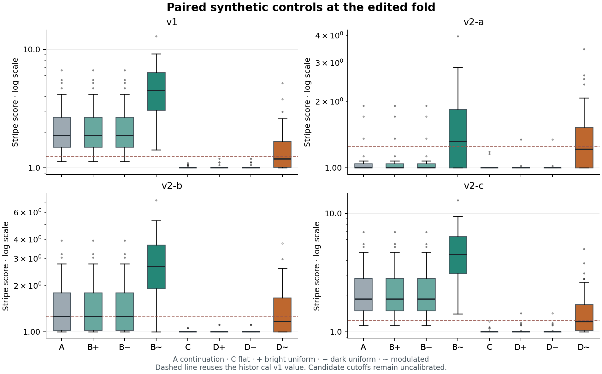

# E02 · 折边条带指数的 CPU 诊断

冻结版 v1 会把自然延续至平整盖面的情况判高。无条带的 A 组有 30/32 个目标折线高于 1.2528，轻微色差的平盖 C 组为 0/32。取整盒最大值后，A、C 分别有 31/32、8/32 高于这个数值。v2-a 用整盒中位数把 A 组越线数降至 3/32，也压掉了一个已知历史条带。v2-b 只托住低参考能量，A 组为 17/32，对照中的调制带检出略降。v2-c 保留同面参照，A 组仍为 30/32，平移参照带无法解决该组的平坦问题。三种试算都无法区分配对的沿线均匀亮暗带。

## 范围与复现

在 AutoDL 数据盘执行以下命令。程序隐藏 CUDA 设备，读取冻结归档，输出数据表和原像素裁图。

```bash
bash code/scripts/run_stripe_diag.sh
```

输出位于 `/root/autodl-tmp/ai-design/outputs/e02/stripe-diagnostic`。历史归档有 B2、B2-post、SyncMVD、Paint3D、方法 v1 各 150 张，以及任务 05 v2 的 5 张。再计入任务 07 的 B2-regional 和三组 v3 共 40 张，任务 08 五组共 50 张，任务 10 四组种子 42 和 G1 种子 1234 共 50 张。任务 03、04 各补入五张已审阅的故障样本。总计 905 张原图，均按归档 SHA-256 验证。有 900 张可以和旧 v1 数值逐一比较。任务 03 生成时采用较早的评测口径，因此使用原图在本轮补算 v1。

指标代码提交为 `33fe37229119c47f7aafdb0b5ee5f3116a2a57d1`，参数哈希为 `76b23ea65839e95a60d3a0c3f9354b601a8d7daa8429eb2ff71a72560631577c`。候选计算在独立脚本中进行，保留原指标、阈值和 Step 1 结论。 [指标冻结记录](METRICS_FREEZE.md) · [任务 10 结果](CAPGEOM.md)

## 参考能量的定义

在 4 px/mm 上，用归一化 sRGB 沿折线切向的一阶差分平方均值计算能量。贴边 0–3 mm 为 E，v1 参考 9–12 mm 为 R，单侧指数为 `1 + max(0, E − R) / (R + (3/255)²)`。每条折线取两侧平均，整盒取五条原生折线最大值。三种试算只替换 R。

- v2-a 对每个面先裁去四周 9 mm，求横纵差分能量的平均值，取六面的中位数作为各侧参照。
- v2-b 用 `max(R, P10)`。P10 在线性分位数口径下取任务 07 冻结的 755 张基线图共 7,550 个侧面参考窗口，得到 0.00011747，这一取法在查看候选得分前确定。
- v2-c 以同一面 11–14 mm（居中落在 10–15 mm 区间）的 3 mm 平行带代替 R，并保留数值稳定项。

下文的 1.2528 来自历史整盒 v1 关口，应用在单折和候选上只作相同数值的描述比较，不作单盒判定，也未给候选设置准入阈值。

## 合成对照

材料为前十条简报的 30 张 B2-post 旧纹理，加前两条简报种子 42 的两张 SyncMVD 旧纹理。在物理网格内存中交替重建正面—顶盖、背面—底盖。RGB 压到 48–207 留出叠带余量，避免截断制造纹理。同一素材构造 A（真实纹理跨线后在 8 mm 内平滑过渡到底色）、B（A 加带）、C（平盖和 5 级 RGB 轻微色差）、D（纹理盖加带）及纹理匹配的无带 D0。B、D 各用均匀亮、均匀暗和切向调制三种条带，宽 2–8 px，标称对比度为 24、36、48 级 RGB。A、C、D0 各 32 条，B、D 各 96 条，合计 288 条。32 张归档素材包含重复简报，结果为配对描述。合成数组只在内存中使用。

| 目标折线 | A | B | C | D | D0 |
| --- | --- | --- | --- | --- | --- |
| v1 | 1.871 / 4.659（30/32） | 2.495 / 6.411（92/96） | 1.000 / 1.024（0/32） | 1.000 / 1.443（15/96） | 1.000 / 1.048（0/32） |
| v2-a | 1.000 / 1.124（3/32） | 1.000 / 1.847（26/96） | 1.000 / 1.000（0/32） | 1.000 / 1.443（17/96） | 1.000 / 1.000（1/32） |
| v2-b | 1.260 / 2.750（17/32） | 1.600 / 3.697（63/96） | 1.000 / 1.000（0/32） | 1.000 / 1.443（14/96） | 1.000 / 1.000（0/32） |
| v2-c | 1.887 / 4.661（30/32） | 2.526 / 6.411（92/96） | 1.000 / 1.062（0/32） | 1.000 / 1.525（17/96） | 1.000 / 1.123（1/32） |

每格依次为中位数、p90 和超过历史数值参考的计数。原始表还包含整盒最大值、条带子类型和实际 RGB 对比度。 [逐条数据](stripe-diag.csv)



| 目标折线 | 比较 | 高于参考数值的正组／负组 | 均匀亮带配对升高（AUC） | 均匀暗带配对升高（AUC） | 切向调制带配对升高（AUC） |
| --- | --- | --- | --- | --- | --- |
| v1 | B 对 A | 92/96 / 30/32 | 0/32（0.500） | 0/32（0.500） | 32/32（0.823） |
| v1 | D 对 C | 15/96 / 0/32 | 4/32（0.505） | 4/32（0.505） | 24/32（0.853） |
| v1 | D 对 D0 | 15/96 / 0/32 | 0/32（0.500） | 0/32（0.500） | 24/32（0.842） |
| v2-a | B 对 A | 26/96 / 3/32 | 0/32（0.500） | 0/32（0.500） | 23/32（0.767） |
| v2-a | D 对 C | 17/96 / 0/32 | 1/32（0.500） | 1/32（0.500） | 22/32（0.827） |
| v2-a | D 对 D0 | 17/96 / 1/32 | 0/32（0.500） | 0/32（0.500） | 22/32（0.824） |
| v2-b | B 对 A | 63/96 / 17/32 | 0/32（0.500） | 0/32（0.500） | 31/32（0.818） |
| v2-b | D 对 C | 14/96 / 0/32 | 2/32（0.502） | 2/32（0.502） | 23/32（0.849） |
| v2-b | D 对 D0 | 14/96 / 0/32 | 0/32（0.500） | 0/32（0.500） | 23/32（0.841） |
| v2-c | B 对 A | 92/96 / 30/32 | 0/32（0.500） | 0/32（0.500） | 32/32（0.821） |
| v2-c | D 对 C | 17/96 / 0/32 | 5/32（0.505） | 5/32（0.505） | 26/32（0.869） |
| v2-c | D 对 D0 | 17/96 / 1/32 | 0/32（0.500） | 0/32（0.500） | 26/32（0.858） |

均匀亮暗带在同一深度给每个切向像素加减相同数值，切向差分因此保持。用同纹理的 B 对 A、D 对 D0 可以直接观察这一盲区。D 对 C 同时改变了底纹，只凭这一列的高分无法判断指标是否检出了叠加条带。

## 真实峰值与参考项拆解

原像素裁图用源刀版分辨率展示折线内外的像素。贴边与参考窗口按原像素位置标出，能量取自冻结的 4 px/mm 网格。观察依据为折线是否伴随独立、连续的窄带，以及局部结构是否随相邻纹样的位置起伏。

- **E01-003** 两档 G2 的底盖都由草叶接到近纯橄榄绿。0.85 档贴边草叶参差续入更深，峰值仍在背面—底盖。
- **E01-004** 两档 G2 的峰值处均可见枝条与花朵明暗过渡到浅底。0.85 档的纹样边缘更清，未见沿折线连续排列的亮栅。
- **E01-007** 0.75 档的实际峰值转到正面—顶盖，可见云头细线跨折。G1 和 0.85 档的峰值仍在背面—底盖，0.85 档麦穗尖端短距离续入后转为近纯棕底。
- **E01-008** G1 在两个侧面之间取峰值，果叶纹理跨过折线。两档 G2 的背面—底盖带有波浪形灰绿过渡，0.85 档边缘更清，未见与折线等距的连续窄带。四例仍有局部色调硬切或柔化。

| 简报 | 配置 | 峰值折线 | v1 | A侧贴边／参考 | B侧贴边／参考 | 原像素 |
| --- | --- | --- | --- | --- | --- | --- |
| E01-003 | G1 | B-Btm | 3.7510 | 0.00427 / 0.00431 | 0.0027 / 0.000298 | [裁图](stripe-diag-crops/g1-E01-003-42-B-Btm.png) |
| E01-003 | G2 · 0.75 | B-Btm | 1.9968 | 0.00427 / 0.00431 | 0.000333 / 1.9e-05 | [裁图](stripe-diag-crops/g2_075-E01-003-42-B-Btm.png) |
| E01-003 | G2 · 0.85 | B-Btm | 3.9324 | 0.00427 / 0.00431 | 0.000944 / 1.92e-05 | [裁图](stripe-diag-crops/g2_085-E01-003-42-B-Btm.png) |
| E01-004 | G1 | B-Btm | 1.4592 | 0.0034 / 0.00385 | 0.00273 / 0.00136 | [裁图](stripe-diag-crops/g1-E01-004-42-B-Btm.png) |
| E01-004 | G2 · 0.75 | B-Btm | 4.1569 | 0.0034 / 0.00385 | 0.00113 / 3.44e-05 | [裁图](stripe-diag-crops/g2_075-E01-004-42-B-Btm.png) |
| E01-004 | G2 · 0.85 | B-Btm | 4.2615 | 0.0034 / 0.00385 | 0.00129 / 5.11e-05 | [裁图](stripe-diag-crops/g2_085-E01-004-42-B-Btm.png) |
| E01-007 | G1 | B-Btm | 2.5227 | 0.00236 / 0.00196 | 0.00145 / 0.000275 | [裁图](stripe-diag-crops/g1-E01-007-42-B-Btm.png) |
| E01-007 | G2 · 0.75 | F-T | 1.9173 | 0.000792 / 0.000338 | 0.000135 / 6.69e-06 | [裁图](stripe-diag-crops/g2_075-E01-007-42-F-T.png) |
| E01-007 | G2 · 0.85 | B-Btm | 2.1410 | 0.00236 / 0.00196 | 0.000369 / 2.57e-05 | [裁图](stripe-diag-crops/g2_085-E01-007-42-B-Btm.png) |
| E01-008 | G1 | B-R | 1.2812 | 0.00445 / 0.00354 | 0.00565 / 0.00425 | [裁图](stripe-diag-crops/g1-E01-008-42-B-R.png) |
| E01-008 | G2 · 0.75 | B-Btm | 2.2411 | 0.00479 / 0.00492 | 0.00119 / 0.000243 | [裁图](stripe-diag-crops/g2_075-E01-008-42-B-Btm.png) |
| E01-008 | G2 · 0.85 | B-Btm | 3.7385 | 0.00479 / 0.00492 | 0.00255 / 0.000276 | [裁图](stripe-diag-crops/g2_085-E01-008-42-B-Btm.png) |

A、B 两侧对应表中折线名称的顺序。全 30 张原像素裁图及 4,525 条折线的双侧能量保留在数据盘。30 个峰值均未见历史任务 03/04 的规则竖栅，E01-002、E01-005 的两档 G2 各有局部近折的快速降纹理过渡，目视保留不确定性。 [逐图目视记录](stripe-diag-visual-review.json)

| 固定折线 | 配置 | 盖侧 E 均值 | 盖侧 R 均值 | 盖侧 v1 均值 |
| --- | --- | --- | --- | --- |
| F-T | G1 | 0.0011031 | 0.0026925 | 1.0585 |
| F-T | G2 · 0.75 | 0.00012782 | 3.1825e-05 | 1.6341 |
| F-T | G2 · 0.85 | 0.00022562 | 6.7486e-05 | 1.9883 |
| B-Btm | G1 | 0.0021051 | 0.0012772 | 2.325 |
| B-Btm | G2 · 0.75 | 0.00049388 | 7.6997e-05 | 2.9344 |
| B-Btm | G2 · 0.85 | 0.00083375 | 0.00010049 | 4.0441 |

| 0.75 → 0.85 | 盖侧 v1 均值变化 | 替换贴边 E 的贡献 | 替换参考 R 的贡献 |
| --- | --- | --- | --- |
| F-T | +0.354 | +0.561 | -0.207 |
| B-Btm | +1.110 | +1.407 | -0.297 |

从 G1 到 G2，两个盖侧的贴边能量都下降，参照能量下降更多。在 G2 两档之间，E、R 同时回升，E 的上升推高了指数，R 的上升抵消了部分增量。贡献按每盒分别替换 E、R，再平均两种替换顺序求得。R 同时影响分母和正超额。

## 历史原图试算

| 归档方法 | 种子 | 盒数 | v1 均值（排序） | v2-a 均值（排序） | v2-b 均值（排序） | v2-c 均值（排序） |
| --- | --- | --- | --- | --- | --- | --- |
| B2-regional | 42 | 10 | 1.1399（1） | 1.0650（1） | 1.1399（2） | 1.1602（1） |
| Paint3D | all | 150 | 1.1779（2） | 1.4614（11） | 1.1397（1） | 1.1859（2） |
| 任务 07 v3 · 共享 | 42 | 10 | 1.2495（3） | 1.9628（18） | 1.2443（3） | 1.2650（4） |
| 任务 07 v3 · 1280 | 42 | 10 | 1.2897（4） | 2.2077（20） | 1.2845（4） | 1.2431（3） |
| B2-post | all | 150 | 1.3067（5） | 1.1116（3） | 1.2934（5） | 1.3409（6） |
| B2 | all | 150 | 1.3076（6） | 1.1102（2） | 1.2944（6） | 1.3428（7） |
| C2 | 42 | 10 | 1.3083（7） | 1.3862（5） | 1.3031（7） | 1.4866（10） |
| C4 | 42 | 10 | 1.3282（8） | 1.3805（4） | 1.3230（9） | 1.2715（5） |
| SyncMVD | all | 150 | 1.3375（9） | 2.9037（21） | 1.3232（10） | 1.3450（8） |
| G1 | 1234 | 10 | 1.3483（10） | 1.7392（16） | 1.3226（8） | 1.4307（9） |
| C1A | 42 | 10 | 1.4515（11） | 1.7177（15） | 1.4463（11） | 1.8023（17） |
| C1B | 42 | 10 | 1.4969（12） | 1.6835（13） | 1.4917（12） | 2.1162（18） |
| C3 | 42 | 10 | 1.5980（13） | 1.4124（6） | 1.5928（13） | 1.5858（12） |
| G3 | 42 | 10 | 1.7457（14） | 1.4146（7） | 1.7405（16） | 1.6841（13） |
| G1 | 42 | 10 | 1.7715（15） | 1.4151（10） | 1.7663（17） | 1.7086（14） |
| 任务 05 v2 | all | 5 | 1.8047（16） | 1.7507（17） | 1.6659（14） | 1.7330（15） |
| 方法 v1 | all | 150 | 1.9119（17） | 2.1436（19） | 1.8396（18） | 1.7955（16） |
| 任务 07 v3 · 1472 | 42 | 10 | 1.9389（18） | 1.6473（12） | 1.9389（19） | 1.5308（11） |
| G2 · 0.75 | 42 | 10 | 2.0807（19） | 1.4149（8） | 1.7164（15） | 2.1162（19） |
| 任务 04 v2 | 42 | 5 | 2.4355（20） | 1.6851（14） | 2.3034（21） | 2.2791（20） |
| G2 · 0.85 | 42 | 10 | 2.6482（21） | 1.4149（9） | 2.1623（20） | 2.5563（21） |
| 任务 03 v2 | 42 | 5 | 11.2357（22） | 10.5122（22） | 11.2357（22） | 23.0154（22） |

以各归档组均值排序，与 v1 的 Spearman 相关依次为 0.285、0.977、0.915。历史组的样本数和种子覆盖不同。下面限制到同一批十盒、种子 42，用配对差检查各公式如何重排。正值为条带指数高于 B2-regional。

| 配置 | v1 | v2-a | v2-b | v2-c |
| --- | --- | --- | --- | --- |
| B2-post | +0.0889 | +0.0884 | +0.0889 | +0.0613 |
| G1 | +0.6316 | +0.3501 | +0.6264 | +0.5484 |
| G2 · 0.75 | +0.9408 | +0.3499 | +0.5765 | +0.9560 |
| G2 · 0.85 | +1.5083 | +0.3499 | +1.0224 | +1.3961 |
| G3 | +0.6058 | +0.3496 | +0.6006 | +0.5239 |
| 任务 07 v3 · 1280 | +0.1498 | +1.1428 | +0.1446 | +0.0829 |

同一 G2 两档在 v2-a 的均值都约为 1.4149，原 v1 为 2.0807 和 2.6482。整盒中位数使多个候选重新排序。v2-b 更接近旧排序，G2 · 0.75 从高于 G1 变为低于 G1，G2 · 0.85 仍高于 G1。三种试算的 G2 · 0.85 均比同批 B2-regional 高。这些重排表明参考能量会改变方法间差距，尚无法据此判断哪种公式在不同画面风格间更公平。

### 历史真实条带对照

| 折线 B–Btm | 简报 | v1 | v2-a | v2-b | v2-c |
| --- | --- | --- | --- | --- | --- |
| 任务 05 v2 | E01-001 | 1.000 | 1.000 | 1.000 | 1.000 |
| 任务 05 v2 | E01-003 | 1.000 | 1.000 | 1.000 | 1.000 |
| 任务 05 v2 | E01-005 | 1.223 | 1.118 | 1.223 | 1.000 |
| 任务 03 v2 | E01-001 | 16.752 | 13.627 | 16.752 | 15.182 |
| 任务 03 v2 | E01-002 | 9.060 | 9.726 | 9.060 | 8.943 |
| 任务 03 v2 | E01-003 | 10.027 | 9.340 | 10.027 | 11.491 |
| 任务 03 v2 | E01-004 | 7.557 | 9.330 | 7.557 | 36.652 |
| 任务 03 v2 | E01-005 | 12.783 | 10.538 | 12.783 | 42.809 |
| 任务 04 v2 | E01-001 | 1.194 | 1.125 | 1.194 | 1.078 |
| 任务 04 v2 | E01-002 | 1.123 | 1.142 | 1.123 | 1.101 |
| 任务 04 v2 | E01-003 | 4.792 | 1.000 | 4.538 | 3.968 |
| 任务 04 v2 | E01-004 | 1.289 | 1.457 | 1.289 | 1.135 |
| 任务 04 v2 | E01-005 | 2.969 | 1.960 | 2.969 | 2.362 |

历史任务 03 和 04 各五盒有明确成排彩色竖纹或亮栅。任务 05 的 E01-001、E01-005 未再出现同类型周期纹，其中 E01-001 仍可见宽横过渡。E01-003 仍可见横向亮带，跨折线切向差分的 v1 在该折仍为 1.000。此对照同时检查保留已知周期纹的检出和对其他带形的局限。 [E01-003 四路原像素](stripe-diag-crops/history-E01-003.png) · [E01-005 四路原像素](stripe-diag-crops/history-E01-005.png)

把历史数值 1.2528 作同值对照，任务 03 的五个已知条带在四个口径中都高于它。任务 04 的五个已知条带，依 v1、v2-a、v2-b、v2-c 分别有 3、2、3、2 个高于它。E01-003 在 v2-a 中从 4.792 降至 1.000，原像素明确保留窄亮栅。这要求用历史实物与合成对照同时检验灵敏度。

## 七条非原生缝的 LPIPS 与盖面纹理

同一批 E01-001 至 E01-010（种子 42）。使用冻结的物理网格和 LPIPS AlexNet v0.1，按每侧 5 mm 条带逐缝重算。顶盖与底盖分别只计三个非原生邻边。报告中的旧顶盖、底盖汇总各含第四条原生折线。逐边重组成原有指标后，与存档的最大绝对差为 3.26e-05。

| 方法 | L–B | 顶盖三缝 | 底盖三缝 | 盖面六缝 | 七缝 |
| --- | --- | --- | --- | --- | --- |
| B2-regional | 0.3072 | 0.3906 | 0.3578 | 0.3742 | 0.3646 |
| G1 | 0.1664 | 0.5045 | 0.3806 | 0.4426 | 0.4031 |
| G2 · 0.75 | 0.1664 | 0.4007 | 0.4883 | 0.4445 | 0.4048 |
| G2 · 0.85 | 0.1664 | 0.3881 | 0.4620 | 0.4250 | 0.3881 |

| 原邻接缝 | B2-regional | G1 | G2 · 0.75 | G2 · 0.85 | G2 · 0.85 − B2-regional |
| --- | --- | --- | --- | --- | --- |
| L–B | 0.3072 | 0.1664 | 0.1664 | 0.1664 | −0.1408 |
| B–T | 0.3933 | 0.4463 | 0.4212 | 0.3990 | +0.0057 |
| L–T | 0.3811 | 0.5647 | 0.3602 | 0.3532 | −0.0280 |
| R–T | 0.3973 | 0.5024 | 0.4207 | 0.4121 | +0.0147 |
| F–Btm | 0.3034 | 0.3927 | 0.4747 | 0.4503 | +0.1469 |
| L–Btm | 0.4044 | 0.3870 | 0.4850 | 0.4601 | +0.0557 |
| R–Btm | 0.3655 | 0.3622 | 0.5054 | 0.4756 | +0.1100 |

G2 · 0.85 的七缝 LPIPS 相对 B2-regional 差 +0.0235。按七缝权重拆开后，L–B −0.0201、顶盖三缝 −0.0011、底盖三缝 +0.0447。正向差值最大的两条缝为 F–Btm、R–Btm。按简报配对，顶盖三缝有 5/10 盒低于 B2-regional，底盖三缝有 0/10 盒低于 B2-regional。

### 盖面面内纹理

在 4 px/mm 网格上，面内排除四周 9 mm，归一化 sRGB 后分别计算横、纵一阶差分平方均值，两轴等权。配对能量差用跨缝两侧各 5 mm 的条带做同样计算后取绝对差。表中能量均以 10⁻³ 为单位。M4 重复度来自同盒侧面和正面两半的相似度。

| 方法 | 环带面内平均 | 顶盖面内 | 底盖面内 | 顶三缝两侧能量差 | 底三缝两侧能量差 | M4 重复度 |
| --- | --- | --- | --- | --- | --- | --- |
| B2-regional | 1.676 | 1.227 | 1.249 | 0.674 | 0.821 | 0.8630 |
| G1 | 2.515 | 2.473 | 1.677 | 1.887 | 1.128 | 0.8492 |
| G2 · 0.75 | 2.515 | 0.016 | 0.008 | 1.441 | 2.268 | 0.8492 |
| G2 · 0.85 | 2.515 | 0.023 | 0.037 | 1.258 | 2.156 | 0.8492 |

B2-regional 与 G2 · 0.85 的底盖面内能量分别为 1.249 与 0.037，底三缝的两侧能量差分别为 0.821 与 2.156。在这十盒中，更平滑的底盖、更大的跨缝能量差与更高的底盖 LPIPS 同时出现。G2 · 0.85 的顶盖面内能量也很低，顶盖三缝 LPIPS 为 0.3881，略低于 B2-regional 的 0.3906。梯度能量同时受图案、对比和噪声影响，M4 记录侧面的重复度。观察结果支持位置相关的纹理关联。要估计同花纹的因果效应，仍需在其余条件一致时单独改变重复程度。

[逐缝 LPIPS](stripe-diag-lpips.csv) · [逐盒盖面纹理](stripe-diag-texture.csv)

候选值和对照作为任务 11 的证据。公式、阈值及 G2 的取舍留待 Claude 与 Gemini 汇总。
