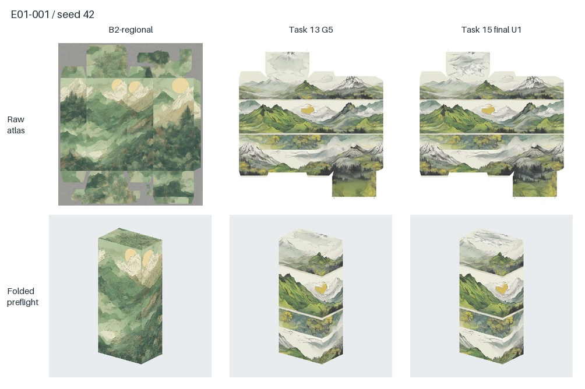
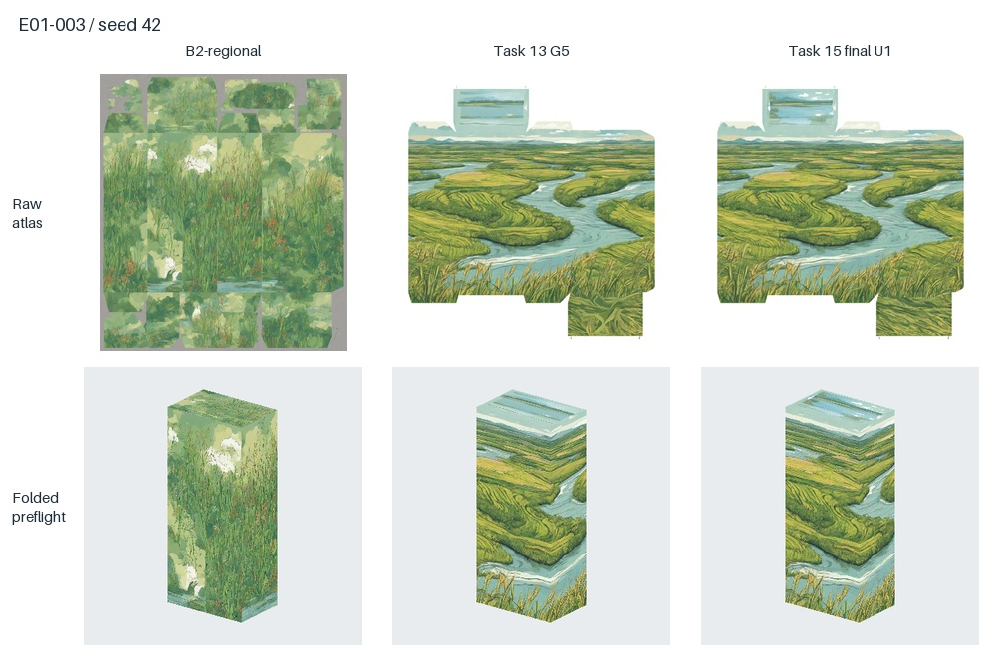
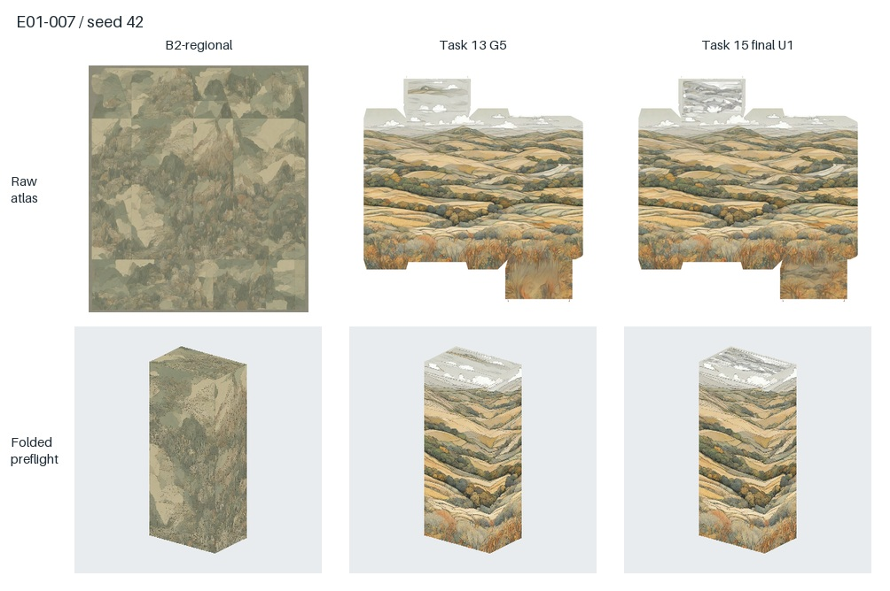

# E02 · 盖面纹理均匀化与环带横幅抑制

**种子 42 未通过，种子 1234 通过。停在 Step 1，等待 Claude 审查。** 最终配置为 U1 + R0。相对任务 13 的同种子 G5，环带单侧下界变化为 +0.0000 / +0.0000，盖面单侧下界变化为 +0.0955 / -0.0806。R1 试验的环带单侧下界变化为 +0.0635 / -0.0070，本轮放弃 R1。以上均按种子 42 / 1234 列示，负值代表下降。

## 环带选用

在 E01-001 至 E01-010 上，R0 读取已审查的同种子原环带。R1 仅给 SDXL 环带编码追加抑制横幅的负向词。正向文本、两路编码、随机状态、1,280×1,024 环带布局和去噪日程沿用原协议。两路 CLIP 分词均从 21 个词元增加到 45 个，上限为 77。四侧 CLIPScore 与 ImageReward 使用冻结全盒评价的同一总提示词和正立裁图，仅取四个侧面。两种出血口径取原采样中归属于四侧面的像素。M4 仍使用四侧及正面两半。

| 种子 | 十盒均值 | R0 | R1 | R1 减 R0 |
| --- | --- | --- | --- | --- |
| 42 | 环带单侧下界 | 1.2244 | 1.2879 | +0.0635 |
| 42 | L–B ΔE00 | 4.0645 | 3.8801 | -0.1844 |
| 42 | L–B LPIPS | 0.1664 | 0.1710 | +0.0046 |
| 42 | 原出血 % | 65.7426 | 64.6384 | -1.1041 |
| 42 | M3 % | 61.1618 | 58.3834 | -2.7784 |
| 42 | 四侧 CLIPScore | 0.7068 | 0.7219 | +0.0151 |
| 42 | 四侧 ImageReward | -1.5612 | -1.5439 | +0.0173 |
| 42 | M4 | 0.8492 | 0.8347 | -0.0145 |
| 1234 | 环带单侧下界 | 1.2798 | 1.2728 | -0.0070 |
| 1234 | L–B ΔE00 | 3.2358 | 3.5096 | +0.2738 |
| 1234 | L–B LPIPS | 0.2148 | 0.2216 | +0.0068 |
| 1234 | 原出血 % | 61.6025 | 59.3909 | -2.2116 |
| 1234 | M3 % | 51.2027 | 43.8939 | -7.3088 |
| 1234 | 四侧 CLIPScore | 0.7313 | 0.7350 | +0.0037 |
| 1234 | 四侧 ImageReward | -1.2458 | -0.9956 | +0.2502 |
| 1234 | M4 | 0.7885 | 0.7528 | -0.0357 |

生成前登记的取舍是两个种子的环带单侧下界均须降低，且每个种子的 L–B ΔE00、LPIPS 增量分别不超过 1.0、0.02，CLIPScore、ImageReward 降幅分别不超过 0.02、0.10。这四个数值用于 R1 去留。种子 42 未通过 环带单侧下界未下降。种子 1234 所有环带判据通过。 [逐盒环带分数](uniform-ring-r0-r1-scores.csv) · [逐盒逐折环带分数](uniform-ring-r0-r1-folds.csv) · [保留判定](uniform-ring-r0-r1-selection.json)

原像素横幅判据为上下堆叠的独立横幅且中间有浅色或白色分隔线。连续地貌的自然明暗过渡不计。逐盒记录绑定原环带缓存和 RGB 哈希。 [原像素记录](uniform-ring-r0-r1-review.json)

| 种子 | 环带 | 检出盒数 / 10 | 盒号 |
| --- | --- | --- | --- |
| 42 | R0 | 1 | E01-001 |
| 42 | R1 | 0 | — |
| 1234 | R0 | 0 | — |
| 1234 | R1 | 0 | — |

种子 42 的 E01-001 从三段独立山景加浅色直分隔变为由云雾连贯的山景。种子 1234 的 E01-003 则从平面稻田变成带伪字的袋装产品示意。 [E01-001 原像素](uniform-ring-examples/E01-001-42-r0-r1.png) · [E01-003 原像素](uniform-ring-examples/E01-003-1234-r0-r1.png)

种子 42 在正面—顶盖原生折线的环带侧下界均值升 0.1063。E01-006、E01-003 两盒单侧下界分别升 0.5831、0.4661。种子 1234 的正面—左面均值降 0.0653，但 E01-010 的控制折线仍为背面—底盖，其单侧下界从 1.3416 升至 1.9685。

## 同提示词的 B2-regional 对照

B2-regional 在原六区域条件、原刀版 ControlNet 和原区域注意力上同样追加 R1。种子 42 从任务 07 读取原组，种子 1234 按原配方补齐十盒。B2-post 继续使用原整图提示和印前复位。每个种子以对应种子的 B2、B2-post、B2-regional、B3、B4 计算冻结关口。B2-regional-R1 作为额外对照。 [基线条件与模型证明](uniform-ring-baseline-inputs.json) · [逐盒源图与提示词核验](uniform-ring-source-proof.json)

| 种子 | 方法 | 盖侧 ΔE00 | 盖侧 LPIPS | 七缝 SDR | 七缝 LPIPS | 原出血 % | M3 % | 全盒 v1 | CLIPScore | ImageReward |
| --- | --- | --- | --- | --- | --- | --- | --- | --- | --- | --- |
| 42 | B2-regional | 9.4935 | 0.3742 | 4.4175 | 0.3646 | 52.9962 | 28.4607 | 1.1399 | 0.6572 | -1.7550 |
| 42 | B2-regional-R1 | 9.2129 | 0.3822 | 3.8008 | 0.3701 | 54.3679 | 25.0951 | 1.0410 | 0.6556 | -1.8300 |
| 1234 | B2-regional | 13.0142 | 0.3794 | 4.6048 | 0.3694 | 51.8315 | 48.9578 | 1.2257 | 0.6534 | -1.8002 |
| 1234 | B2-regional-R1 | 11.7727 | 0.3763 | 3.7325 | 0.3690 | 47.9525 | 42.8081 | 1.1256 | 0.6577 | -1.7906 |

同原 B2-regional 配对。种子 42 改善 盖侧 ΔE00、七缝 SDR、原出血 %。种子 1234 改善 盖侧 ΔE00、盖侧 LPIPS、七缝 SDR、七缝 LPIPS。

## 种子 42 选型

G5 沿用任务 13 的余弦衰减高通注入。U1/U2 由四条真邻边取高通，双倍画布高斯 σ=8 px。每边按距该边的像素距离 dᵢ 取权重 1/(1+dᵢ)，混合按权重的 L2 范数归一。 把到最近边的距离按最大值归一成 d̂，乘上包络 0.60 + 0.40·cos²(πd̂/2)。系数从贴边 1 降至中心 0.60。每边沿法向镜像并叠加固定种子 15 的切向相位偏移，贴边锁相区为 16 px，两对边用相反方向；这使纹理延伸保持连续，同时打散单次镜像的轴向重复。核心远离折线后渐减混合残差中的低频分量，限制局部残差不超出源纹理幅值，已知区域逐像素保留。中心的 0.60 是权重包络的下限，源纹理能量不均、裁剪和相消会改变测得的 RMS。U1 SDEdit 0.85 执行末 25 步，U2 0.92 执行末 27 步。 [配置](../../../code/configs/E02_uniform_ring.yaml)

硬筛选使用单盒 60 s / 20 GiB、CLIPScore 均值 ≥0.6362、ImageReward 均值 ≥ 原 B2-regional 减 0.10、顶底面内能量均值 ≥ 各自原 B2-regional 的 0.5 倍，以及各盖逐盒 ≤ 同盒四侧能量均值的 2.0 倍。合格者按六项主目标优于同环带 G5 的项数排序，平手比较冻结 v1，完全相同时查看原像素。G5 通过硬约束。U1 通过硬约束。U2 通过硬约束。最终锁定 U1。

| 种子 42 | 胜 G5 项数 / 6 | 硬筛选 | CLIPScore | ImageReward | 顶盖能量 ×10³ | 底盖能量 ×10³ | 超 2 倍的盖数 |
| --- | --- | --- | --- | --- | --- | --- | --- |
| G5 | 0 | 通过 | 0.6813 | -1.6774 | 0.888 | 0.790 | 0 |
| U1 | 2 | 通过 | 0.6891 | -1.6334 | 1.769 | 1.324 | 0 |
| U2 | 0 | 通过 | 0.6886 | -1.6136 | 1.566 | 1.614 | 0 |

| 种子 42 | 盖侧 ΔE00 | 盖侧 LPIPS | 七缝 SDR | 七缝 LPIPS | 原出血 % | M3 % | 全盒 v1 | CLIPScore | ImageReward |
| --- | --- | --- | --- | --- | --- | --- | --- | --- | --- |
| G5 | 4.1885 | 0.3624 | 1.6241 | 0.3344 | 67.4550 | 58.5015 | 1.5917 | 0.6813 | -1.6774 |
| U1 | 4.1874 | 0.3789 | 1.5885 | 0.3486 | 67.3937 | 58.4402 | 1.6841 | 0.6891 | -1.6334 |
| U2 | 4.2875 | 0.3824 | 1.6254 | 0.3515 | 67.3860 | 58.3969 | 1.6426 | 0.6886 | -1.6136 |

| 种子 | 方法 | 顶盖 / 环带 | 底盖 / 环带 | 顶三缝差 ×10³ | 底三缝差 ×10³ | 盖侧六缝差 ×10³ | 顶盖 2× 留存 | 底盖 2× 留存 |
| --- | --- | --- | --- | --- | --- | --- | --- | --- |
| 42 | B2-regional | 0.726 | 0.704 | 0.674 | 0.821 | 0.747 | 1.194 | 1.340 |
| 42 | B2-regional-R1 | 0.748 | 0.675 | 0.742 | 0.792 | 0.767 | 1.098 | 1.176 |
| 42 | G5 | 0.320 | 0.276 | 0.719 | 1.549 | 1.134 | 2.218 | 2.363 |
| 42 | U1 | 0.637 | 0.486 | 0.709 | 1.380 | 1.045 | 2.252 | 2.281 |
| 42 | U2 | 0.586 | 0.535 | 0.877 | 1.439 | 1.158 | 2.310 | 2.342 |
| 1234 | B2-regional | 1.639 | 1.508 | 0.547 | 0.612 | 0.580 | 1.452 | 1.493 |
| 1234 | B2-regional-R1 | 1.495 | 1.445 | 0.724 | 0.893 | 0.808 | 1.235 | 1.264 |
| 1234 | U1 | 0.501 | 0.509 | 1.731 | 1.701 | 1.716 | 2.343 | 2.440 |

| 种子 | 配置 | 盖面 | 实际中心 / 贴边 RMS 均值 | 最小比值 | 实际比值 < 0.60 的盒数 |
| --- | --- | --- | --- | --- | --- |
| 42 | U1 | 顶盖 | 0.864 | 0.568 | 1 / 10 |
| 42 | U1 | 底盖 | 0.600 | 0.462 | 4 / 10 |
| 42 | U2 | 顶盖 | 0.864 | 0.568 | 1 / 10 |
| 42 | U2 | 底盖 | 0.600 | 0.462 | 4 / 10 |
| 1234 | U1 | 顶盖 | 1.053 | 0.503 | 4 / 10 |
| 1234 | U1 | 底盖 | 1.054 | 0.393 | 6 / 10 |

上表测的是 SDEdit 前注入的 RGB 残差。中心取画布核心的中间三分之一，贴边取核心内侧首 16 px。两类实测量配合权重包络解读。 [盖面初图与边带核验](uniform-ring-cap-source-proof.json)

面内能量按四周裁去 9 mm 后的双向差分计算。盖环比先逐盒计算再取平均。跨缝差对齐真邻边后取 5 mm 条带。2× 留存先做 2×2 盒式平均，再计算双向差分比值。粗网格步长增长后比值可以高于 1。 [逐盒结果](results-uniform-ring.csv) · [筛选台账](uniform-ring-selection.json)

## 种子 1234 复验与双种子关口

锁定 U1 后，只在种子 1234 重跑这一盖面配置。两种子各用前十盒，并以各自的原基线组判定。保留原五项检查和冻结的相对阈值。表中七缝与出血的两个对照按 B2-regional / B2-post 列示。

| 指标 | 种子 42 | 种子 1234 | 1234 减 42 |
| --- | --- | --- | --- |
| 盖侧 ΔE00 | 4.1874 | 5.2978 | +1.1104 |
| 盖侧 LPIPS | 0.3789 | 0.3810 | +0.0021 |
| 七缝 SDR | 1.5885 | 2.0799 | +0.4914 |
| 七缝 LPIPS | 0.3486 | 0.3573 | +0.0087 |
| 原出血 % | 67.3937 | 62.2167 | -5.1770 |
| M3 % | 58.4402 | 51.0585 | -7.3817 |
| 全盒 v1 | 1.6841 | 1.3032 | -0.3809 |
| CLIPScore | 0.6891 | 0.7015 | +0.0123 |
| ImageReward | -1.6334 | -1.3781 | +0.2554 |

| 种子 | 原关口 | 本轮与上限 / 同种子对照 | 判定 |
| --- | --- | --- | --- |
| 42 | 七条非原生缝 | 七缝 SDR 1.5885，对照 4.4175 / 4.6199。七缝 LPIPS 0.3486，对照 0.3646 / 0.4135 | 通过 |
| 42 | 双口径出血 | 原出血 % 67.3937，对照 52.9962 / 52.8471。M3 % 58.4402，对照 28.4607 / 47.3847 | 通过 |
| 42 | 条带 v1 与原像素 | 1.6841 / 上限 1.2528（B4 × 1.2），原像素 0/10 盒见条带或亮边 | 未过 |
| 42 | CLIPScore 单侧 | 0.6891 / 下限 0.6362 | 通过 |
| 42 | 逐盒硬件 | 最高 53.89 s / 10.283 GiB | 通过 |
| 1234 | 七条非原生缝 | 七缝 SDR 2.0799，对照 4.6048 / 5.7941。七缝 LPIPS 0.3573，对照 0.3694 / 0.4423 | 通过 |
| 1234 | 双口径出血 | 原出血 % 62.2167，对照 51.8315 / 52.8265。M3 % 51.0585，对照 48.9578 / 50.5284 | 通过 |
| 1234 | 条带 v1 与原像素 | 1.3032 / 上限 1.3832（B4 × 1.2），原像素 0/10 盒见条带或亮边 | 通过 |
| 1234 | CLIPScore 单侧 | 0.7015 / 下限 0.6460 | 通过 |
| 1234 | 逐盒硬件 | 最高 51.62 s / 10.283 GiB | 通过 |

条带上限由同种子的最好原基线乘 1.2 得出，种子 42 为 1.2528，种子 1234 为 1.3832。沿用任务 13 的跨种子数值参考，种子 1234 的最终 v1 与种子 42 上限相差 +0.0504。保存的 1234 关口取本种子同批基线。

[五项关口及原像素指纹](gate-uniform-ring.json) · [逐盒目视记录](uniform-ring-visual-review.json)

## 条带逐折拆解

单侧下界把另一侧比值设为 1，按每盒五条原生折线重新取最大，再在十盒上平均。环带和盖面的最大值可能来自不同折线，两侧下界的变化不可直接相加。

| 种子 | 配置 | 环带单侧下界 | 盖面单侧下界 | 整盒条带 v1 |
| --- | --- | --- | --- | --- |
| 42 | 任务 13 G5 | 1.2244 | 1.4858 | 1.5917 |
| 42 | 本轮 | 1.2244 | 1.5813 | 1.6841 |
| 42 | 本轮减任务 13 | +0.0000 | +0.0955 | +0.0924 |
| 1234 | 任务 13 G5 | 1.2798 | 1.1645 | 1.3455 |
| 1234 | 本轮 | 1.2798 | 1.0838 | 1.3032 |
| 1234 | 本轮减任务 13 | +0.0000 | -0.0806 | -0.0423 |

种子 42 的 U1 在 E01-003、E01-007 的背面—底盖最高，分别为 3.2607、2.3540，盖面侧超额为 2.2607、1.2582。种子 1234 的两处峰值为 E01-005 正面—右面与 E01-001 正面—左面，超额全部来自原环带。

U1 在 42 的盖侧 ΔE00 相对 G5 仅降 0.0011，七缝 SDR 降 0.0356。G5 在盖侧 LPIPS、七缝 LPIPS 与双口径出血上占优。盖面面内能量上升的同时，42 的整盒条带 v1 升 0.0924。

| 种子 | 配置 | 折线 | 整折 v1 | 环带单侧 | 盖面单侧 |
| --- | --- | --- | --- | --- | --- |
| 42 | 本轮 | B-Btm | 1.5648 | 1.0096 | 1.5552 |
| 42 | 本轮 | B-R | 1.1090 | 1.1090 | 1.0000 |
| 42 | 本轮 | F-L | 1.0066 | 1.0066 | 1.0000 |
| 42 | 本轮 | F-R | 1.0469 | 1.0469 | 1.0000 |
| 42 | 本轮 | F-T | 1.2333 | 1.1449 | 1.0884 |
| 1234 | 本轮 | B-Btm | 1.1777 | 1.0939 | 1.0838 |
| 1234 | 本轮 | B-R | 1.1107 | 1.1107 | 1.0000 |
| 1234 | 本轮 | F-L | 1.0860 | 1.0860 | 1.0000 |
| 1234 | 本轮 | F-R | 1.1764 | 1.1764 | 1.0000 |
| 1234 | 本轮 | F-T | 1.0193 | 1.0018 | 1.0175 |

[逐盒逐折线全表](uniform-ring-stripe-sources.csv) · [任务 13 G5 逐折线](captexture-stripe-sources.csv)

## RTX 3090 开销

| 种子 | 配置 | 均值 s / 盒 | 最长 s / 盒 | 最大 GiB |
| --- | --- | --- | --- | --- |
| 42 | G5 | 49.84 | 53.22 | 10.282 |
| 42 | U1 | 51.12 | 53.89 | 10.283 |
| 42 | U2 | 52.68 | 52.97 | 10.283 |
| 1234 | U1 | 50.88 | 51.62 | 10.283 |

耗时计入配对环带、两盖生成及合成，峰值为 PyTorch 分配量。首次加载模型、写图和评分单独发生。

| 种子 | R0 环带均值 s | R1 环带均值 s | R0 / R1 环带均值峰值 GiB | B2-regional / R1 均值 s |
| --- | --- | --- | --- | --- |
| 42 | 12.41 | 12.35 | 10.178 / 10.178 | 43.12 / 43.01 |
| 1234 | 12.34 | 12.40 | 10.179 / 10.178 | 43.03 / 42.99 |

## 展开图、折叠图与原像素

每组从左往右为 B2-regional、任务 13 G5、本轮保留配置。展开示意及折叠视角用于对照。原像素盖边裁图仅按拓扑旋转或翻转。







种子 42 的顶、底盖四边原像素。[E01-001](uniform-ring-examples/seed-42/E01-001-cap-edges.png) · [E01-003](uniform-ring-examples/seed-42/E01-003-cap-edges.png) · [E01-004](uniform-ring-examples/seed-42/E01-004-cap-edges.png) · [E01-007](uniform-ring-examples/seed-42/E01-007-cap-edges.png) · [E01-008](uniform-ring-examples/seed-42/E01-008-cap-edges.png)

种子 1234 的顶、底盖四边原像素。[E01-001](uniform-ring-examples/seed-1234/E01-001-cap-edges.png) · [E01-003](uniform-ring-examples/seed-1234/E01-003-cap-edges.png) · [E01-004](uniform-ring-examples/seed-1234/E01-004-cap-edges.png) · [E01-007](uniform-ring-examples/seed-1234/E01-007-cap-edges.png) · [E01-008](uniform-ring-examples/seed-1234/E01-008-cap-edges.png)

两组各十盒的五条原生折线均按原像素复核，均未检出独立的贴折窄带或亮边。种子 42 的 E01-003 正顶浅青天空及 E01-009 蓝天有轻微面间阶跃。E01-003、E01-007 的背底可见草茎或麦穗跨折延续，贴边纹理较强。种子 1234 的 E01-007 背侧有一条浅棕细线，离实际折线约 12–13 px。它出现在 G5 与 U1 共用的原环带，沿相邻侧面延续，并与整图的木桌板纹一致。 [原像素判读](uniform-ring-visual-review.json)

种子 42 的五例底盖中，E01-001 的 U1/U2 保留了中央的山丘线条，E01-003 的草叶形成较密的同向斜束，E01-004 的中央灰色缺纹块明显缩小，E01-007 的麦穗与地面纹理形成层次。用同环带 G5 对照，未见跨中心轴的规则镜像铺图。E01-008 的 U1 生成了带灰框的伪文字，U2 也生成了伪文字，G5 盖面主要是枝叶。伪文字位于底盖内部。 [三候选底盖原像素](uniform-ring-examples/E01-008-42-bottom-core.png)

## 复现

RTX 3090 运行目录为 `/root/autodl-tmp/ai-design/outputs/e02/uniform-ring/runs/35493b7f5869`。从 AutoDL 数据盘上的项目根目录执行。脚本绑定历史归档、冻结指标和已生成样本哈希，完成相同两种子配对。首次出图后按报告原生折线口径复核，可用 `--visual` 提交匹配本次实际产物指纹的目视记录。 [运行输入](uniform-ring-inputs.json) · [双种子汇总](uniform-ring-evaluation.json)

```bash
bash code/scripts/run_E02_uniform_ring.sh
```
